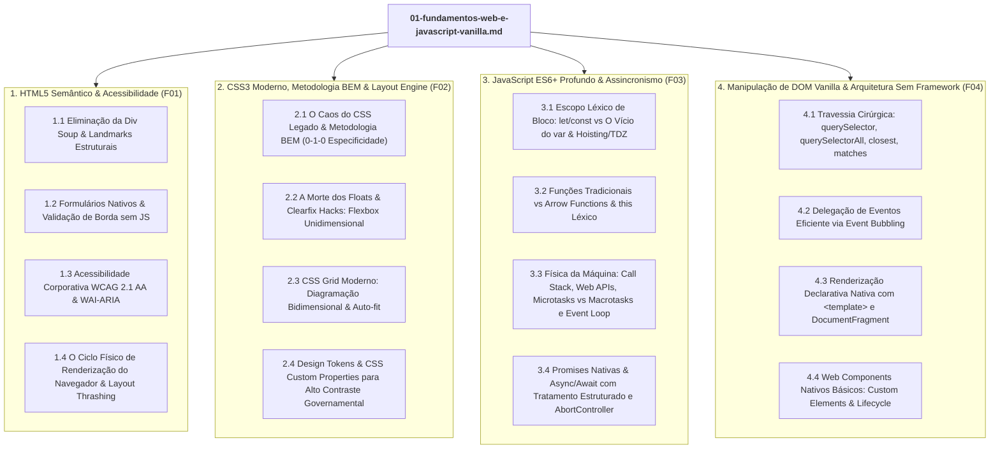

# ESPECIFICAÇÃO ARQUITETURAL & BLUEPRINT PEDAGÓGICO DE IMPLEMENTAÇÃO: MÓDULO 01
## `01-fundamentos-web-e-javascript-vanilla.md` (Fundamentos Web & JavaScript Vanilla)

- **Agente Responsável:** Explorer Milestone 1 (`teamwork_preview_explorer_m1_1`)
- **Data / Versão:** 2026-10-25 / Revisão 1.0
- **Destino do Documento Final:** `/home/lan/dotfiles/templates-lab/docs/01-fundamentos-web-e-javascript-vanilla.md`
- **Agente Executor Alvo:** Worker Milestone 1
- **Fontes Primárias Integradas:**
  - 1.625 Transcrições AlgaWorks (Cursos *Web Design Responsivo* - WDR e *Mergulho no JavaScript* - MJS).
  - Dossiê Arquitetural de 25 Microsserviços da AGR (`agr-docs`, `portalservice :8080`, `fiscalizacao :8083`, `cadu :8081`).
  - Projeto Greenfield `teatro-abc` (:8090).
  - Web Standards W3C (HTML5, CSS3, ECMAScript 2024+, WCAG 2.1 AA).

---

## 1. DIRETRIZES DE ENGENHARIA & CONTRATO DIDÁTICO INEGOCIÁVEL

O arquivo `01-fundamentos-web-e-javascript-vanilla.md` é a pedra angular de toda a suíte de documentação. Ele estabelece o domínio físico da plataforma web sem o amortecedor cognitivo de frameworks (como React, Vue ou Angular). 

Para atender estritamente ao Requisito **R3** de `ORIGINAL_REQUEST.md` e à **Lei Suprema de Engenharia do Repositório**, **CADA CONCEITO** abordado no módulo deve seguir obrigatoriamente a estrutura quádrupla canônica:

```
┌────────────────────────────────────────────────────────────────────────┐
│                   A ESTRUTURA QUÁDRUPLA CANÔNICA                       │
├────────────────────────────────────────────────────────────────────────┤
│ 1. O que é o conceito (Analogia Intuitiva do Mundo Real)               │
│    -> Tradução cristalina para fixação de modelo mental imediato.      │
│ 2. A Dor Histórica / O Desastre do Legado                              │
│    -> Autópsia forense, stack traces, desastres em produção e          │
│       CITAÇÕES LITERAIS das transcrições AlgaWorks (MJS/WDR).          │
│ 3. A Solução Moderna de Elite                                          │
│    -> Código vanilla limpo, tipado/estrito, sem TODOs, com física      │
│       da máquina explicada (Event Loop, DOM/CSSOM, Heap vs Stack).     │
│ 4. Vínculo Direto com o AGR-Docs / Teatro-ABC                          │
│    -> Aplicação real nos microsserviços do Estado de Goiás ou na       │
│       bilhetagem crítica do Centro Cultural Oscar Niemeyer.            │
└────────────────────────────────────────────────────────────────────────┘
```

---

## 2. MAPA ESTRUTURAL DAS 4 GRANDES SEÇÕES DO MÓDULO 01

O documento final em `/home/lan/dotfiles/templates-lab/docs/01-fundamentos-web-e-javascript-vanilla.md` deve cobrir exaustivamente as 4 frentes:



---

## 3. ESPECIFICAÇÃO DETALHADA CONCEITO POR CONCEITO

Abaixo está o roteiro prescritivo com o conteúdo exato, citações literais, analogias, códigos executáveis e conexões com a AGR que o Worker M1 deve redigir.

---

### PARTE 1: HTML5 SEMÂNTICO, ARQUITETURA DE DOCUMENTO & ACESSIBILIDADE CORPORATIVA (WCAG 2.1 AA)

#### Conceito 1.1: Eliminação da "Div Soup" e Adoção de Landmarks Estruturais
- **Analogia Simples:**  
  Imagine um hospital onde todas as portas fossem idênticas: portas de compensado sem placas, sem cores e sem identificação. Médicos, pacientes e socorristas precisariam abrir porta por porta para descobrir onde fica a UTI, o banheiro ou a sala de cirurgia. Um documento HTML feito apenas com `<div>`s aninhadas é esse hospital às escuras. O HTML5 semântico é a sinalização universal: `<header>` é a recepção, `<nav>` são os corredores com placas, `<main>` é o centro cirúrgico principal, `<article>` é o prontuário independente, `<aside>` são os murais informativos e `<footer>` é a saída de emergência com as diretrizes.
- **A Dor Histórica / O Desastre do Legado:**  
  No curso *Web Design Responsivo* (WDR), na aula `14_WDR - 2.9 - Elementos estruturais.txt`, discute-se o vício que assolou a web dos anos 2000 a 2015: a "Div Soup" (Sopa de Divs), onde um cabeçalho era escrito como `<div id="header"><div class="topo"><div class="menu">...</div></div></div>`.  
  *Impacto Real:* Leitores de tela para pessoas com deficiência visual (NVDA, JAWS, VoiceOver) tratavam todas as divisões como blocos opacos genéricos. O usuário cego não conseguia saltar diretamente para o conteúdo principal, sendo forçado a ouvir o leitor recitar todos os 50 links de menu a cada recarregamento de página. Motores de busca (Googlebot) rebaixavam o ranking SEO da página por incapacidade de distinguir o miolo editorial de menus laterais e rodapés de copyright.
- **A Solução Moderna de Elite:**  
  Construção de uma casca de documento com semântica pura e landmarks nativos reconhecidos pela árvore de acessibilidade (Accessibility Tree):
  ```html
  <!DOCTYPE html>
  <html lang="pt-BR">
  <head>
    <meta charset="UTF-8">
    <meta name="viewport" content="width=device-width, initial-scale=1.0">
    <title>AGR - Painel de Fiscalização Regulatória</title>
  </head>
  <body>
    <!-- Link de salto para acessibilidade de teclado (Skip to Main Content) -->
    <a href="#conteudo-principal" class="sr-only-focusable">Saltar para o conteúdo principal</a>

    <header class="cabecalho-governo" role="banner">
      <div class="cabecalho-governo__barra-estado">
        <span class="cabecalho-governo__orgao">Governo de Goiás | AGR</span>
      </div>
      <nav class="navegacao-principal" aria-label="Navegação Institucional" role="navigation">
        <ul class="navegacao-principal__lista">
          <li class="navegacao-principal__item"><a href="/dashboard">Dashboard</a></li>
          <li class="navegacao-principal__item"><a href="/blitz">Blitz e Abordagens</a></li>
          <li class="navegacao-principal__item"><a href="/veiculos">Frota Cadastrada</a></li>
        </ul>
      </nav>
    </header>

    <main id="conteudo-principal" class="painel-operacional" role="main">
      <header class="painel-operacional__cabecalho">
        <h1>Operação Rodovias Seguras - GO-020</h1>
        <p class="painel-operacional__meta">Data: 25/10/2026 | Auditor Responsável: Wheslan Cardoso</p>
      </header>

      <section class="painel-operacional__secao-autos" aria-labelledby="titulo-autos">
        <h2 id="titulo-autos">Autos de Infração Lavrados em Campo</h2>
        
        <article class="card-infracao" aria-labelledby="auto-2026-001">
          <header class="card-infracao__header">
            <h3 id="auto-2026-001">Auto Nº 2026/00142 - Transporte Clandestino</h3>
            <span class="badge badge--perigo">Retenção de Veículo</span>
          </header>
          <div class="card-infracao__corpo">
            <p><strong>Placa:</strong> NXY-8890 (Mercosul: NXY8J90)</p>
            <p><strong>Infrator:</strong> Expresso Guanabara Complementar Ltda</p>
            <p><strong>Local:</strong> Trevo de Bela Vista de Goiás (Km 42)</p>
          </div>
        </article>
      </section>

      <aside class="painel-operacional__alertas" aria-labelledby="titulo-alertas">
        <h2 id="titulo-alertas">Alertas da Central de Monitoramento (Hórus)</h2>
        <p>3 vans sem autorização de fretamento identificadas pelos radares OCR da GO-070.</p>
      </aside>
    </main>

    <footer class="rodape-institucional" role="contentinfo">
      <p>&copy; 2026 Agência Goiana de Regulação, Controle e Fiscalização de Serviços Públicos.</p>
    </footer>
  </body>
  </html>
  ```
- **Vínculo Direto com o AGR-Docs / Teatro-ABC:**  
  - *No `portalservice` (:8080) e Portal do Cidadão:* A interface pública para consulta de certidões e linhas de transporte intermunicipal deve seguir estritamente as diretrizes do Modelo de Acessibilidade em Governo Eletrônico (e-MAG) e da Lei Brasileira de Inclusão (Lei nº 13.146/2015). A substituição da div soup por landmarks garante que frotistas e cidadãos com baixa visão consigam usar leitores de tela sem travar a navegação.
  - *No `teatro-abc` (:8090):* A página do espetáculo organiza o cabeçalho do teatro em `<header>`, o catálogo de peças em `<main>`, a sinopse e elenco em `<article>`, o mapa de plateia em `<section>` e as políticas de cancelamento em `<aside>`.

---

#### Conceito 1.2: Formulários Nativos & Validação de Borda Sem JavaScript
- **Analogia Simples:**  
  Imagine uma portaria de prédio comercial. Se qualquer pessoa com informações incompletas entrar no elevador, subir 20 andares até a sala da diretoria apenas para ser avisada pelo diretor: *"Faltou apresentar o documento com foto na recepção, desça e comece de novo"*, o elevador fica congestionado e todos perdem tempo. Os atributos de formulário do HTML5 (`required`, `pattern`, `inputmode`, `min`, `max`) são a triagem rigorosa na portaria térrea: o formulário sequer viaja pela rede se o dado básico estiver malformado, economizando CPU do cliente e banda de rede.
- **A Dor Histórica / O Desastre do Legado:**  
  No curso WDR (aulas `71_WDR - 7.16 - Criando um formulário.txt` e `72_WDR - 7.17`), aborda-se o tempo em que campos HTML eram meros `<input type="text">` genéricos.  
  *Impacto Real:* Em sistemas legados corporativos (como as primeiras telas do Portal 1 da AGR), validações de campos obrigatórios eram feitas manualmente no evento `onsubmit` via scripts de 800 linhas cheios de `if (document.getElementById('cpf').value == '') { alert('Preencha o CPF'); return false; }`. Em dispositivos móveis (tablets de fiscais em campo sob sol escaldante), o teclado virtual abria no layout alfabético comum em campos de CEP, CPF e Telefone, obrigando o fiscal a trocar de teclado para números manualmente a cada campo.
- **A Solução Moderna de Elite:**  
  Aproveitamento da Constraint Validation API nativa do HTML5, combinando `inputmode`, `pattern` com expressões regulares de fronteira e acessibilidade com `<fieldset>` e `<legend>`:
  ```html
  <form class="formulario-vistoria" novalidate id="form-vistoria">
    <fieldset class="formulario-vistoria__grupo">
      <legend class="formulario-vistoria__legenda">Identificação do Veículo Fiscalizado</legend>

      <div class="campo">
        <label for="placa-veiculo" class="campo__rotulo">
          Placa do Veículo (Padrão Cinza ou Mercosul)
          <span aria-hidden="true" class="campo__obrigatorio">*</span>
        </label>
        <input
          type="text"
          id="placa-veiculo"
          name="placa"
          class="campo__controle"
          required
          maxlength="8"
          placeholder="Ex: ABC1D23 ou ABC-1234"
          pattern="^[A-Z]{3}-?[0-9][A-Z0-9][0-9]{2}$"
          aria-describedby="placa-ajuda placa-erro"
          autocomplete="off"
          style="text-transform: uppercase;"
        >
        <small id="placa-ajuda" class="campo__ajuda">Formato Mercosul (ABC1D23) ou antigo (ABC-1234).</small>
        <span id="placa-erro" class="campo__mensagem-erro" aria-live="polite"></span>
      </div>

      <div class="campo">
        <label for="renavam-veiculo" class="campo__rotulo">
          Código RENAVAM
          <span aria-hidden="true" class="campo__obrigatorio">*</span>
        </label>
        <input
          type="text"
          id="renavam-veiculo"
          name="renavam"
          class="campo__controle"
          required
          inputmode="numeric"
          minlength="9"
          maxlength="11"
          pattern="^[0-9]{9,11}$"
          placeholder="Apenas os dígitos"
          aria-describedby="renavam-erro"
        >
        <span id="renavam-erro" class="campo__mensagem-erro" aria-live="polite"></span>
      </div>
    </fieldset>

    <button type="submit" class="btn btn--primario">Consultar Regularidade Cadastral</button>
  </form>
  ```
- **Vínculo Direto com o AGR-Docs:**  
  - *No `cadastrounicoservice` (:8081) e Portal Web CADU (:4201):* Ao cadastrar um veículo na frota de ônibus intermunicipal ou vans escolares, o campo `inputmode="numeric"` assegura que o operador digite o RENAVAM e Chassi no teclado numérico físico/virtual com máscara automática e zero envio de strings alfabéticas inválidas.

---

#### Conceito 1.3: Acessibilidade Corporativa (WCAG 2.1 Nível AA, WAI-ARIA & Foco por Teclado)
- **Analogia Simples:**  
  Uma rampa de acesso em um prédio público não serve apenas para quem usa cadeira de rodas: ela serve para pais com carrinhos de bebê, entregadores com carrinhos pesados e pessoas que temporariamente quebraram a perna. A acessibilidade digital (WAI-ARIA e contraste) não é um favor para minorias; é o alicerce universal da interface. Se um botão só pode ser clicado com o mouse e não responde à tecla `Tab` e `Enter`, ele é um degrau intransponível para quem navega por comando de voz, teclado ou leitor de tela.
- **A Dor Histórica / O Desastre do Legado:**  
  A prática destrutiva de criar botões usando `<div onclick="salvar()">Salvar</div>` ou `<a href="javascript:void(0)" onclick="...">`.  
  *Impacto Real:* Leitores de tela ignoram a `<div>` clicável porque ela não possui papel semântico de botão (`role="button"`), não entra na ordem de tabulação natural (`tabindex="0"`) e não responde ao pressionamento da barra de espaço (`Space`) ou `Enter`. Além disso, esquemas de cores com baixo contraste (ex: texto cinza claro `#999999` sobre fundo branco `#FFFFFF`) causavam falhas sistemáticas em auditorias do Tribunal de Contas (TCE-GO), que exige estrita conformidade com a WCAG 2.1 nível AA (taxa mínima de contraste de 4.5:1 para texto normal e 3:1 para texto grande).
- **A Solução Moderna de Elite:**  
  Uso de botões nativos `<button type="button">`, atributos ARIA dinâmicos (`aria-expanded`, `aria-controls`, `aria-live`) e foco visível obrigatório:
  ```html
  <!-- Componente de Accordion Acessível para Autos de Infração -->
  <div class="sanfona-processo">
    <h3>
      <button 
        type="button" 
        class="sanfona-processo__gatilho" 
        aria-expanded="false" 
        aria-controls="painel-evidencias-1" 
        id="btn-evidencias-1">
        <span class="sanfona-processo__titulo">Visualizar 4 Fotos de Evidências Anexadas</span>
        <span class="sanfona-processo__icone" aria-hidden="true">▼</span>
      </button>
    </h3>
    <div 
      id="painel-evidencias-1" 
      class="sanfona-processo__painel" 
      role="region" 
      aria-labelledby="btn-evidencias-1" 
      hidden>
      <ul class="lista-evidencias">
        <li></li>
        <li></li>
      </ul>
    </div>
  </div>

  <style>
    /* WCAG 2.1: Foco visível obrigatório com contraste superior a 3:1 */
    .sanfona-processo__gatilho:focus-visible {
      outline: 3px solid #0056b3;
      outline-offset: 2px;
      box-shadow: 0 0 0 5px rgba(0, 86, 179, 0.25);
    }
    
    /* Leitor de tela exclusivo (sr-only) */
    .sr-only-focusable:not(:focus) {
      position: absolute;
      width: 1px;
      height: 1px;
      padding: 0;
      margin: -1px;
      overflow: hidden;
      clip: rect(0, 0, 0, 0);
      white-space: nowrap;
      border: 0;
    }
  </style>
  ```
- **Vínculo Direto com o AGR-Docs:**  
  - *No `fiscalizacaoservice` (:8083) e Telas de Autos de Infração:* Na auditoria do TCE-GO, os sistemas do governo estadual são submetidos ao Validador e-MAG. O uso de `aria-expanded="true/false"` nos painéis sanfonados de anexos fotográficos e histórico de penalidades assegura conformidade legal plena.

---

#### Conceito 1.4: O Ciclo Físico de Renderização do Navegador & Layout Thrashing
- **Analogia Simples:**  
  Pense em uma gráfica imprimindo um jornal. O diagramador monta o texto e as imagens (DOM + CSSOM), define o tamanho exato de cada coluna (Layout/Reflow), passa as matrizes para a tinta (Paint) e sobrepõe as camadas transparentes de cor (Composite). Se, no meio da impressão de 10.000 jornais, alguém parar a máquina a cada parágrafo para medir com uma régua a altura da página (`offsetHeight`) e mudar o tamanho da fonte em seguida, a gráfica quebra e a produção cai a zero. Isso é o *Layout Thrashing*.
- **A Dor Histórica / O Desastre do Legado:**  
  Scripts legados com jQuery que liam e escreviam propriedades geométricas do DOM em loops:
  ```javascript
  // ❌ O DESASTRE DO LAYOUT THRASHING NO LEGADO
  const caixas = document.querySelectorAll('.card-infracao');
  for (let i = 0; i < caixas.length; i++) {
    // Leitura força o navegador a calcular o Layout síncrono imediatamente!
    const altura = caixas[i].offsetHeight; 
    // Escrita invalida o Layout imediatamente!
    caixas[i].style.height = (altura + 10) + 'px'; 
    // No próximo loop, o navegador é forçado a recalcular tudo de novo (Forced Synchronous Layout)
  }
  ```
  *Impacto Real:* Em telas do Portal da AGR com listagens de 200 veículos, o navegador congelava por 4 a 6 segundos com frame rate caindo para 3 FPS, disparando avisos de *"Página Não Responde"* no Chrome.
- **A Solução Moderna de Elite:**  
  Separação estrita da fase de leitura (Batch Read) da fase de escrita (Batch Write) ou delegação da animação/renderização para o motor de composição da GPU via propriedades `transform` e `opacity` aceleradas por hardware:
  ```javascript
  // ✅ SOLUÇÃO DE ELITE: Batch DOM Read/Write com requestAnimationFrame
  function equalizarAlturasCards(seletor) {
    const elementos = Array.from(document.querySelectorAll(seletor));
    
    // FASE 1: Leitura em lote (sem invalidar o layout entre as medições)
    const alturas = elementos.map(el => el.getBoundingClientRect().height);
    const alturaMaxima = Math.max(...alturas);

    // FASE 2: Escrita em lote agendada para o próximo frame de renderização
    window.requestAnimationFrame(() => {
      elementos.forEach(el => {
        el.style.minHeight = `${alturaMaxima}px`;
      });
    });
  }
  ```
- **Vínculo Direto com o AGR-Docs:**  
  - *Na listagem de abordagens em campo da `fiscalizacao` (:4203):* Equalização visual de cards e expansão dinâmica de painéis de evidências sem travamento de tela em tablets lentos de viaturas rodoviárias.

---

### PARTE 2: CSS3 MODERNO, METODOLOGIA BEM & LAYOUT ENGINE (FLEXBOX E GRID)

#### Conceito 2.1: O Caos do CSS Legado & Metodologia BEM (Especificidade Plana 0-1-0)
- **Analogia Simples:**  
  Imagine uma empresa sem crachás padronizados onde cada funcionário é identificado por sua posição geográfica passageira: *"Aquele estagiário sentado na terceira mesa do corredor leste atrás da impressora"*. Se você mudar a impressora de lugar ou trocar o estagiário de mesa, ninguém mais o encontra. Seletores como `#conteudo ul li a` são essa descrição geográfica frágil. A Metodologia BEM (`bloco__elemento--modificador`) é o crachá universal: não importa em qual sala o funcionário esteja, o crachá dele é único, autodescritivo e inconfundível.
- **A Dor Histórica / O Desastre do Legado (Com Citações Literais da AlgaWorks):**  
  Na aula canônica `50_WDR_6_2_Caos_no_CSS_porque_uma_metodologia_é_importante_.txt`, o instrutor Thiago expõe a autópsia da guerra de especificidade em projetos sem metodologia:
  > *"Geralmente quando você coloca `!important`, a maioria das vezes os desenvolvedores que usam isso sem conhecer muito fazem porque perderam totalmente o caminho, não sabem mais o que está fazendo e para funcionar tem que colocar... não tem reusabilidade, não dá para compartilhar código."* (`50_WDR_6_2`)
  
  Ele demonstra que seletores como `#conteudo ul li` acoplam o estilo ao container pai `#conteudo`. Ao mover a lista de cursos para o rodapé:
  > *"Olha o que vai acontecer, nossa que bagunça... não pode mover uma parte do código, isso aqui não deveria ser independente? ... Ela não é independente, ela é dependente do local que ela está. E se você tem algo que é dependente do local que ela está, você não consegue mover isso para outro lugar sem quebrar nada."* (`50_WDR_6_2`)
  
  E detalha a colisão desastrosa de classes genéricas como `.novo`:
  > *"Como a gente não tem um padrão de nomenclaturas, a gente usou um mesmo nome que acabou se colidindo e afetando de forma que é algo imprevisível... a gente não sabia que ia acontecer isso. Uma solução seria colocar outro nome: `novo2`... ou seja, você está batalhando demais com as especificidades."* (`50_WDR_6_2`)
- **A Solução Moderna de Elite:**  
  Adoção estrita da Metodologia **BEM (Block, Element, Modifier)**:
  - **Block (`bloco`):** Entidade autônoma reutilizável (ex: `.card-auto`).
  - **Element (`bloco__elemento`):** Parte interna dependente do bloco (ex: `.card-auto__placa`).
  - **Modifier (`bloco--modificador` ou `bloco__elemento--modificador`):** Variação de estado ou aparência (ex: `.card-auto--apreendido`, `.card-auto__status--ativo`).
  - **Regra de Ouro da Engenharia:** Toda regra BEM opera com especificidade plana `0-1-0` (exatamente uma classe CSS). **Proibição absoluta de seletores de ID (`#id`) e de `!important`.**
  
  ```css
  /* ✅ PADRÃO BEM DE ELITE - ESPECIFICIDADE PLANA 0-1-0 */
  .card-auto {
    display: flex;
    flex-direction: column;
    padding: 1.5rem;
    border-radius: 8px;
    background-color: var(--cor-superficie);
    border: 1px solid var(--cor-borda);
    transition: transform 0.2s ease, box-shadow 0.2s ease;
  }

  .card-auto:hover {
    transform: translateY(-2px);
    box-shadow: 0 4px 12px rgba(0, 0, 0, 0.08);
  }

  .card-auto__cabecalho {
    display: flex;
    justify-content: space-between;
    align-items: center;
    margin-bottom: 1rem;
  }

  .card-auto__numero {
    font-size: 1.125rem;
    font-weight: 700;
    color: var(--cor-texto-primaria);
  }

  .card-auto__status {
    padding: 0.25rem 0.75rem;
    font-size: 0.75rem;
    font-weight: 600;
    text-transform: uppercase;
    border-radius: 9999px;
  }

  /* Modificadores de estado do elemento */
  .card-auto__status--notificado {
    background-color: var(--cor-aviso-suave);
    color: var(--cor-aviso-texto);
  }

  .card-auto__status--apreendido {
    background-color: var(--cor-perigo-suave);
    color: var(--cor-perigo-texto);
  }

  /* Modificador de bloco: Auto sob custódia judicial */
  .card-auto--em-recurso {
    border-left: 4px solid var(--cor-primaria);
  }
  ```
- **Vínculo Direto com o AGR-Docs:**  
  - *No Portal da Fiscalização e Sistema de Abordagens (`agrfiscalservice` :8083):* Ao migrar as telas legadas de JSF/Portal 1 para frontend moderno, os componentes visuais dos autos de infração construídos com BEM podem ser movidos livremente da listagem de rodovias para o modal de despacho do auditor sem sofrer mutações visuais causadas por seletores de descendência antigos.

---

#### Conceito 2.2: A Morte dos Floats & Clearfix Hacks: Flexbox Unidimensional
- **Analogia Simples:**  
  Imagine tentar alinhar cinco quadros de parede em uma sala esticando barbantes e amarrando balões de gás em cada quadro para tentar fazê-los flutuar no mesmo nível (`float: left`). Qualquer vento ou ajuste de altura estoura o alinhamento e derruba os quadros no chão, exigindo calços de madeira (`clearfix`) para segurar o rodapé. O Flexbox é um trilho de alumínio instalado na parede: você prende os quadros no trilho e ele distribui os espaços (`justify-content: space-between`), alinha a altura de todos (`align-items: center`) e quebra em nova linha automaticamente se a parede encolher (`flex-wrap: wrap`).
- **A Dor Histórica / O Desastre do Legado (Com Citações Literais da AlgaWorks):**  
  Na aula `34_WDR - 4.5 - Flutuando elementos.txt`, o instrutor explica a mecânica física que quebrava o layout com `float`:
  > *"Quando a gente especifica que um elemento está flutuando, o elemento é retirado do fluxo normal do documento. Então, mesmo que esses dois parágrafos estejam dentro da área verde, que é o artigo, ela não enxerga isso... a altura do artigo terminou antes... porque o P saiu do fluxo normal."* (`34_WDR`)
  
  E na sequência, a criação forçada do hack de `clearfix`:
  > *"Esse div Clear Fix aqui, ele não é muito interessante... porque ele não é semântico, né? A gente está colocando simplesmente algo aqui para resolver um problema que o CSS que a gente colocou gerou. Ele não é semântico, ele não representa nada no documento."* (`34_WDR`)
- **A Solução Moderna de Elite:**  
  Uso de **CSS Flexbox** para alinhamentos unidimensionais (linha ou coluna), garantindo distribuição automática de espaço e alinhamento vertical perfeito sem hacks:
  ```css
  /* Barra de Ações Rápidas do Fiscal da AGR com Flexbox */
  .barra-acoes-blitz {
    display: flex;
    flex-direction: row;
    align-items: center;
    justify-content: space-between;
    gap: 1rem;
    padding: 1rem 1.5rem;
    background-color: var(--cor-superficie);
    border-radius: 8px;
  }

  .barra-acoes-blitz__filtros {
    display: flex;
    align-items: center;
    gap: 0.75rem;
    flex-wrap: wrap; /* Em telas menores, os botões quebram naturalmente */
  }

  .barra-acoes-blitz__resumo {
    display: flex;
    align-items: baseline;
    gap: 0.5rem;
    font-size: 0.875rem;
    color: var(--cor-texto-secundaria);
  }
  ```
- **Vínculo Direto com o AGR-Docs:**  
  - *No `cadastrounicoservice` (:8081) e `fiscalizacao` (:8083):* Cabeçalhos de fichas cadastrais, barras de ferramentas com botões de ação ("Emitir Auto", "Apreender Veículo", "Imprimir TRV") e formulários de pesquisa em linha.

---

#### Conceito 2.3: CSS Grid Moderno: Diagramação Bidimensional & Auto-fit
- **Analogia Simples:**  
  Enquanto o Flexbox é uma fila de pessoas em um banco (uma linha ou coluna de cada vez), o CSS Grid é o tabuleiro de xadrez: você define exatamente as coordenadas horizontais e verticais de cada casa (`grid-template-columns` e `grid-template-rows`). Você pode ordenar que a rainha ocupe da casa C3 até a casa E5 (`grid-area` ou `span`), e o tabuleiro se autoajusta se o tamanho da mesa mudar sem que uma peça empurre a outra para fora do tabuleiro.
- **A Dor Histórica / O Desastre do Legado:**  
  Tentativa de criar grids bidimensionais utilizando frameworks CSS pesados (Bootstrap 3/4) repletos de classes `.col-xs-12 .col-sm-6 .col-md-4 .col-lg-3` e múltiplos aninhamentos de `<div class="row">`.  
  *Impacto Real:* Adição de centenas de kilobytes desnecessários de CSS legado, "grid locks" onde cards com alturas dinâmicas travavam a quebra de linha deixando espaços vazios no layout ("buracos no grid") e impossibilidade de rearranjar assentos de espetáculos ou vistorias sem reescrever o HTML.
- **A Solução Moderna de Elite:**  
  Diagramação bidimensional pura com `repeat(auto-fit, minmax(...))` que elimina completamente as media queries manuais para responsividade básica:
  ```css
  /* Grid de Painéis Operacionais Responsivo sem Media Queries */
  .dashboard-operacional {
    display: grid;
    grid-template-columns: repeat(auto-fit, minmax(280px, 1fr));
    gap: 1.5rem;
    padding: 1.5rem;
  }

  /* Grid de Plateia do Teatro-ABC com Coordenadas Bidimensionais */
  .mapa-plateia {
    display: grid;
    grid-template-columns: 40px repeat(20, 1fr) 40px; /* Corredor + 20 assentos + corredor */
    gap: 6px;
    padding: 2rem;
    background-color: #1a1a24;
    border-radius: 12px;
    overflow-x: auto; /* Permite scroll horizontal suave em telas pequenas */
  }

  .mapa-plateia__identificador-fila {
    display: flex;
    align-items: center;
    justify-content: center;
    font-weight: 700;
    color: #a0a0b2;
  }

  .mapa-plateia__palco {
    grid-column: 1 / -1; /* Ocupa a largura total da plateia de ponta a ponta */
    height: 48px;
    background: linear-gradient(180deg, #3b82f6 0%, rgba(59, 130, 246, 0.1) 100%);
    border-radius: 6px 6px 50% 50%;
    margin-bottom: 2rem;
    display: flex;
    align-items: center;
    justify-content: center;
    font-weight: 800;
    letter-spacing: 2px;
    color: #ffffff;
  }
  ```
- **Vínculo Direto com o Teatro-ABC (:8090):**  
  - No projeto de bilhetagem do Centro Cultural Oscar Niemeyer (`teatro-abc`), a disposição das poltronas das salas (Plateia Baixa, Plateia Alta e Frisas) é diagramada integralmente via CSS Grid. A renderização de 400 poltronas por sessão é fluida, responsiva e permite destacar assentos para pessoas com deficiência (PCD) com `grid-column: span 2`.

---

#### Conceito 2.4: Design Tokens & CSS Custom Properties para Alto Contraste Governamental
- **Analogia Simples:**  
  Imagine um teatro onde cada holofote tivesse um interruptor e uma lâmpada com gelatina colorida fixa. Se o diretor pedisse para trocar a iluminação de um show infantil alegre para um drama gótico sombrio, os eletricistas precisariam subir em escadas e trocar 500 gelatinas uma por uma. As CSS Custom Properties (`var(--...)`) são a mesa de controle DMX central: com um único botão de preset, você altera a variável da cor mestre e todos os 500 holofotes do prédio mudam instantaneamente de tonalidade no mesmo milissegundo.
- **A Dor Histórica / O Desastre do Legado:**  
  Cores e tamanhos fixados com valores hexadecimais literais (`#003366`, `#ff0000`, `14px`) espalhados por 50 arquivos CSS diferentes.  
  *Impacto Real:* Quando o Governo de Goiás alterou o manual de identidade visual das autarquias ou quando o Ministério Público exigiu o botão de **Alto Contraste** nos portais públicos (requisito mandatório de acessibilidade), a equipe da AGR gastou semanas vasculhando arquivos `.css` para substituir códigos de cor, gerando regressões visuais e quebrando botões em telas esquecidas.
- **A Solução Moderna de Elite:**  
  Arquitetura baseada em **Design Tokens** declarados no `:root`, com alternância instantânea de temas (Claro, Escuro e Alto Contraste) via data-attributes:
  ```css
  :root {
    /* Design Tokens Fundamentais do Estado de Goiás */
    --cor-primaria: #005a2b;         /* Verde Bandeira Institucional */
    --cor-primaria-hover: #00401e;
    --cor-secundaria: #ffcc00;       /* Amarelo Ouro Goiás */
    --cor-superficie: #ffffff;
    --cor-fundo: #f4f6f8;
    --cor-borda: #d1d5db;
    --cor-texto-primaria: #111827;
    --cor-texto-secundaria: #4b5563;
    
    /* Estados Semânticos de Fiscalização */
    --cor-sucesso: #10b981;
    --cor-aviso: #f59e0b;
    --cor-perigo: #ef4444;

    /* Tipografia e Raios de Borda */
    --fonte-padrao: system-ui, -apple-system, BlinkMacSystemFont, 'Segoe UI', Roboto, sans-serif;
    --raio-borda-md: 6px;
    --raio-borda-lg: 10px;
  }

  /* Modo Alto Contraste Governamental (WCAG 2.1 AAA - Ratio > 7:1) */
  [data-tema="alto-contraste"] {
    --cor-primaria: #ffff00;         /* Amarelo Puro sobre Fundo Preto */
    --cor-primaria-hover: #ffffff;
    --cor-superficie: #000000;
    --cor-fundo: #000000;
    --cor-borda: #ffffff;
    --cor-texto-primaria: #ffffff;
    --cor-texto-secundaria: #ffff00;
    --cor-perigo: #ff5555;
  }

  /* Modo Escuro (Dark Mode) para Uso Noturno em Viaturas */
  [data-tema="dark"] {
    --cor-superficie: #1f2937;
    --cor-fundo: #111827;
    --cor-borda: #374151;
    --cor-texto-primaria: #f9fafb;
    --cor-texto-secundaria: #9ca3af;
  }

  body {
    font-family: var(--fonte-padrao);
    background-color: var(--cor-fundo);
    color: var(--cor-texto-primaria);
    margin: 0;
  }
  ```
- **Vínculo Direto com o AGR-Docs:**  
  - *No `portalservice` (:8080) e Tablets da `fiscalizacao` (:4203):* O fiscal atuando em fiscalizações noturnas na rodovia ativa o modo "Dark" para não ofuscar a visão na escuridão. O cidadão com deficiência visual no Portal de Protocolo clica no botão "Alto Contraste", chaveando o tema via `document.documentElement.dataset.tema = 'alto-contraste'` instantaneamente sem recarregar a página.

---

### PARTE 3: JAVASCRIPT ES6+ PROFUNDO & ASSINCRONISMO DE ALTA PERFORMANCE (F03)

#### Conceito 3.1: Escopo Léxico de Bloco: `const`/`let` vs O Vício Histórico do `var` & Temporal Dead Zone
- **Analogia Simples:**  
  Declarar variáveis com `var` é como colocar um bilhete de aviso no alto-falante do condomínio inteiro: mesmo que você só queira dar um recado para a pessoa dentro do seu apartamento (dentro de um `if`), a voz ecoa por todos os corredores e pelo hall de entrada. O `let` e o `const` são conversas fechadas no quarto: a informação nasce, vive e morre rigorosamente dentro daquele cômodo (bloco `{ ... }`), sem perturbar o restante do prédio.
- **A Dor Histórica / O Desastre do Legado (Com Citações Literais da AlgaWorks):**  
  Na aula canônica `90_MJS - 3.3 - Entendendo o uso do var.txt`, a AlgaWorks disseca o comportamento perigoso de `var`:
  > *"As nossas variáveis, quando a gente declara elas utilizando a keyword var, elas são delimitadas apenas por funções e elas não são delimitadas por blocos... isso significa que mesmo que eu tenha criado ela dentro desse if, ela está disponível aqui fora dele... tanto que se eu coloco aqui `console.log(test)` ele já fez o log de 35, que é basicamente o valor de uma variável que foi declarada lá em cima."* (`90_MJS`)
  
  E o fenômeno do **Hoisting** e vazamento em loops:
  ```javascript
  // ❌ O BUG CLÁSSICO DE ESCOPO DO VAR EM LOOPS DE EVENTO
  for (var i = 0; i < 3; i++) {
    setTimeout(function() {
      console.log('Veículo autuado: ' + i); // Imprime 3, 3, 3!
    }, 100);
  }
  ```
  *Impacto Real:* Na AGR, scripts legados de envio em lote de autos de infração no Portal 1 sobrescreviam o ID do processo em variáveis `var idAuto` declaradas dentro de condicionais, enviando múltiplos autos com o mesmo número identificador e cancelando autos válidos por engano.
- **A Solução Moderna de Elite:**  
  Adoção incondicional de `const` por padrão (imutabilidade de referência) e `let` estritamente quando houver reatribuição necessária. Entendimento da **Temporal Dead Zone (TDZ)**:
  ```javascript
  // ✅ ESCOPO DE BLOCO ESTADO DA ARTE E TDZ EXPLICADA
  function processarAutuacaoRodovia(placa, velocidadeAferida) {
    const LIMITE_VELOCIDADE = 80; // Imutável por design

    if (velocidadeAferida > LIMITE_VELOCIDADE) {
      // console.log(valorMulta); // ERRO: ReferenceError (TDZ - não pode acessar antes da inicialização!)
      const excessoKm = velocidadeAferida - LIMITE_VELOCIDADE;
      let valorMulta; // Let com escopo confinado a este bloco

      if (excessoKm <= 20) {
        valorMulta = 130.16;
      } else {
        valorMulta = 195.23;
      }
      
      console.log(`Veículo ${placa} autuado em R$ ${valorMulta}`);
    }

    // console.log(valorMulta); // ERRO: ReferenceError: valorMulta is not defined (Imunidade total a vazamento)
  }

  // ✅ LOOPS COM LET: Cada iteração cria uma nova ligação léxica de i
  for (let i = 0; i < 3; i++) {
    setTimeout(() => {
      console.log('Veículo autuado: ' + i); // Imprime corretamente: 0, depois 1, depois 2!
    }, 100);
  }
  ```
- **Vínculo Direto com o AGR-Docs:**  
  - *No módulo de cálculo de multas da `receitaservice` (:8092):* Garantia de que taxas de juros, mora e penalidades calculadas em loops de parcelamento nunca vazem variáveis entre parcelas diferentes.

---

#### Conceito 3.2: Funções Tradicionais vs Arrow Functions & `this` Léxico
- **Analogia Simples:**  
  Uma função tradicional `function()` é como um ator mercenário de teatro: onde quer que ele vá, ele assume o papel e a identidade do palco onde acabou de pisar (o `this` depende dinamicamente de QUEM o invocou). Uma Arrow Function `() => {}` é um astronauta com seu próprio rádio e identidade fixa da base de controle: não importa se ele pisou na Lua, em Marte ou em um foguete inimigo, ele sempre conversa e se refere à cabine de comando original onde foi criado (o `this` é estritamente léxico).
- **A Dor Histórica / O Desastre do Legado (Com Citações Literais da AlgaWorks):**  
  Na aula `95_MJS - 3.8 - Criando arrow functions.txt`, é explicada a confusão do contexto dinâmico do JavaScript:
  > *"As arrow functions elas não têm o contexto de this próprio... você trabalhar com o contexto dentro de arrow functions pode ser uma coisa um pouco tricky... na hora que eu executasse esse método, o contexto de this estaria valendo o quê? Ele estaria valendo o meu objeto window... porque a arrow function ignora basicamente o contexto na qual ela está sendo executada e captura o contexto léxico de onde foi declarada... Você não consegue fazer bind, apply ou call para mudar o this de uma arrow function."* (`95_MJS`)
  
  *Impacto Real:* No desenvolvimento legado, desenvolvedores eram forçados a encher o código com hacks arcaicos como `var that = this;` ou `var self = this;` antes de entrar em callbacks assíncronos:
  ```javascript
  // ❌ O HACK ANTIGO DE PRESERVAÇÃO DE THIS
  function GerenciadorAbordagem() {
    this.totalAbordagens = 0;
    var that = this; // Hack para não perder a referência!

    document.getElementById('btn-registrar').addEventListener('click', function() {
      that.totalAbordagens++; // Sem o "that", this seria o elemento DOM botão!
    });
  }
  ```
- **A Solução Moderna de Elite:**  
  Utilização de Arrow Functions para preservar naturalmente o escopo léxico do objeto envolvente, eliminando qualquer necessidade de `bind(this)` ou `var self = this`:
  ```javascript
  // ✅ CLASSE MODERNA ES6+ COM ARROW FUNCTIONS E THIS LÉXICO
  class FiscalizadorRodoviario {
    constructor(nomeAuditor) {
      this.nomeAuditor = nomeAuditor;
      this.infracoesRegistradas = [];
      this.inicializarEscutadores();
    }

    inicializarEscutadores() {
      const botaoAutuar = document.querySelector('#btn-autuar');
      if (!botaoAutuar) return;

      // A Arrow Function captura o this da instância de FiscalizadorRodoviario
      botaoAutuar.addEventListener('click', (evento) => {
        evento.preventDefault();
        this.registrarInfracao({
          placa: 'ABC-1234',
          dataHora: new Date().toISOString()
        });
      });
    }

    registrarInfracao(dados) {
      this.infracoesRegistradas.push(dados);
      console.log(`Auditor ${this.nomeAuditor} registrou infração com sucesso.`);
    }
  }
  ```
- **Vínculo Direto com o Teatro-ABC / AGR:**  
  - *No widget de seleção de ingressos do `teatro-abc`:* Handlers de clique nos botões de poltrona disparam métodos da classe gerenciadora de reservas mantendo a referência correta ao estado da sessão sem perder o `this` para o elemento HTML `<button>`.

---

#### Conceito 3.3: Física da Execução JS: Call Stack, Web APIs, Microtasks vs Macrotasks e Event Loop
- **Analogia Simples:**  
  Imagine um caixa único de agência bancária extremamente ágil (a **Call Stack** da thread única do JavaScript). Ele atende um cliente por vez. Se um cliente pede um serviço demorado como autenticar uma escritura em cartório (uma chamada de rede ou I/O), o caixa não fica congelado olhando para a parede: ele entrega a ficha para os despachantes externos (as **Web APIs** do navegador) e continua atendendo a fila do banco.  
  Quando o despachante termina a escritura, ele não interrompe o caixa no meio de um atendimento: ele coloca a ficha em uma fila de retorno. Mas existem duas filas:
  1. A **Fila de Microtasks (VIP / Prioridade Absoluta):** Onde entram as **Promises** resolvidas e `queueMicrotask`. O caixa esvazia 100% dessa fila antes de piscar os olhos!
  2. A **Fila de Macrotasks (Geral):** Onde entram `setTimeout`, `setInterval` e eventos de clique do mouse. O caixa atende exatamente UMA tarefa dessa fila e roda o renderizador de tela antes de pegar a próxima.  
  O maestro que coordena esse tráfego incessante é o **Event Loop**.
- **A Dor Histórica / O Desastre do Legado:**  
  Desenvolvedores acreditavam que `setTimeout(fn, 0)` executava imediatamente a função:
  ```javascript
  console.log('1: Início');
  setTimeout(() => console.log('2: Timeout 0ms'), 0);
  Promise.resolve().then(() => console.log('3: Promise resolvida'));
  console.log('4: Fim');
  // Ordem real: 1 -> 4 -> 3 -> 2
  ```
  *Impacto Real:* Desenvolvedores usavam múltiplos `setTimeout(..., 100)` para tentar sincronizar dependências assíncronas em telas governamentais. Sob carga de CPU pesada, os timers disparavam fora da ordem esperada, exibindo modais de sucesso antes que os dados retornassem do servidor ou travando formulários em estados inconsistentes.
- **A Solução Moderna de Elite:**  
  Entendimento preciso do ciclo do Event Loop para evitar bloqueio da Call Stack e gerenciar tarefas com a granularidade correta:
  ```javascript
  // ✅ DEMONSTRAÇÃO PRÁTICA DO EVENT LOOP E HIERARQUIA DE FILAS
  function auditoriaEventLoop() {
    console.log('[STACK] 1. Execução Síncrona');

    // Macrotask agendada para a próxima rodada do loop
    setTimeout(() => {
      console.log('[MACROTASK] 4. Executado após esvaziar microtasks e renderizar');
    }, 0);

    // Microtask (Promise) - prioridade máxima imediata assim que a stack esvaziar
    Promise.resolve().then(() => {
      console.log('[MICROTASK] 3. Resolvida antes de qualquer Macrotask!');
    });

    console.log('[STACK] 2. Fim da Execução Síncrona');
  }
  ```
- **Vínculo Direto com o AGR-Docs:**  
  - *Na sincronização de assinaturas digitais em canvas na `fiscalizacao` (:8083):* A conversão do traçado vetorial do canvas para PNG Base64 roda via Promise (Microtask) garantindo que o indicador visual de processamento na tela seja renderizado sem travamento de frames.

---

#### Conceito 3.4: Promises Nativas & Async/Await com Tratamento Estruturado e `AbortController`
- **Analogia Simples:**  
  Fazer uma requisição assíncrona com callbacks antigos era como contratar um motoboy e dizer: *"Vá ao cartório. Quando carimbar, ligue para a Maria. A Maria vai ligar para o João. O João vai ligar para o fiscal..."* (a pirâmide maldita do Callback Hell).  
  O `async/await` com Promises é como dar ao motoboy um rastreador GPS moderno com rádio: o código é escrito de forma linear, limpa e legível como se fosse síncrono (`const certidao = await buscarCertidao()`), mas sob o capô a thread do navegador fica 100% livre para responder ao usuário. E se o usuário cancelar a consulta, o `AbortController` é o botão de emergência que manda o motoboy voltar imediatamente, economizando sinal de rede e memória.
- **A Dor Histórica / O Desastre do Legado (Com Citações Literais da AlgaWorks):**  
  Na aula `125_MJS - 7.1 - Introdução às Promises.txt`, a AlgaWorks define:
  > *"Um código assíncrono é basicamente um código que é executado sem bloquear a execução principal de um programa... utilizando as promises, objetos que representam um valor que pode estar disponível agora, depois ou nunca."* (`125_MJS`)
  
  E na aula `128_MJS - 7.4 - Async e Await.txt`, comprova a superioridade de `async/await`:
  > *"Quando você usa essa keyword async, antes de você definir uma função, basicamente a sua função já vai retornar uma nova promise... e o que você retornar dentro dela vai ser o valor da promise... você não precisa daquele resolve e reject manual... o código fica muito mais clean e legível."* (`128_MJS`)
  
  *O Desastre do Callback Hell no Legado:*  
  ```javascript
  // ❌ O INFERNO DE CALLBACKS E REQUISIÇÕES OBSOLETAS NÃO CANCELADAS
  buscarVeiculo(placa, function(err, veiculo) {
    if (err) return tratarErro(err);
    buscarMultas(veiculo.id, function(err, multas) {
      if (err) return tratarErro(err);
      buscarEmpresa(veiculo.empresaId, function(err, empresa) {
        // Pirâmide de 10 níveis de aninhamento
      });
    });
  });
  ```
  Além disso, em buscas "enquanto você digita" (live search), se o usuário digitasse a placa `ABC1234`, o sistema disparava 7 requisições HTTP simultâneas. Se a resposta da letra `A` demorasse mais para retornar do que a resposta da placa completa, a resposta antiga sobrescrevia a tela com dados errados (*Race Condition* de rede).
- **A Solução Moderna de Elite:**  
  Uso de `async/await` com blocos `try/catch/finally` rigorosos e cancelamento preventivo via `AbortController`:
  ```javascript
  // ✅ SERVIÇO MODERNO DE CONSULTA REGULATÓRIA COM ABORTCONTROLLER
  class ConsultaRegulatoriaService {
    constructor() {
      this.controladorRequisicaoAtiva = null;
    }

    async consultarVeiculoPorPlaca(placa) {
      // 1. Se já existir uma requisição em voo, aborta-a imediatamente!
      if (this.controladorRequisicaoAtiva) {
        this.controladorRequisicaoAtiva.abort();
      }

      // 2. Instancia novo AbortController para a consulta atual
      this.controladorRequisicaoAtiva = new AbortController();
      const { signal } = this.controladorRequisicaoAtiva;

      try {
        const url = `/api/v1/veiculos/consulta?placa=${encodeURIComponent(placa)}`;
        const resposta = await fetch(url, {
          method: 'GET',
          headers: {
            'Accept': 'application/json',
            'X-Origem': 'Portal-Fiscalizacao-AGR'
          },
          signal // Sinal de cancelamento plugado ao fetch nativo
        });

        if (!resposta.ok) {
          // Extrai o ProblemDetail padrão RFC 7807 retornado pelo backend
          const erroDetalhado = await resposta.json();
          throw new Error(erroDetalhado.detail || `Falha na consulta: HTTP ${resposta.status}`);
        }

        const dadosVeiculo = await resposta.json();
        return dadosVeiculo;

      } catch (erro) {
        if (erro.name === 'AbortError') {
          console.warn(`Consulta da placa ${placa} foi descartada por nova digitação.`);
          return null; // Cancelamento intencional, não é erro crítico
        }
        console.error('Erro na integração com o CADU:', erro.message);
        throw erro;

      } finally {
        this.controladorRequisicaoAtiva = null;
      }
    }
  }
  ```
- **Vínculo Direto com o AGR-Docs:**  
  - *No Portal do Cidadão e Sistema de Consulta de Linhas (`tripregularservice` :8082):* Conforme o passageiro digita o nome do município de destino ("Anápolis", "Caldas Novas"), requisições obsoletas são canceladas em tempo real via `AbortController`, poupando conexões no servidor e garantindo que o itinerário correto seja exibido.

---

### PARTE 4: MANIPULAÇÃO DE DOM VANILLA & ARQUITETURA SEM FRAMEWORK (F04)

#### Conceito 4.1: Travessia e Seleção Cirúrgica no DOM (`querySelector`, `closest`, `matches`) sem jQuery
- **Analogia Simples:**  
  Imagine um fiscal da vigilância sanitária que precise encontrar o gerente de um restaurante. O método antigo era contratar um guia turístico estrangeiro caríssimo (a biblioteca jQuery de 90 KB) para gritar no megafone em todo o restaurante. Os métodos nativos modernos (`querySelector`, `closest`, `matches`) são a visão raio-x do próprio fiscal: ele olha para a mesa e encontra cirurgicamente quem precisa, ou olha para um garçom e pergunta diretamente: *"Qual é o superior imediato mais próximo deste setor?"* (`el.closest('.gerente')`).
- **A Dor Histórica / O Desastre do Legado:**  
  Injeção de bibliotecas pesadas como jQuery (`3.x` com 90 KB comprimido) apenas para usar `$('#meu-elemento').addClass(...)` e travessias frágeis como `parentNode.parentNode.firstChild`.  
  *Impacto Real:* Se um desenvolvedor envolvesse um botão dentro de uma nova `<div>` para ajustar um padding, `parentNode.parentNode` passava a apontar para o elemento errado, quebrando a lógica de exclusão ou edição silenciosamente.
- **A Solução Moderna de Elite:**  
  Uso exclusivo dos métodos padrão W3C Selectors API Nível 4:
  - `querySelector(seletor)`: Retorna o primeiro nó que casa com o seletor CSS.
  - `querySelectorAll(seletor)`: Retorna uma `NodeList` estática iterável via `.forEach()`.
  - `elemento.closest(seletor)`: Sobe a árvore genealógica do DOM procurando o ancestral mais próximo que atenda ao seletor (essencial para delegação de eventos).
  - `elemento.matches(seletor)`: Retorna booleano testando se o elemento atende a um critério CSS.
  
  ```javascript
  // ✅ TRAVESSIA ROBUSTA E INDEPENDENTE DA ESTRUTURA INTERNA
  document.addEventListener('click', (evento) => {
    // Procura o botão de autuação mais próximo, mesmo se o clique foi no ícone interno <i>
    const botaoAutuar = evento.target.closest('[data-acao="lavrar-auto"]');
    
    if (botaoAutuar) {
      // Localiza o card ancestral independente de quantas divs existam no meio
      const cardVeiculo = botaoAutuar.closest('.card-veiculo');
      const placa = cardVeiculo.dataset.placa;
      console.log(`Iniciando autuação para o veículo de placa: ${placa}`);
    }
  });
  ```
- **Vínculo Direto com o AGR-Docs:**  
  - *No módulo de Vistorias Veiculares (`vistoriadoraservice` :4205):* Localização imediata do item de inspeção (ex: "Extintor de Incêndio Vencido") ao marcar o checkbox de reprovação, sem quebrar quando novos subpainéis são adicionados ao layout.

---

#### Conceito 4.2: Delegação Eficiente de Eventos (Event Delegation) via Bubbling
- **Analogia Simples:**  
  Imagine uma sala com 500 fiscais sentados. Se o diretor quiser ouvir se alguém quer café, ele tem duas opções: colocar um interfone individual em cima de cada uma das 500 mesas (adicionar 500 event listeners), ou colocar um único atendente na porta da sala que ouve quando qualquer fiscal levanta a mão e fala alto (delegação de eventos na porta pai). O segundo método consome infinitamente menos recursos de fiação, bateria e manutenção.
- **A Dor Histórica / O Desastre do Legado:**  
  Adicionar listeners em loop para cada linha de uma tabela dinâmica:
  ```javascript
  // ❌ O ANTIPADRÃO QUE ESGOTA A MEMÓRIA HEAP DO NAVEGADOR
  const botoes = document.querySelectorAll('.btn-excluir-auto');
  botoes.forEach(btn => {
    btn.addEventListener('click', function() {
      // 500 funções de callback criadas em memória Heap!
      // Se novas linhas forem inseridas via Ajax, esses botões novos NÃO FUNCIONAM!
    });
  });
  ```
  *Impacto Real:* Em tabelas paginadas ou com scroll infinito da AGR (ex: listagem de 1.000 veículos monitorados pelo Hórus), registrar listeners individuais causava consumo de centenas de megabytes de RAM e botões que "morriam" ao carregar a página seguinte sem reatachar os eventos.
- **A Solução Moderna de Elite:**  
  Registrar exatamente **UM** ouvinte de evento no elemento pai contêiner, explorando a fase de borbulhamento (*Event Bubbling*):
  ```javascript
  // ✅ DELEGAÇÃO DE EVENTOS DE ALTA PERFORMANCE (1 ÚNICO LISTENER)
  const tabelaAutos = document.querySelector('#tabela-autos-fiscalizacao');

  tabelaAutos.addEventListener('click', (evento) => {
    // 1. Identifica se o elemento clicado (ou seu ancestral) é o botão de ação
    const gatilhoAcao = evento.target.closest('[data-acao]');
    if (!gatilhoAcao || !tabelaAutos.contains(gatilhoAcao)) return;

    const linhaRegistro = gatilhoAcao.closest('tr');
    const idAuto = linhaRegistro.dataset.idAuto;
    const acao = gatilhoAcao.dataset.acao;

    switch (acao) {
      case 'visualizar':
        abrirModalAuto(idAuto);
        break;
      case 'imprimir-dare':
        solicitarImpressaoDare(idAuto);
        break;
      case 'apreender':
        confirmarApreensaoVeiculo(idAuto);
        break;
      default:
        console.warn('Ação desconhecida:', acao);
    }
  });
  ```
- **Vínculo Direto com o Teatro-ABC & AGR:**  
  - *No Teatro-ABC:* O container da plateia com 1.200 poltronas possui um único ouvinte de evento `click` no container `.mapa-plateia`. Quando o cliente clica em uma cadeira, o evento borbulha até o container pai, que detecta instantaneamente o assento selecionado (`evento.target.closest('.assento')`), consumindo quase zero memória RAM.

---

#### Conceito 4.3: Renderização Declarativa Nativa com `<template>` e `DocumentFragment`
- **Analogia Simples:**  
  Imagine um pedreiro construindo uma parede de tijolos. Se a cada tijolo colocado ele correr até o depósito da rua buscar um saco de cimento e misturar na colher, a calçada fica intransitável e a obra demora um ano. Usar `DocumentFragment` é levar um carrinho de mão para a obra: você monta a fileira inteira de tijolos dentro do carrinho (em memória) e, quando estiver pronta, descarrega a parede inteira no edifício de uma só vez. O navegador recalcula o layout exatamente UMA vez.
- **A Dor Histórica / O Desastre do Legado:**  
  Concatenação insegura de strings de HTML em loops com `innerHTML`:
  ```javascript
  // ❌ DESASTRE DE PERFORMANCE (LAYOUT RECALCULADO A CADA VOLTA) E VULNERABILIDADE A XSS
  for (let i = 0; i < dados.length; i++) {
    tabela.innerHTML += '<tr><td>' + dados[i].nomeInfrator + '</td></tr>'; // XSS VULNERÁVEL!
  }
  ```
  *Impacto Real:* Além de congelar a tela ao forçar centenas de reflows, se o nome do infrator contivesse `<script>roubarToken()</script>` ou atributos maliciosos `onload`, o script era executado no navegador do fiscal (Vulnerabilidade Crítica de Cross-Site Scripting - XSS).
- **A Solução Moderna de Elite:**  
  Uso da tag semântica `<template>` (cujo conteúdo não é renderizado no carregamento inicial) combinada com `DocumentFragment` e atribuição segura de texto via `.textContent`:
  ```html
  <!-- Template Nativo Declarativo no HTML -->
  <template id="template-linha-auto">
    <tr class="linha-auto">
      <td class="linha-auto__numero"></td>
      <td class="linha-auto__placa"></td>
      <td class="linha-auto__infracao"></td>
      <td class="linha-auto__valor"></td>
      <td>
        <button type="button" class="btn btn--sm" data-acao="visualizar">Detalhes</button>
      </td>
    </tr>
  </template>

  <script>
    // ✅ RENDERIZAÇÃO EM LOTE 100% SEGURA CONTRA XSS E COM ZERO LAYOUT THRASHING
    function renderizarTabelaAutos(listaAutos) {
      const template = document.querySelector('#template-linha-auto');
      const corpoTabela = document.querySelector('#corpo-tabela-autos');
      
      // Cria o carrinho de mão virtual em memória
      const fragmento = document.createDocumentFragment();

      listaAutos.forEach(auto => {
        // Clona o conteúdo do template (deep clone = true)
        const clone = template.content.cloneNode(true);
        const linha = clone.querySelector('.linha-auto');
        
        linha.dataset.idAuto = auto.id;
        
        // Uso estrito de textContent: Imunidade total contra XSS Injection!
        clone.querySelector('.linha-auto__numero').textContent = auto.numeroFormatado;
        clone.querySelector('.linha-auto__placa').textContent = auto.placaVeiculo;
        clone.querySelector('.linha-auto__infracao').textContent = auto.descricaoInfracao;
        clone.querySelector('.linha-auto__valor').textContent = new Intl.NumberFormat('pt-BR', {
          style: 'currency',
          currency: 'BRL'
        }).format(auto.valorMulta);

        fragmento.appendChild(clone);
      });

      // Uma única inserção física no DOM real!
      corpoTabela.innerHTML = ''; // Limpa anterior com segurança
      corpoTabela.appendChild(fragmento);
    }
  </script>
  ```
- **Vínculo Direto com o AGR-Docs:**  
  - *No módulo de blitz da `fiscalizacao` (:8083):* Renderização ultrarrápida da listagem de 200 veículos interceptados em tempo real na barreira policial, com zero risco de injeção XSS por placas adulteradas ou nomes forjados.

---

#### Conceito 4.4: Componentização Nativa com Custom Elements (Web Components)
- **Analogia Simples:**  
  Se a W3C te desse o poder de criar sua própria tag HTML oficial — como `<teatro-assento>` ou `<agr-badge-status>` — com comportamento, estilo e propriedades embutidas, você não precisaria carregar um framework de 2 Megabytes para ter componentes reutilizáveis. Os **Custom Elements** da especificação Web Components são essas peças de Lego nativas do próprio navegador.
- **A Dor Histórica / O Desastre do Legado:**  
  Dependência de bibliotecas monolíticas pesadas para componentes simples de interface (badges, caixas de status, contadores).  
  *Impacto Real:* No Portal 1, carregar um simples painel de alerta exigia instanciar bibliotecas legadas de widgets em JavaScript que colidiam entre si e pesavam o carregamento do bundle inicial.
- **A Solução Moderna de Elite:**  
  Criação de um Web Component nativo estendendo `HTMLElement` com ciclo de vida padrão (`connectedCallback`, `attributeChangedCallback`):
  ```javascript
  // ✅ CUSTOM ELEMENT NATIVO AUTOCONTIDO: <agr-status-veiculo>
  class AgrStatusVeiculo extends HTMLElement {
    // Observa mudanças no atributo 'status'
    static get observedAttributes() {
      return ['status'];
    }

    connectedCallback() {
      this.render();
    }

    attributeChangedCallback(nome, valorAntigo, valorNovo) {
      if (valorAntigo !== valorNovo) {
        this.render();
      }
    }

    render() {
      const status = this.getAttribute('status') || 'REGULAR';
      
      const mapaStatus = {
        REGULAR: { rotulo: 'Regular', classe: 'status--regular' },
        APREENDIDO: { rotulo: 'Apreendido', classe: 'status--apreendido' },
        NOTIFICADO: { rotulo: 'Notificado', classe: 'status--notificado' }
      };

      const config = mapaStatus[status] || mapaStatus.REGULAR;

      this.innerHTML = `
        <span class="badge-status ${config.classe}" role="status">
          <span class="badge-status__ponto" aria-hidden="true"></span>
          <span class="badge-status__texto">${config.rotulo}</span>
        </span>
      `;
    }
  }

  // Registra a tag customizada no navegador
  customElements.define('agr-status-veiculo', AgrStatusVeiculo);
  ```
  Uso declarativo direto no HTML sem nenhum framework:
  ```html
  <agr-status-veiculo status="APREENDIDO"></agr-status-veiculo>
  ```
- **Vínculo Direto com o Teatro-ABC (:8090):**  
  - No Teatro-ABC, a poltrona é encapsulada na tag nativa `<teatro-assento numero="14B" setor="PLATEIA_VIP" status="LIVRE">`, encapsulando sua lógica de interação sem acoplar a biblioteca de frontend.

---

## 4. CADERNO DE CASOS PRÁTICOS REAIS (APLICAÇÃO DE PONTA A PONTA)

Para enriquecer a documentação pedagógica e garantir ancoragem total no ecossistema da AGR e do Teatro-ABC, o Worker M1 deve incluir seções dedicadas com o código executável dos seguintes casos práticos:

### Caso Prático 1: Canvas de Assinatura Digital de Blitz Rodoviária em Tablets de Campo
- **Microsserviço:** `fiscalizacaoservice` (:8083) / Módulo Frontend Fiscalização (:4203).
- **Problema de Negócio:** Na lavratura do Auto de Infração em rodovias remotas, o condutor e o auditor fiscal precisam assinar digitalmente o documento na tela do tablet. A assinatura deve ser capturada de forma vetorial fluida, convertida em imagem PNG Base64 e anexada ao payload JSON do auto, com proteção contra assinaturas em branco (evitando autos nulos na auditoria do TCE-GO).
- **Implementação Vanilla Completa:**
  ```javascript
  class CanvasAssinaturaDigital {
    constructor(canvasId, options = {}) {
      this.canvas = document.querySelector(canvasId);
      this.ctx = this.canvas.getContext('2d');
      this.estaDesenhando = false;
      this.houveTraco = false; // Flag para prevenir envio de assinatura em branco

      this.larguraLinha = options.larguraLinha || 2.5;
      this.corLinha = options.corLinha || '#002b49'; // Azul escuro caneta

      this.configurarCanvas();
      this.inicializarEventos();
    }

    configurarCanvas() {
      // Ajuste para telas HiDPI/Retina para evitar traços pixelados
      const dpr = window.devicePixelRatio || 1;
      const rect = this.canvas.getBoundingClientRect();

      this.canvas.width = rect.width * dpr;
      this.canvas.height = rect.height * dpr;
      this.ctx.scale(dpr, dpr);

      this.ctx.lineCap = 'round';
      this.ctx.lineJoin = 'round';
      this.ctx.lineWidth = this.larguraLinha;
      this.ctx.strokeStyle = this.corLinha;
    }

    inicializarEventos() {
      // Uso de Pointer Events nativos: unifica Mouse, Caneta Stylus e Toque Touch
      this.canvas.addEventListener('pointerdown', this.iniciarTraco.bind(this));
      this.canvas.addEventListener('pointermove', this.desenhar.bind(this));
      this.canvas.addEventListener('pointerup', this.finalizarTraco.bind(this));
      this.canvas.addEventListener('pointerleave', this.finalizarTraco.bind(this));
    }

    obterCoordenadas(evento) {
      const rect = this.canvas.getBoundingClientRect();
      return {
        x: evento.clientX - rect.left,
        y: evento.clientY - rect.top
      };
    }

    iniciarTraco(evento) {
      this.estaDesenhando = true;
      this.houveTraco = true;
      this.canvas.setPointerCapture(evento.pointerId);
      
      const { x, y } = this.obterCoordenadas(evento);
      this.ctx.beginPath();
      this.ctx.moveTo(x, y);
    }

    desenhar(evento) {
      if (!this.estaDesenhando) return;
      const { x, y } = this.obterCoordenadas(evento);
      this.ctx.lineTo(x, y);
      this.ctx.stroke();
    }

    finalizarTraco(evento) {
      if (!this.estaDesenhando) return;
      this.estaDesenhando = false;
      this.ctx.closePath();
      if (evento.pointerId) {
        this.canvas.releasePointerCapture(evento.pointerId);
      }
    }

    limpar() {
      const dpr = window.devicePixelRatio || 1;
      this.ctx.clearRect(0, 0, this.canvas.width / dpr, this.canvas.height / dpr);
      this.houveTraco = false;
    }

    exportarBase64() {
      if (!this.houveTraco) {
        throw new Error('Assinatura obrigatória ausente. O fiscal ou autuado deve assinar.');
      }
      return this.canvas.toDataURL('image/png');
    }
  }
  ```

---

### Caso Prático 2: Chaveador de Contexto Multi-Empresa com `localStorage` e `CustomEvent`
- **Microsserviço:** `portalservice` (:8080) e Hub de Microfrontends da AGR.
- **Problema de Negócio:** Um único empresário logado no Portal da AGR via Gov.br é sócio ou procurador de 10 empresas concessionárias de transporte intermunicipal. Ao trocar de empresa no dropdown do cabeçalho, todos os microfrontends ativos na página (ou em iframes/painéis) precisam receber o novo contexto sem recarregar toda a aplicação e atualizar o token Bearer.
- **Implementação Vanilla Completa:**
  ```javascript
  class ContextoEmpresaManager {
    static CHAVE_STORAGE = 'agr:contexto:empresa_ativa';
    static EVENTO_CUSTOMIZADO = 'agr:contexto-alterado';

    static definirEmpresaAtiva(empresa) {
      if (!empresa || !empresa.cnpj) {
        throw new Error('Dados da concessionária inválidos.');
      }

      // 1. Persiste no LocalStorage para sobreviver ao F5
      localStorage.setItem(this.CHAVE_STORAGE, JSON.stringify(empresa));

      // 2. Dispara evento nativo CustomEvent no window para microfrontends
      const evento = new CustomEvent(this.EVENTO_CUSTOMIZADO, {
        detail: {
          cnpj: empresa.cnpj,
          razaoSocial: empresa.razaoSocial,
          perfilAcesso: empresa.perfilAcesso,
          timestamp: Date.now()
        },
        bubbles: true
      });

      window.dispatchEvent(evento);
      console.log(`Contexto alterado para concessionária: ${empresa.razaoSocial}`);
    }

    static obterEmpresaAtiva() {
      const salvo = localStorage.getItem(this.CHAVE_STORAGE);
      return salvo ? JSON.parse(salvo) : null;
    }

    static escutarAlteracaoContexto(callback) {
      window.addEventListener(this.EVENTO_CUSTOMIZADO, (evento) => {
        callback(evento.detail);
      });
    }
  }
  ```

---

### Caso Prático 3: Validação e Conversão de Placas Mercosul em Tempo Real com RegEx
- **Microsserviço:** `cadastrounicoservice` (:8081).
- **Problema de Negócio:** Na blitz rodoviária, o fiscal digita a placa no formato antigo (`AAA-9999`) ou Mercosul (`AAA9A99`). O sistema deve formatar, validar a máscara e permitir conversão bidirecional instantânea antes de submeter ao backend.
- **Implementação Vanilla Completa:**
  ```javascript
  class ValidadorPlacaVeiculo {
    // Regex estrita para formato antigo (AAA-9999) e Mercosul (AAA9A99)
    static REGEX_MERCOSUL = /^[A-Z]{3}[0-9][A-Z0-9][0-9]{2}$/;
    static REGEX_ANTIGA = /^[A-Z]{3}-?[0-9]{4}$/;

    // Mapeamento segundo Resolução CONTRAN 780/2019
    static TABELA_CONVERSAO_SEGUNDO_DIGITO = {
      '0': 'A', '1': 'B', '2': 'C', '3': 'D', '4': 'E',
      '5': 'F', '6': 'G', '7': 'H', '8': 'I', '9': 'J'
    };

    static validar(placaBruta) {
      const placaLimpa = placaBruta.replace(/[^A-Za-z0-9]/g, '').toUpperCase();
      return this.REGEX_MERCOSUL.test(placaLimpa) || this.REGEX_ANTIGA.test(placaLimpa);
    }

    static converterAntigaParaMercosul(placaAntiga) {
      const limpa = placaAntiga.replace(/[^A-Za-z0-9]/g, '').toUpperCase();
      if (!/^[A-Z]{3}[0-9]{4}$/.test(limpa)) {
        throw new Error('Formato de placa antiga inválido. Deve ter 3 letras e 4 números.');
      }

      const letrasIniciais = limpa.substring(0, 3);
      const primeiroDigito = limpa.charAt(3);
      const segundoDigito = limpa.charAt(4); // Vira letra!
      const digitosFinais = limpa.substring(5, 7);

      const letraCorrespondente = this.TABELA_CONVERSAO_SEGUNDO_DIGITO[segundoDigito];
      return `${letrasIniciais}${primeiroDigito}${letraCorrespondente}${digitosFinais}`;
    }
  }
  ```

---

## 5. CHECKLIST DE QUALIDADE E CONFORMIDADE PARA O WORKER M1

Antes de finalizar a escrita de `01-fundamentos-web-e-javascript-vanilla.md`, o Worker M1 deve validar rigorosamente os seguintes pontos:

- [ ] **Ausência Total de Placeholders:** Zero instâncias de `TODO`, `FIXME`, `[TBD]`, `implementar depois` ou blocos de código abreviados com `// resto aqui`.
- [ ] **Presença Obrigatória das 4 Camadas em TODOS os Conceitos:**
  1. Analogia simples e intuitiva do mundo real.
  2. A Dor Histórica / O Desastre do Legado com citações explícitas de MJS ou WDR.
  3. A Solução Moderna de Elite com código limpo e executável.
  4. Vínculo Direto com microsserviços reais da AGR ou Teatro-ABC.
- [ ] **Didática Visual de Contraste:** Uso consistente dos blocos `❌ O ERRO LEGADO` e `✅ A SOLUÇÃO DE ELITE`.
- [ ] **Citações Literais da AlgaWorks Incorporadas:**
  - `50_WDR` (Caos no CSS, seletores de ID `#conteudo ul li`, colisão de `.novo`, abuso de `!important`).
  - `34_WDR` (Float retirando elemento do fluxo normal, div `clearfix` não-semântica).
  - `90_MJS` (Escopo delimitado apenas por função no `var`, vazamento fora de blocos `if`).
  - `95_MJS` (`this` dinâmico em `function` vs `this` léxico em Arrow Functions).
  - `125_MJS` e `128_MJS` (Promises nativas vs `async/await`, `AbortController`).
- [ ] **Contratos Web Standards:** WCAG 2.1 AA, BEM estrito com especificidade `0-1-0`, ES Modules, Event Loop com distinção clara de Microtasks e Macrotasks.

---

*Blueprint aprovado pelo Explorer M1. Pronto para execução e redação pelo Worker Milestone 1.* 🏛️⚡💻
