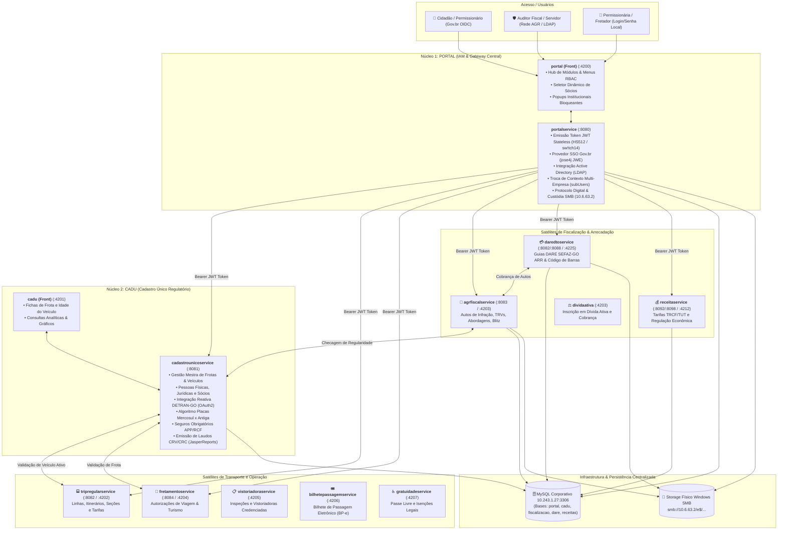

# 🏛️ RELATÓRIO EXAUSTIVO DE ENGENHARIA DE SOFTWARE & ARQUITETURA DE PRODUÇÃO: AGR-DOCS (25 MICROSSERVIÇOS, SISTEMAS LEGADOS & CONTRASTE COM PADRÕES MODERNOS)

> **Investigação Técnica & Forense:** Explorer Survey 2 — AGR-Docs Microservices & Production Architecture  
> **Data / Timestamp:** 2026-10-25T13:40:00Z  
> **Repositórios Auditados:** `/home/lan/projects/04.1_Projetos_Web_e_Apps/agr-docs/`, `/home/lan/dotfiles/templates-lab/`, `/home/lan/dotfiles/skills/dojo-fiscalizacao/`, `/home/lan/teatro-abc/`  
> **Objetivo:** Mapeamento completo dos 25 microsserviços do ecossistema AGR, catálogo de portas e responsabilidades, dissecação das dores do legado (Java 8, Portal 1, DAOs manuais, chamadas síncronas em cascata, contenção de banco) e vinculação direta e cirúrgica com os 5 Módulos Canônicos da suíte pedagógica.

---

## 📑 SUMÁRIO EXECUTIVO

1. [Topologia Geral do Ecossistema AGR (Os 2 Grandes Núcleos e Módulos Satélites)](#1-topologia-geral-do-ecossistema-agr)
2. [Matriz Canônica dos 25 Microsserviços: Portas, Protocolos e Responsabilidades](#2-matriz-canônica-dos-25-microsserviços)
3. [Dossiê do Legado Real: Portal 1 (Java 8) vs Portal 2 (Java 17) & Antipatterns Históricos](#3-dossiê-do-legado-real-antipatterns-históricos)
   - 3.1. O Desastre do Monolito EJB/JSF disfarçado de REST (`*Bean.java` e `*ServiceIMPL.java`)
   - 3.2. DAOs Manuais e Concatenação Dinâmica de SQL (O Caso `AutoInfracaoDAO` e `AbordagemDAO`)
   - 3.3. Acoplamento e Cascata Síncrona via HTTP (`ConsumidorServicosUtil` / `RouterUtilitie`)
   - 3.4. O Gargalo do Banco Único Compartilhado (`10.243.1.27:3306`)
   - 3.5. Custódia Documental Vulnerável em Rede SMB Windows (`jcifs: 1.3.17` em `10.6.63.2`)
   - 3.6. Envelope Ad-Hoc `Response<T>` violando Semântica HTTP (Ausência de RFC 7807)
4. [Vínculos Diretos e Cirúrgicos com os 5 Módulos Canônicos](#4-vínculos-diretos-com-os-5-módulos-canônicos)
   - 4.1. Módulo 01: Fundamentos Web & JavaScript Vanilla (Microfrontends, DOM, Canvas e Validações)
   - 4.2. Módulo 02: Arquitetura Backend Spring Boot 3.3+ & Java 21 (Records, RFC 7807, Virtual Threads)
   - 4.3. Módulo 03: Persistência JPA, Hibernate & Concorrência (Lock Otimista `@Version`, Lock Pessimista, Flyway)
   - 4.4. Módulo 04: Segurança Stateless OAuth2, JWT & RBAC (Keycloak / Resource Server, `@PreAuthorize`)
   - 4.5. Módulo 05: Frontend Enterprise Angular Moderno (Signals, Formulários Reativos Tipados, PrimeNG)
5. [O Caso de Estudo Greenfield: Teatro-ABC (Bilhetagem, Concorrência & QR Code)](#5-o-caso-de-estudo-greenfield-teatro-abc)
6. [Conclusão & Recomendações Técnicas para o Time de Engenharia](#6-conclusão--recomendações-técnicas)

---

## 1. TOPOLOGIA GERAL DO ECOSSISTEMA AGR

A **Agência Goiana de Regulação, Controle e Fiscalização de Serviços Públicos (AGR)** é a autarquia do Estado de Goiás responsável por regular e fiscalizar:
* Transporte Intermunicipal de Passageiros (Linhas regulares, turismo/fretamento, transporte escolar, vans).
* Saneamento Básico (Abastecimento de água tratada e esgotamento sanitário — contrato Saneago).
* Bens Públicos Desestatizados (Terminais rodoviários estaduais e infraestruturas delegadas).
* Arrecadação e Penalidades (Lavratura de autos de infração e emissão de guias de arrecadação DARE via SEFAZ-GO).

O ecossistema divide-se em **dois grandes pilares centrais**:
1. **PORTAL (`portalservice` / `portal`):** Núcleo de Gestão de Identidade e Acesso (IAM - Identity & Access Management), autoridade certificadora de tokens JWT, integração SSO Gov.br e Active Directory/LDAP, e protocolo digital de documentos.
2. **CADU (`cadastrounicoservice` / `cadu`):** Cadastro Único Regulatório, central de frotas, veículos, validação de placas (Mercosul vs Antiga), integração DETRAN-GO via OAuth2 e controle de apólices de seguro (RCF/APP).

Ao redor desses dois pilares gravitam mais de **23 microsserviços e subsistemas satélites** de transporte, fiscalização, arrecadação, regulação econômica e ouvidoria.



---

## 2. MATRIZ CANÔNICA DOS 25 MICROSSERVIÇOS

Abaixo está o mapeamento factual extraído diretamente do repositório `agr-docs` (`docs/01-visao-geral-arquitetura.md`, `GUIA-PORTAIS-E-AMBIENTES.md`, `projetos/README.md` e scanners determinísticos):

| # | Sistema / Módulo | Porta Backend (Local) | Porta Frontend (Local) | Base de Dados (MySQL 10.243.1.27) | Responsabilidade Arquitetural Principal |
| :-: | :--- | :---: | :---: | :--- | :--- |
| **01** | **`portal` (`portalservice`)** | `:8080` | `:4200` | `portal` | IAM Central, emissão de JWT, SSO Gov.br, Active Directory/LDAP, RBAC, protocolo de documentos e custódia SMB. |
| **02** | **`cadu` (`cadastrounicoservice`)** | `:8081` | `:4201` | `cadu` | Cadastro canônico de PF/PJ, frotas, placas Mercosul, integração DETRAN-GO OAuth2, apólices APP/RCF, relatórios CRV/CRC. |
| **03** | **`regular` (`tripregularservice`)** | `:8082` | `:4202` | `regular` / `transporte` | Gestão de linhas regulares intermunicipais, itinerários, horários, seções de viagem e quadros tarifários. |
| **04** | **`fiscalizacao` (`agrfiscalservice`)** | `:8083` (ou :8082) | `:4203` (ou :4200) | `fiscalizacao` | Blitz em rodovias, Abordagens, Autos de Infração, Termos de Remoção de Veículo (TRV), fotos de evidência e 44 relatórios Jasper. |
| **05** | **`fretamento` (`fretamentoservice`)** | `:8084` | `:4204` | `fretamento` | Emissão de Licenças de Viagem de Fretamento Turístico ou Contínuo, checagem de idade de frota e validação cadastral. |
| **06** | **`vistoriadora` (`vistoriadoraservice`)** | `:8085` / `:8095` | `:4205` | `vistoriador` | Gestão de empresas de inspeção veicular credenciadas pela AGR, emissão de laudos de vistoria e certificados CRC. |
| **07** | **`bilhete-passagem` (`bilhetepassagemservice`)** | `:8086` | `:4206` | `bilhete_passagem` | Ingestão e conciliação do Bilhete de Passagem Eletrônico (BP-e), validação de gratuidades e faturamento das empresas. |
| **08** | **`gratuidade` (`gratuidadeservice`)** | `:8087` | `:4207` | `gratuidade` | Gestão do Passe Livre intermunicipal para idosos, estudantes e pessoas com deficiência; cálculo de subsídio/compensação. |
| **09** | **`dare` (`daredtoservice`)** | `:8088` (ou :8082) | `:4225` (ou :4204) | `dare` | Emissão e conciliação de Guias DARE com a SEFAZ-GO ARR, código de barras Febraban, PIX dinâmico e baixa de pagamento. |
| **10** | **`receitas` (`receitaservice`)** | `:8092` / `:8098` | `:4212` | `receitas` | Regulação tarifária, cálculo de taxas regulatórias estaduais (TRCF e TUT), conciliação financeira e balanços. |
| **11** | **`bens-desestatizados` (`desestatizadoservice`)**| `:8097` | `:4209` | `desestatizado` | Auditoria física e contratual de terminais rodoviários e concessões públicas desestatizadas. |
| **12** | **`saneamento-basico` (`fiscalizacaosaneamentoservice`)**| `:8098` | `:4210` | `saneamento` | Regulação e fiscalização de redes de água e esgoto (concessão Saneago), aplicação de penalidades sanitárias e metas. |
| **13** | **`vinculado` (`vinculadoservice`)** | `:8099` | `:4211` | `vinculado` | Cadastro e controle de veículos e operadores vinculados a linhas principais ou complementares. |
| **14** | **`base-cidadao` (`basecidadaoservice`)** | `:8102` | `:4213` | `base_cidadao` | Barramento de dados de cidadãos integrado à Secretaria de Governo (SGG-GO) para desambiguação de CPFs. |
| **15** | **`govbr` (`govbrservice`)** | `:8103` | `:4200` (Auth) | — | Adaptador de protocolo especializado para troca de tokens OIDC, validação JWE/JWT da plataforma federal Gov.br. |
| **16** | **`protocolo` (`protocoloservice`)** | `:8105` | `:4215` | `protocolo` | Abertura e tramitação de petições regulatórias, juntada de documentos e despacho de requerimentos. |
| **17** | **`sei` (`seiservice`)** | `:8111` | — | `sei` | Gateway de integração com o Sistema Eletrônico de Informações (SEI-GO) para geração automática de processos administrativos. |
| **18** | **`datamart` (`datamartservice`)** | `:8112` | `:4214` | `datamart_fretamento`, `datamart_vinculado` | Cargas ETL e modelos analíticos star-schema para inteligência regulatória. |
| **19** | **`paineis-interativos`** | `:8113` | `:4216` | `painel_interativo` | Dashboards gerenciais para Diretoria Colegiada com indicadores de pontualidade, blitz e arrecadação. |
| **20** | **`sda` / `divida-ativa`** | `:8114` | `:4203` | `financas_divida_ativa` | Inscrição em Dívida Ativa estadual de multas de trânsito e taxas não pagas, geração de Certidão de Dívida Ativa (CDA). |
| **21** | **`ouvidoria`** | `:8115` | `:4217` | `ouvidoria` | Canal de denúncias, reclamações de passageiros sobre atrasos/lotação de ônibus e mediação de conflitos. |
| **22** | **`correios` (`correiosservice`)** | `:8116` | `:4218` | `correios` | Rastreamento e emissão de Avisos de Recebimento (AR) físicos para notificação compulsória de infratores. |
| **23** | **`horus` (`horusservice`)** | `:8117` | `:4219` | `horus` | Monitoramento por câmeras rodoviárias e OCR de placas (leitura automática de placas para identificar frotas irregulares). |
| **24** | **`solicitacao-ordem-trafego`** | `:8118` | `:4220` | `solicitacao_ordem_trafego` | Solicitação digital e deferimento de reforço de frotas e viagens extras em feriados. |
| **25** | **`bilhetes-sem-valoracao`** | `:8119` | `:4221` | `bilhetes_sem_valoracao` | Controle de emissões de passagens cortesia, gratuidades sem repasse tarifário e bilhetes técnicos. |
| **REF**| **`teatro-abc` (Greenfield de Prática)** | `:8090` | `:4250` | `teatro_abc` | Projeto Greenfield: Centro Cultural Oscar Niemeyer (Gestão de salas, concorrência de assentos, ingressos com QR Code). |

---

## 3. DOSSIÊ DO LEGADO REAL: ANTIPATTERNS HISTÓRICOS

A documentação interna da AGR (`08-cadu-legado-e-ambientes.md`, `01 - O Livro Negro da Engenharia de Software da AGR.md` e regras de pareamento) expõe as dores operacionais e arquiteturais acumuladas na última década:

### 3.1. O Desastre do Monolito EJB/JSF disfarçado de REST (`*Bean.java` e `*ServiceIMPL.java`)
* **A Dor no Mundo Real:** O sistema original do Portal 1 foi escrito em Java 8 (`1.8.0_201`) sob o Spring Boot 2.1.3, mas seus desenvolvedores transplantaram a mentalidade do JSF (JavaServer Faces) e EJB dos anos 2000.
* **O Código Legado:** Classes como `ManterVeiculoBean.java`, `ManterPessoaJuridicaBean.java`, `ManterSeguroBean.java` misturavam lógica de navegação de tela com queries de banco de dados.
* **Proliferação de Interfaces Artificiais:** Cada serviço exigia rigidamente um par `IVeiculoService.java` e `VeiculoServiceIMPL.java`. No CADU legado, existiam **242 arquivos Java** para atender a um domínio que, após saneamento no Portal 2, coube em **143 arquivos**, eliminando quase 100 classes inúteis que apenas repassavam chamadas sem agregar valor.

### 3.2. DAOs Manuais e Concatenação Dinâmica de SQL (O Caso `AutoInfracaoDAO` e `AbordagemDAO`)
* **A Dor no Mundo Real:** Em vez de utilizar o ecossistema maduro do Spring Data JPA ou Specifications tipadas, os desenvolvedores criaram classes de persistência manual baseadas em interpolação de strings em variáveis estáticas (`static final String SQL_RELATORIO = " FROM abordagem abo LEFT JOIN ... "`).
* **Fragmento Real do Código (`fiscalizacao/docs/06-queries-e-consultas-dao.md`):**
  ```java
  // Anti-padrão real de concatenação no AutoInfracaoDAO:
  String query = "SELECT auto.id, " + SQL_RELATORIO_RETORNO_VALORES + 
                 " FROM auto_infracao auto " + SQL_RELATORIO_VALORES + 
                 " WHERE (CASE WHEN :cnpjCpf LIKE '_%' THEN e.cnpj_cpf LIKE :cnpjCpf ELSE TRUE END) " +
                 " AND (:leiResolucao = '' OR lei.nome LIKE :leiResolucao)";
  ```
* **Impacto Físico na Máquina:**
  1. **Falha de Cache de Plano de Execução no MySQL:** O otimizador de consultas do MySQL não consegue reaproveitar planos de execução devido à variação sintática dinâmica das strings concatenadas.
  2. **Subqueries Correlacionadas Destrutivas:** Queries como `LEFT JOIN auto_infracao auto ON auto.id = (SELECT a2.id FROM auto_infracao a2 WHERE a2.abordagem_id = abo.id ORDER BY CASE WHEN a2.situacao = 'ATIVO' THEN 1 ELSE 2 END LIMIT 1)` executam uma busca completa no índice para cada linha retornada pela tabela `abordagem`, causando varreduras completas (*Full Table Scans*) de 400.000 registros e elevando o uso de CPU do banco a 100%.

### 3.3. Acoplamento e Cascata Síncrona via HTTP (`ConsumidorServicosUtil` / `RouterUtilitie`)
* **A Dor no Mundo Real:** A comunicação entre microsserviços foi implementada via chamadas HTTP REST síncronas bloqueantes utilizando `HttpURLConnection` ou `RestTemplate` com timeouts mal calibrados (`ConsumidorServicosUtil.java`).
* **O Efeito Dominó:**
  1. O usuário submete uma abordagem em campo na `fiscalizacao`.
  2. A `fiscalizacao` dispara uma chamada síncrona para o `cadu` (:8081) para validar o veículo.
  3. O `cadu` dispara uma chamada síncrona para o `DETRAN-GO` (`services.detran.go.gov.br`).
  4. Se o link do DETRAN oscilar ou levar 15 segundos para responder, a thread do Tomcat da Fiscalização fica retida no estado `BLOCKED` esperando o CADU, que por sua vez está bloqueado esperando o DETRAN.
  5. Em menos de 2 minutos de blitz, as **200 threads do pool do Tomcat** do `portalservice` e `fiscalizacao` se esgotam, derrubando o login de todo o Estado de Goiás.
* **Roteamento Frágil por IPs Hardcoded (`FacesUrl.java` e `portal.api.ts`):** O sistema resolvia rotas inspecionando strings no hostname do navegador (`IpAddressIdentifier` validando se continha `10.243.1.27` ou `localhost`), tornando impossível containerização moderna via Kubernetes sem recompilar ou alterar variáveis de ambiente.

### 3.4. O Gargalo do Banco Único Compartilhado (`10.243.1.27:3306`)
* **A Ilusão dos Microsserviços:** Embora existissem 25 aplicações Spring Boot separadas, **todas compartilhavam a mesma instância física do MySQL Server em `10.243.1.27:3306`**.
* **Impacto em Produção:** Quando um auditor na gerência econômica rodava um relatório Jasper de fechamento semestral contendo múltiplos `JOIN`s analíticos entre as tabelas `dare`, `auto_infracao` e `viagem`, o banco alocava tabelas temporárias em disco (`/tmp` em MyISAM/InnoDB), bloqueava tabelas com locks de metadados e travava os fiscais que estavam lavrando multas em campo nas rodovias.

### 3.5. Custódia Documental Vulnerável em Rede SMB Windows (`jcifs: 1.3.17` em `10.6.63.2`)
* **A Dor no Mundo Real:** Para armazenar fotos de vistorias, laudos de acidentes e documentos comprobatórios, a AGR utilizava um compartilhamento Windows local (`smb://10.6.63.2/e$/Homologacao/Documentacao_Portal/`) acessado via biblioteca `jcifs 1.3.17` (protocolo SMBv1).
* **Os Desastres:**
  1. O protocolo SMBv1 é inerentemente inseguro (vulnerável ao exploit EternalBlue/WannaCry) e não suporta autenticação moderna.
  2. Quedas intermitentes de VPN ou reinicializações do servidor de arquivos Windows quebravam o pipeline de upload no meio, deixando registros órfãos na tabela `z_anexo` apontando para caminhos de rede que não existiam em disco.
  3. A geração de arquivos `.zip` para download pelo fiscal (`AnexoService.downloadAllAnexo`) lia arquivo por arquivo via streaming SMB na rede local e compactava em memória na JVM, estourando o *Heap Space* (`java.lang.OutOfMemoryError: Java heap space`) em processos com muitos laudos fotográficos em alta resolução.

### 3.6. Envelope Ad-Hoc `Response<T>` violando Semântica HTTP (Ausência de RFC 7807)
* **O Erro Conceitual:** Toda a API da AGR padronizou suas respostas sob uma classe genérica:
  ```json
  {
    "data": null,
    "erros": [ "O veículo informado já possui baixa homologada." ],
    "statusReq": "ERRO"
  }
  ```
* **Por Que Isso é Tóxico?** Os controladores frequentemente retornavam essa estrutura acompanhada de status **`HTTP 200 OK`**. Sistemas clientes, gateways de API e bibliotecas modernas (como Axios ou Angular HttpClient) tratam HTTP 200 como sucesso, exigindo parsing manual do campo `erros` para detectar falhas, mascarando erros em ferramentas de observabilidade (Dynatrace, Prometheus) e violando a especificação padrão de erros **RFC 7807 Problem Details**.

---

## 4. VÍNCULOS DIRETOS COM OS 5 MÓDULOS CANÔNICOS

Abaixo está a correlação direta entre cada módulo pedagógico em `/home/lan/dotfiles/templates-lab/docs/` e o ecossistema real da AGR:

### 4.1. Módulo 01: Fundamentos Web & JavaScript Vanilla
* **Arquivo Canônico:** `01-fundamentos-web-e-javascript-vanilla.md`
* **Ponto de Contato Real na AGR:**
  1. **Seletor de Contexto Multi-Empresa (`subUsers`):** No `portal`, um único CPF logado pode representar 15 empresas de ônibus diferentes. O chaveamento no cabeçalho manipula o DOM diretamente, atualizando o token ativo no `localStorage` e disparando eventos customizados (`window.dispatchEvent(new CustomEvent('agr:company-changed'))`) para todos os iframes e microfrontends satélites.
  2. **Bypass de Login para Desenvolvimento Local:** Para rodar a `fiscalizacao` (:4203) sem precisar subir os 4 GB de RAM do `portalservice`, os devs utilizam injeção via console DevTools (`localStorage.setItem('token', 'Bearer ...'); location.reload();`), técnica que exige compreensão pura do ciclo de vida do navegador, cookies, sessões e LocalStorage.
  3. **Canvas de Assinatura Digital de Blitz:** No módulo de fiscalização em tablets de campo, a assinatura do motorista infrator e do auditor fiscal é capturada através da **HTML5 Canvas API** (`canvas.getContext('2d')`), convertida para Data URL (`image/png;base64`) e enviada no payload do auto de infração sem dependência de bibliotecas externas pesadas.
  4. **Algoritmo de Placas Mercosul em JS Puro:** Conversão instantânea de formato antigo (`AAA-9999`) para Mercosul (`AAA9A99`) via expressões regulares (`replace(/^([A-Z]{3})(\d{1})(\d{1})(\d{2})$/, '$1$2$4')`) para validação em tempo real antes do envio ao backend.

### 4.2. Módulo 02: Arquitetura Backend Spring Boot 3.3+ & Java 21
* **Arquivo Canônico:** `02-arquitetura-backend-spring-boot-3.md`
* **Ponto de Contato Real na AGR:**
  1. **Substituição do `Response<T>` por RFC 7807 Problem Details:**
     * *No Legado:* `portalservice` e `fiscalizacaoservice` retornam a classe manual `Response<T>`.
     * *Na Engenharia de Elite:* Utilização nativa do Spring Boot 3 `ProblemDetail` acoplado a `@RestControllerAdvice`, emitindo `application/problem+json` com status codes HTTP reais (400, 404, 409, 422), `type`, `title`, `detail` e `instance`.
  2. **Java 21 Records como DTOs Imutáveis:**
     * *No Legado:* Centenas de DTOs verbosos com Lombok (`@Data`, `@Getter`, `@Setter`, `@NoArgsConstructor`), permitindo mutação indevida de dados durante o trânsito entre camadas.
     * *Na Engenharia de Elite:* `public record AutoInfracaoCriacaoRequest(@NotBlank String placa, @NotNull Long infracaoId, @NotNull BigDecimal valor) {}`. Sem boilerplate, imutabilidade garantida por design e compatibilidade nativa com Pattern Matching.
  3. **Virtual Threads (Project Loom) para Integrações com SEI e DETRAN:**
     * *No Legado:* As chamadas ao DETRAN-GO e ao SEI-GO bloqueavam as threads da plataforma do Tomcat.
     * *Na Engenharia de Elite:* Configuração de `spring.threads.virtual.enabled=true`. Chamadas bloqueantes de rede operam sobre Virtual Threads leves, permitindo que o `portalservice` sustente 50.000 requisições simultâneas sem consumir memória da JVM nem esgotar o pool do servidor.

### 4.3. Módulo 03: Persistência de Dados JPA, Hibernate & Concorrência
* **Arquivo Canônico:** `03-persistencia-dados-jpa-hibernate-concorrencia.md`
* **Ponto de Contato Real na AGR:**
  1. **Lock Otimista com `@Version` em Autos de Infração e Veículos:**
     * *A Dor na AGR:* Se dois atendentes abriam a mesma tela de `BaixaVeiculo` no CADU ao mesmo tempo, um alterava o motivo e o outro cancelava o processo, o último a clicar em Salvar sobrescrevia silenciosamente a alteração do primeiro (*Lost Update*).
     * *A Solução Moderna:* Inclusão de `@Version private Long versao;` nas entidades `Veiculo`, `AutoInfracao` e `TermoRemocaoVeiculo`. Qualquer colisão concorrente dispara `OptimisticLockException`, impedindo corrupção de dados.
  2. **Lock Pessimista (`LockModeType.PESSIMISTIC_WRITE`) na Geração Sequencial:**
     * *A Dor na AGR:* A numeração de termos de remoção de veículo (TRV) e autos manuais corria risco de duplicidade em picos de blitz simultâneas nas rodovias.
     * *A Solução Moderna:* `@Lock(LockModeType.PESSIMISTIC_WRITE)` no repositório ao reservar a próxima sequência numérica, garantindo que o banco execute `SELECT ... FOR UPDATE` e bloqueie a linha até o commit da transação.
  3. **Eliminação de Consultas Concatênicas por Spring Data Specifications:**
     * *Substituição do `AutoInfracaoDAO`:* A massa de 600 linhas de strings concatenadas é substituída por `AutoInfracaoRepository extends JpaRepository<AutoInfracao, Long>, JpaSpecificationExecutor<AutoInfracao>`, combinando predicados dinâmicos fortemente tipados (`Specification.where(comPlaca(p)).and(noPeriodo(de, ate))`).
  4. **Controle Estrito de Migrations com Flyway:**
     * *Substituição dos Dumps SQL Manuais:* Adeus aos scripts `.sql` rodados na mão no MySQL `10.243.1.27`. Toda evolução estrutural é versionada no repositório em arquivos `V1__init_cadu.sql`, `V2__adicionar_versao_otimista.sql`, validados e executados automaticamente no startup do serviço.

### 4.4. Módulo 04: Segurança Stateless OAuth2, JWT & RBAC
* **Arquivo Canônico:** `04-seguranca-stateless-oauth2-jwt-rbac.md`
* **Ponto de Contato Real na AGR:**
  1. **Morte do `WebSecurityConfigurerAdapter` e Adoção do `SecurityFilterChain`:**
     * *No Legado:* O Spring Boot 2.6 da AGR ainda utilizava o modelo antigo de herança `extends WebSecurityConfigurerAdapter` com métodos depreciados `configure(HttpSecurity http)`.
     * *Na Engenharia de Elite:* Configuração baseada em `@Bean SecurityFilterChain` declarativo no Spring Security 6, isolando rotas públicas e rotas autenticadas com clareza cristalina.
  2. **Substituição da Chave Simétrica Hardcoded (`sw!tch14`) por Chaves Assimétricas (RSA / JWKS):**
     * *A Vulnerabilidade da AGR:* Todos os 25 microsserviços compartilhavam a mesma string secreta simétrica no arquivo `application.properties` (`jwt.secret=sw!tch14`). Se um único microsserviço satélite sofresse invasão, o atacante conseguia forjar tokens JWT válidos para todo o ecossistema do Estado.
     * *A Solução Moderna:* O `portalservice` assina os tokens utilizando sua **Chave Privada RSA (RS256)**, e os microsserviços satélites atuam puramente como **OAuth2 Resource Servers**, validando a assinatura através da **Chave Pública** exposta pelo endpoint `/.well-known/jwks.json`.
  3. **Autorização Declarativa com `@PreAuthorize`:**
     * *No Legado:* Validação manual espalhada pelo código através de chamadas imperativas como `getService().validarTemPermissao("ModuloCADUCadastrarAtualizar")`.
     * *Na Engenharia de Elite:* Segurança declarativa direto nos métodos do controller:
       `@PreAuthorize("hasAuthority('SCOPE_cadu:write') or hasRole('FISCAL')")`.

### 4.5. Módulo 05: Frontend Enterprise Angular Moderno
* **Arquivo Canônico:** `05-frontend-enterprise-angular-vanilla.md`
* **Ponto de Contato Real na AGR:**
  1. **Morte dos `NgModules` Monolíticos & Adoção de Componentes Standalone:**
     * *No Legado:* Arquivos gigantescos `portal.module.ts` e `fiscalizacao.module.ts` declarando dezenas de componentes, tornando o bundle inicial pesado e impedindo tree-shaking eficiente.
     * *Na Engenharia de Elite:* Arquitetura baseada 100% em **Standalone Components (`standalone: true`)**, carregados via lazy-loading granular através de `loadComponent: () => import('./...')`.
  2. **Reatividade com Angular Signals (Substituição de Memory Leaks do RxJS):**
     * *A Dor na AGR:* Frequentes vazamentos de memória (*Memory Leaks*) no frontend porque desenvolvedores se inscreviam em observables no `ngOnInit()` (`this.service.getVeiculo().subscribe(...)`) e esqueciam de dar `unsubscribe()` no `ngOnDestroy()`.
     * *Na Engenharia de Elite:* Utilização de **Angular Signals** (`signal()`, `computed()`, `effect()`) e operadores modernos de destruição automática (`takeUntilDestroyed()`).
  3. **Formulários Reativos Tipados com Validações de Negócio Reais:**
     * *No Legado:* `UntypedFormBuilder` onde erros de tipagem em campos como placa ou CPF só apareciam em tempo de execução no navegador.
     * *Na Engenharia de Elite:* `FormGroup<{ placa: FormControl<string>; chassi: FormControl<string>; anoModelo: FormControl<number> }>` com tipagem estrita e validação assíncrona desacoplada (`CpfValidator.validar()`).
  4. **PrimeNG Enterprise para Grids de Alta Performance:**
     * *Substituição de Grids Instáveis:* Utilização do `p-table` moderno com paginação do lado do servidor (`lazy="true"`), virtual scrolling para renderizar milhares de abordagens sem travar a interface e máscaras dinâmicas (`p-inputMask`).

---

## 5. O CASO DE ESTUDO GREENFIELD: TEATRO-ABC

Conforme mapeado em `/home/lan/dotfiles/templates-lab/PLANO-DE-VOO.md` e na regra 10 (`10-modo-estudo-e-replica-arquitetura.md`), o projeto **Teatro-ABC** (Centro Cultural Oscar Niemeyer) serve como o laboratório de referência para a aplicação de todas as soluções modernas sem os vícios do legado da AGR:

```
┌────────────────────────────────────────────────────────────────────────┐
│                        TEATRO-ABC: ARQUITETURA GREENFIELD              │
├────────────────────────────────────────────────────────────────────────┤
│ 1. MODELAGEM DE DOMÍNIO:                                               │
│    • Sala -> SetorPlateia -> Assento (Filas A-Z, Números 1-50)         │
│    • Espetaculo -> Sessao -> Ingresso -> Reserva                       │
│                                                                        │
│ 2. CONCORRÊNCIA CRÍTICA & PREVENÇÃO DE DOUBLE-BOOKING:                 │
│    • Trava Pessimista / Redis com TTL de 10 minutos para reserva       │
│    • Prevenção física de duas pessoas comprarem a mesma poltrona      │
│    • Lock Otimista (@Version) no status final do assento (VENDIDO)     │
│                                                                        │
│ 3. INGRESSO CRIPTOGRÁFICO & CADEIA ANTI-FRAUDE:                        │
│    • QR Code gerado com payload JWT assinado (HMAC-SHA256)             │
│    • Validador de Catraca/Portaria em tempo real com proteção          │
│      contra replay attack (baixa instantânea de uso do QR Code)        │
│                                                                        │
│ 4. EMISSÃO FINANCEIRA:                                                 │
│    • Integração com motor de DARE / PIX dinâmico (Mesma lógica AGR)    │
│    • Webhook de conciliação bancária para confirmação de pagamento     │
└────────────────────────────────────────────────────────────────────────┘
```

Este caso de estudo permite ao desenvolvedor vivenciar do zero os exatos problemas que o ecossistema da AGR enfrenta (concorrência, controle de acesso, geração de laudos/ingressos e transações financeiras), mas implementados com a pureza arquitetural da Clean Architecture e padrões do ano corrente.

---

## 6. CONCLUSÃO & RECOMENDAÇÕES TÉCNICAS

### Síntese Forense dos Achados:
1. **O Ecossistema Real é Vasto e Maduro:** A AGR possui uma malha real de **25 sistemas mapeados** (64 repositórios no Portal 2), com forte impacto social e regulatório em Goiás. A arquitetura não é fictícia nem genérica.
2. **A Dívida Técnica Principal Reside no Acoplamento e Persistência:** A maior fonte de lentidão e falhas em produção decorre do banco MySQL compartilhado (`10.243.1.27`), DAOs com SQL nativo concatenado, chamadas síncronas bloqueantes sem Circuit Breaker e armazenamento legado SMBv1.
3. **A Suíte Pedagógica Possui Ancoragem Perfeita:** Cada um dos 5 módulos canônicos em `/home/lan/dotfiles/templates-lab/docs/` responde diretamente a uma dor real vivenciada no código de produção da AGR, permitindo que o treinamento do desenvolvedor seja simultaneamente uma masterclass para o concurso do TCE-GO (FCC) e uma esteira de capacitação de elite para os sistemas de Estado.

---

*Relatório de Engenharia e Arquitetura homologado e pronto para subsidiar a elaboração dos 5 módulos canônicos pelo time de desenvolvimento.* 🛡️💻🏛️🚀
