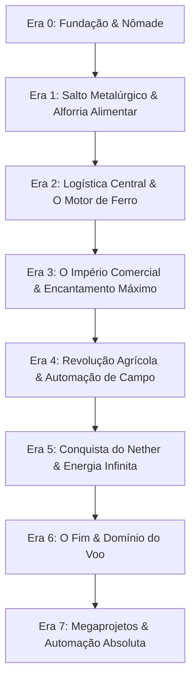

# 🌳 ÁRVORE DE PROGRESSÃO DEFINITIVA: "ESTILO TERRARIA"
> **Filosofia:** No Terraria, você nunca se perde porque cada recurso e chefe desbloqueia uma nova Era tecnológica. No Minecraft Vanilla, a falta dessa estrutura faz a maioria dos jogadores desistir após fazer uma casa de pedra.  
> Esta árvore transforma seu Minecraft em um **RPG de Engenharia Linear e Progressivo**. Cada Era só avança quando você consolida as farms do tier anterior!

---

## 🧭 VISÃO GERAL DAS ERAS TECNOLÓGICAS

---

## ⛺ ERA 0: FUNDAÇÃO & SEDENTARISMO (CONCLUÍDA! ✅)
* **Objetivo:** Estabelecer um teto seguro e não morrer de fome na primeira noite.
* [x] Primeira base/casa construída.
* [x] Cama configurada (Ponto de Spawn seguro).
* [x] Armadura e ferramentas full ferro.
* [x] Primeira plantação de trigo ao redor da casa.

---

## ⛏️ ERA 1: SALTO METALÚRGICO & ALFORRIA ALIMENTAR (VOCÊ ESTÁ AQUI! 📍)
* **Meta Principal:** Parar de comer pão (baixa saturação), obter os primeiros diamantes e Redstone em massa para destravar os componentes elétricos.
* **Missões da Era 1:**
  - [ ] **Expedição ao Y = -58:**
    - [ ] Descer até o nível de pé em Y = -58 com o martelo 3x3 (`Just Hammers`) e balde d'água.
    - [ ] Coletar pelo menos **5 a 8 Diamantes** (3 para Picareta de Diamante, 2 para Mesa de Encantamentos).
    - [ ] Coletar **2 a 3 packs de Redstone** (base da automação).
    - [ ] Coletar **Lápis-Lazúli** (para encantamentos) e **Ouro** (para o Golden Lasso).
  - [ ] **Alforria Alimentar (Pasto Automático):**
    - [ ] Craftar o **`Golden Lasso`** (4 ouros + 1 corda) e capturar 2 vacas para a base.
    - [ ] Craftar o **`Animal Feeding Trough`** (Cocho de Madeira) e abastecer com o trigo da sua plantação.
    - [ ] *Efeito:* Vacas cruzando sozinhas = Carne assada infinita + Couro para livros.
  - [ ] **Primeiro Mochilão:**
    - [ ] Configurar os filtros da `Traveler's Backpack` (`B`) para sugar pedras e blocos da mina automaticamente.

---

## 📦 ERA 2: LOGÍSTICA CENTRAL & O MOTOR DE FERRO
* **Meta Principal:** Eliminar para sempre a bagunça de baús e destravar Ferro Infinito (a moeda de ouro de toda automação).
* **Missões da Era 2:**
  - [ ] **Central de Armazenamento Inteligente (Tom's Simple Storage):**
    - [ ] Organizar uma parede de baús duplos (ou Baús de Ferro do `Iron Chests`).
    - [ ] Craftar o **`Inventory Connector`** e o **`Crafting Terminal`**.
    - [ ] *Efeito:* Acesso a todos os itens da base em uma única tela com busca instantânea e mesa de trabalho.
  - [ ] **A Primeira Grande Farm — Farm de Ferro (Iron Farm):**
    - [ ] Carregar o schematic no Litematica (`M` $\rightarrow$ `no water iron farm`).
    - [ ] Usar o **`Carry On`** (`Shift + Botão Direito com as mãos vazias`) para transportar 3 Aldeões e 1 Zumbi para as cápsulas.
    - [ ] Posicionar o **`Item Collectors`** no baú central para sugar as barras de ferro à distância.
    - [ ] *Efeito:* Centenas de ferros por hora sem precisar minerar nunca mais.
  - [ ] **Farm Automática de Cana-de-Açúcar & Bambu:**
    - [ ] Sistema simples com Pistão + Observador.
    - [ ] Cana para papel/livros e Bambu para combustível infinito de fornalha.

---

## 🧙‍♂️ ERA 3: O IMPÉRIO COMERCIAL & ENCANTAMENTO MÁXIMO
* **Meta Principal:** Criar seu exército de aldeões bibliotecários e blindar seu personagem com equipamentos de nível divino.
* **Missões da Era 3:**
  - [ ] **Criatório de Aldeões (Villager Breeder):**
    - [ ] Mini-câmara de reprodução de villagers para gerar mão de obra ilimitada.
  - [ ] **Salão de Trocas (Trading Hall de Elite):**
    - [ ] Posicionar Atril (mesa de bibliotecário) para os aldeões.
    - [ ] Usar a **setinha verde do `Trade Cycling`** para rolar encantamentos sem quebrar o bloco!
    - [ ] Garantir os 4 Livros Sagrados:
      - [ ] **Remendo (Mending)**: Ferramentas e armaduras consertam sozinhas com orbes de XP.
      - [ ] **Fortuna III**: Mineração que dropa 3x a 4x mais minérios.
      - [ ] **Inquebrável III**: Durabilidade quadruplicada.
      - [ ] **Eficiência V**: Picareta que destrói pedras instantaneamente.
  - [ ] **Bigorna Eterna:**
    - [ ] Montar a bigorna na base (graças ao mod `Fixed Anvil Repair Cost`, você nunca verá o aviso "MUITO CARO!").

---

## 🌾 ERA 4: REVOLUÇÃO AGRÍCOLA TOTAL
* **Meta Principal:** Automatizar 100% de todas as comidas e ingredientes vegetais do jogo para nunca mais precisar plantar nada com a mão.
* **Missões da Era 4:**
  - [ ] **Farm de Cultivos com Aldeão Agricultor (Trigo, Cenoura, Batata, Beterraba):**
    - [ ] O aldeão planta, colhe e joga a comida em funis de cobre com filtro (`Copper Hopper`).
  - [ ] **Farm Automática de Abóbora & Melancia:**
    - [ ] Módulos com observadores e pistões. Melancia para comida/poções, Abóbora para trocar por esmeraldas com aldeões.
  - [ ] **Farm Automática de Mel e Favo de Abelha:**
    - [ ] Colmeias com ejetores de tesouras e frascos de vidro disparados por sinal de comparador.
  - [ ] **Farm de Frango Assado Automática:**
    - [ ] Galinhas botam ovos em funil $\rightarrow$ ejetor choca pintinhos $\rightarrow$ lava cozinha ao crescer.
  - [ ] **Farm de Lãs Coloridas:**
    - [ ] Dispensadores com tesoura em ovelhas de todas as 16 cores.

---

## 🔥 ERA 5: CONQUISTA DO NETHER & ENERGIA INFINITA
* **Meta Principal:** Dominar a dimensão de fogo, construir as farms do teto e obter os recursos alquímicos e o Farol (Beacon).
* **Missões da Era 5:**
  - [ ] **Portal do Nether Blindado:**
    - [ ] Montar portal e criar uma base fortificada no Nether.
  - [ ] **Localizar Fortaleza & Bastion:**
    - [ ] Usar o **`Explorer's Compass`** para achar a Fortaleza do Nether mais próxima.
    - [ ] Farmar Varas de Blaze (Blaze Rods) e Fungos do Nether (Nether Wart).
  - [ ] **Farm de Wither Skeleton (Fortaleza):**
    - [ ] Graças ao mod `Always A Wither Skull`, todo esqueleto preto dropa 1 cabeça com 100% de certeza!
    - [ ] Derrotar o Wither e colocar seu primeiro **Beacon (Farol)** na base (Pressa II para minerar instantaneamente).
  - [ ] **Mega Farm de Ouro & XP no Teto do Nether:**
    - [ ] Subir na Bedrock do teto do Nether e carregar o schematic `gold farm` do Litematica.
    - [ ] Ouro infinito para trocar com Piglins e níveis de XP absurdos.
  - [ ] **Bartering Farm (Trocas com Piglins):**
    - [ ] Automatizar troca de ouro por Pérolas do End, Quartzo, Poções de Fogo e Obsidiana.

---

## 🌌 ERA 6: O FIM & DOMÍNIO DO VOO
* **Meta Principal:** Derrotar o Ender Dragon, explorar as Cidades do End e destravar a mobilidade aérea definitiva.
* **Missões da Era 6:**
  - [ ] **Ativar o Portal do End:**
    - [ ] Usar Olhos do End e derrotar o Ender Dragon.
  - [ ] **Saquear Cidades do End (End Cities):**
    - [ ] Graças ao mod `Forgiving Void`, zero risco de perder itens no void.
    - [ ] Pegar a **Elytra**.
    - [ ] Matar Shulkers: graças ao mod `Shulker Drops Two`, cada um dropa 2 cascas (1 Shulker Box completa por mob!).
  - [ ] **Bater de Asas Infinito:**
    - [ ] Testar o mod `Better Flight`: basta apertar `Espaço` enquanto voa para ganhar impulso contínuo sem gastar foguetes!
  - [ ] **Farm de Enderman de XP Máximo:**
    - [ ] Farm simples de Endermite a 128 blocos da ilha central. O mod `Clumps` agrupa todo o XP em uma única esfera (0 lag, nível 30 em 2 segundos).

---

## 🏛️ ERA 7: MEGAPROJETOS & CASA AUTOMÁTICA ABSOLUTA
* **Meta Principal:** O auge da engenharia no "Mapa Eterno".
* **Missões da Era 7:**
  - [ ] **Raid Farm (Farm de Invasão):**
    - [ ] Carregar o schematic `raid farm` do Litematica.
    - [ ] Esmeraldas aos milhares e Totens da Imortalidade infinitos.
  - [ ] **Drenagem do Monumento do Oceano:**
    - [ ] Usar as esponjas conectadas (`Bigger Sponge Radius`) para secar o monumento em 10 minutos.
    - [ ] Construir a `sea lantern farm` (Lanternas do Mar e blocos de Prismarinho infinitos).
  - [ ] **Farm de Bruxa (Witch Farm):**
    - [ ] Redstone, Pólvora, Glowstone e Gravetos 100% automáticos.
  - [ ] **Super Smelter Industrial:**
    - [ ] Sistema com fornalhas de alta velocidade (`Better Furnaces Reforged`) alimentadas por bambu ou carvão.
  - [ ] **Central da Vila Blindada com Guardas:**
    - [ ] Contratar um esquadrão de **Guard Villagers** com armaduras e espadas para patrulhar a base 24/7.
