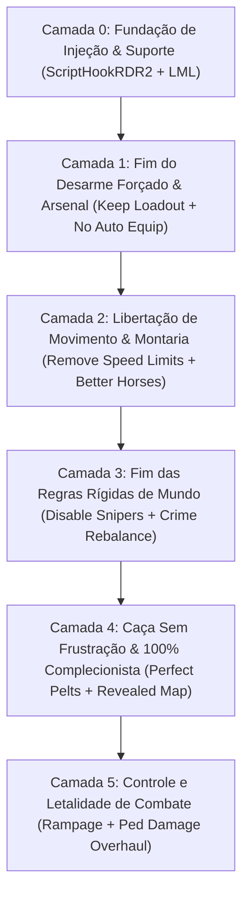

# 🤠 RED DEAD REDEMPTION 2: PROTOCOLO DEFINITIVO ZERO-ATRITO

> **Objetivo:** Eliminar 100% das frustrações mecânicas da Rockstar Games (desarme forçado ao descer do cavalo, lentidão artificial em cidades, animações lentas repetitivas, testemunhas mágicas e sniper invisível em New Austin).
> **Perfil do Jogador:** `Mercenary308` (Baseado no seu histórico oficial de mods no Nexus Mods).
> **Ambiente Alvo:** PC (Linux Proton / Windows) via **ScriptHookRDR2** + **Lenny's Mod Loader (LML)**.

---

## 🏗️ ARQUITETURA EM 6 CAMADAS

---

## 🛠️ CAMADA 0: FUNDAÇÃO DE ENGINE & INJETORES DE SCRIPTS
*Os motores obrigatórios para que qualquer mod funcione no RDR2.*

| Mod / Ferramenta | Onde Baixar / ID | Função Vital |
| :--- | :--- | :--- |
| **Alexander Blade's ScriptHookRDR2** | `dev-c.com` | Injetor essencial (`ScriptHookRDR2.dll` e `dinput8.dll`) para rodar scripts `.asi`. |
| **Lenny's Mod Loader (LML)** | `ModdingCommunity` | Virtualizador de arquivos (`lml/`) que substitui parâmetros sem alterar os arquivos `.rpf` da Rockstar. |
| **Online Content Unlocker** | Nexus ID: `1688` | Libera roupas, armas, selas e cavalos do Red Dead Online para a campanha do Arthur. |

---

## 🔫 CAMADA 1: O FIM DO DESARME FORÇADO AO DESCER DO CAVALO
*A maior irritação de combate de RDR2: o jogo guarda suas armas longas no cavalo sem você pedir e você entra no tiroteio só de revólver.*

| Mod | Nexus ID | A Dor no Vanilla | A Solução Cirúrgica |
| :--- | :--- | :--- | :--- |
| **Keep Weapon Loadout Dismounting** | `3404` | **Arthur guardando rifles na sela:** Toda vez que você desmonta para investigar algo ou entra numa cidade, suas armas das costas voltam para o cavalo. | As armas que você escolheu nas costas e no ombro **permanecem no seu corpo para sempre** ao descer do cavalo. |
| **No AUTO horse equip** | `1970` | **Jogo forçando armas indesejadas em missões:** Antes de um tiroteio roteirizado, o jogo coloca uma escopeta ou rifle que você não queria nas suas costas. | Bloqueia a interferência da Rockstar: você luta exclusivamente com as armas que você escolheu equipar. |
| **All Weapons Unlocked** | `1266` | **Armas bloqueadas por capítulos:** Você quer usar a Mauser ou a Carcano no Capítulo 2 e o jogo trava a compra até o final da história. | Libera todas as armas em todos os armeiros desde o início da campanha. |

---

## 🐎 CAMADA 2: LIBERTAÇÃO DE MOVIMENTO & MONTARIA SOBERANA
*RDR2 força você a andar arrastando o pé em acampamentos e cidades, e limita o assobio do cavalo.*

| Mod | Nexus ID | A Dor no Vanilla | A Solução Cirúrgica |
| :--- | :--- | :--- | :--- |
| **Remove Speed Limits** | `975` | **Lentidão forçada em cidades e acampamento:** O cavalo e Arthur são forçados a trotar devagar em Saint Denis, pontes e no acampamento da gangue. | Permite correr e galopar livremente em qualquer lugar sem freio artificial do jogo. |
| **Fix Toggle Run On Keyboard** | `704` | **Transição travada de corrida no teclado:** Ao começar a correr com Shift, você só consegue voltar a andar parando totalmente. | Aperte Shift para alternar suavemente entre andar e correr no teclado sem engasgar. |
| **Unlimited Horse Whistling Distance** | `306` | **Cavalo surdo fora de alcance:** Você assobia longe e o jogo diz *"Seu cavalo está longe demais para ouvir"*. | O cavalo escuta seu assobio em qualquer ponto do mapa e vem galopando até você. |
| **Better Horses / All Horses Perfect** | `842` / `880` | **Cavalos lentos que cansam rápido:** Cavalos comuns morrem sem estamina ao atravessar o mapa. | Atributos aprimorados e estamina equilibrada para cavalos velozes e confiáveis. |
| **Instant Travel** | `331` | **Fast Travel restrito a fogueiras:** Você precisa montar acampamento e ver a animação toda para viajar. | Viagem instantânea imersiva diretamente de qualquer ponto. |

---

## ⚖️ CAMADA 3: FIM DAS REGRAS RÍGIDAS DE MUNDO & POLÍCIA PSÍQUICA
*Em RDR2, dar um tiro no meio do deserto gera uma testemunha mágica do nada e a polícia te persegue até o inferno.*

| Mod | Nexus ID | A Dor no Vanilla | A Solução Cirúrgica |
| :--- | :--- | :--- | :--- |
| **Disable Out Of Bounds Snipers** | `877` | **Sniper invisível em New Austin:** Arthur Morgan toma um tiro telecinético na cabeça se tentar explorar Blackwater e New Austin. | Desativa os snipers invisíveis. Arthur pode explorar 100% do mapa clássico do RDR1 livremente. |
| **Crime and Law Rebalance** | `569` | **Polícia onisciente e testemunhas mágicas:** Um crime sem testemunhas no meio do mato atrai xerifes em 10 segundos. | Rebalanceia o sistema de crimes: a polícia precisa ser chamada fisicamente, as testemunhas demoram para chegar à cidade e máscaras realmente ocultam sua identidade. |

---

## 🎯 CAMADA 4: CAÇA SEM FRUSTRAÇÃO & 100% COMPLECIONISTA
*Caçar peles perfeitas para o Pearson e para as bolsas de Arthur sem perder a paciência.*

| Mod | Nexus ID | A Dor no Vanilla | A Solução Cirúrgica |
| :--- | :--- | :--- | :--- |
| **Perfect Pelts** | `984` | **Pele de 3 estrelas estragada por tiro errado:** Você passa 1 hora procurando um alce raro e a pele vira 2 estrelas porque usou a munição errada. | Garante peles de qualidade máxima (3 estrelas / Perfect) em animais abatidos. |
| **Revealed Map** | `1245` | **Névoa de guerra escondendo o mapa:** Ter que cavalgar por cada centímetro para tirar a mancha cinza do mapa. | Revela todo o relevo e estradas do mapa sem névoa. |
| **Arthur Chapter 2 L.O.T.E Save** | `1801` / `8` | **Pular o prólogo na neve:** Pula o Capítulo 1 lento em Colter e entrega a bolsa *Legend of the East* (capacidade de 99 itens de cada tipo). | Começa o jogo livre no Capítulo 2 em Horseshoe Overlook com a melhor bolsa do jogo. |

---

## 💥 CAMADA 5: LETALIDADE DE COMBATE & SANDBOX DEFINITIVO
*Combate visceral com físicas de dano realistas.*

| Mod | Nexus ID | Mecânica | Impacto na Gameplay |
| :--- | :--- | :--- | :--- |
| **Ped Damage Overhaul (PDO)** | `184` | **Física de ferimentos realista:** Tiro na perna faz o inimigo mancar e cair; tiro nos braços faz largar a arma; inimigos feridos gemem e perdem a vontade de lutar. | Elimina o comportamento de esponja de dano e traz a física visceral de Euphoria do RDR1. |
| **1 Shot 1 Kill Mod** | `92` | **Tiros letais no peito:** Inimigos caem com 1 tiro certeiro no tronco. | Realismo máximo de tiroteio clássico de faroeste. |
| **Rampage Trainer** | `233` | **Menu de controle total in-game (F5):** Ajuste de clima, teletransporte, spawn de animais raros, dinheiro e munição infinita. | A ferramenta definitiva de suporte para nunca travar em nenhum desafio da campanha. |
