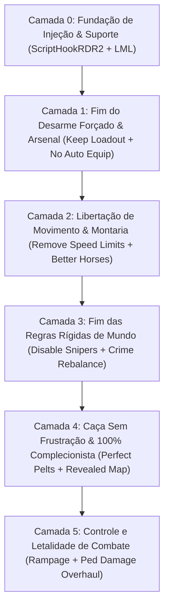

# 🤠 RED DEAD REDEMPTION 2: PROTOCOLO DEFINITIVO ZERO-ATRITO

> **Objetivo:** Eliminar 100% das frustrações mecânicas da Rockstar Games (desarme forçado ao descer do cavalo, lentidão artificial em cidades, animações lentas repetitivas, testemunhas mágicas e sniper invisível em New Austin).
> **Perfil do Jogador:** `Mercenary308` (Baseado no seu histórico oficial de mods no Nexus Mods).
> **Ambiente Alvo:** PC (Linux Proton / Windows) via **ScriptHookRDR2** + **Lenny's Mod Loader (LML)**.

---

## 🏗️ ARQUITETURA EM 6 CAMADAS

---

## 🛠️ CAMADA 0: FUNDAÇÃO DE ENGINE & INJETORES DE SCRIPTS
*Os motores obrigatórios para que qualquer mod funcione no RDR2.*

| Mod / Ferramenta | Onde Baixar / ID | Função Vital |
| :--- | :--- | :--- |
| **Alexander Blade's ScriptHookRDR2** | `dev-c.com` | Injetor essencial (`ScriptHookRDR2.dll` e `dinput8.dll`) para rodar scripts `.asi`. |
| **Lenny's Mod Loader (LML)** | `ModdingCommunity` | Virtualizador de arquivos (`lml/`) que substitui parâmetros sem alterar os arquivos `.rpf` da Rockstar. |
| **Online Content Unlocker** | Nexus ID: `1688` | Libera roupas, armas, selas e cavalos do Red Dead Online para a campanha do Arthur. |

---

## 🔫 CAMADA 1: O FIM DO DESARME FORÇADO AO DESCER DO CAVALO
*A maior irritação de combate de RDR2: o jogo guarda suas armas longas no cavalo sem você pedir e você entra no tiroteio só de revólver.*

| Mod | Nexus ID | A Dor no Vanilla | A Solução Cirúrgica |
| :--- | :--- | :--- | :--- |
| **Keep Weapon Loadout Dismounting** | `3404` | **Arthur guardando rifles na sela:** Toda vez que você desmonta para investigar algo ou entra numa cidade, suas armas das costas voltam para o cavalo. | As armas que você escolheu nas costas e no ombro **permanecem no seu corpo para sempre** ao descer do cavalo. |
| **No AUTO horse equip** | `1970` | **Jogo forçando armas indesejadas em missões:** Antes de um tiroteio roteirizado, o jogo coloca uma escopeta ou rifle que você não queria nas suas costas. | Bloqueia a interferência da Rockstar: você luta exclusivamente com as armas que você escolheu equipar. |
| **All Weapons Unlocked** | `1266` | **Armas bloqueadas por capítulos:** Você quer usar a Mauser ou a Carcano no Capítulo 2 e o jogo trava a compra até o final da história. | Libera todas as armas em todos os armeiros desde o início da campanha. |

---

## 🐎 CAMADA 2: LIBERTAÇÃO DE MOVIMENTO & MONTARIA SOBERANA
*RDR2 força você a andar arrastando o pé em acampamentos e cidades, e limita o assobio do cavalo.*

| Mod | Nexus ID | A Dor no Vanilla | A Solução Cirúrgica |
| :--- | :--- | :--- | :--- |
| **Remove Speed Limits** | `975` | **Lentidão forçada em cidades e acampamento:** O cavalo e Arthur são forçados a trotar devagar em Saint Denis, pontes e no acampamento da gangue. | Permite correr e galopar livremente em qualquer lugar sem freio artificial do jogo. |
| **Fix Toggle Run On Keyboard** | `704` | **Transição travada de corrida no teclado:** Ao começar a correr com Shift, você só consegue voltar a andar parando totalmente. | Aperte Shift para alternar suavemente entre andar e correr no teclado sem engasgar. |
| **Unlimited Horse Whistling Distance** | `306` | **Cavalo surdo fora de alcance:** Você assobia longe e o jogo diz *"Seu cavalo está longe demais para ouvir"*. | O cavalo escuta seu assobio em qualquer ponto do mapa e vem galopando até você. |
| **Better Horses / All Horses Perfect** | `842` / `880` | **Cavalos lentos que cansam rápido:** Cavalos comuns morrem sem estamina ao atravessar o mapa. | Atributos aprimorados e estamina equilibrada para cavalos velozes e confiáveis. |
| **Instant Travel** | `331` | **Fast Travel restrito a fogueiras:** Você precisa montar acampamento e ver a animação toda para viajar. | Viagem instantânea imersiva diretamente de qualquer ponto. |

---

## ⚖️ CAMADA 3: FIM DAS REGRAS RÍGIDAS DE MUNDO & POLÍCIA PSÍQUICA
*Em RDR2, dar um tiro no meio do deserto gera uma testemunha mágica do nada e a polícia te persegue até o inferno.*

| Mod | Nexus ID | A Dor no Vanilla | A Solução Cirúrgica |
| :--- | :--- | :--- | :--- |
| **Disable Out Of Bounds Snipers** | `877` | **Sniper invisível em New Austin:** Arthur Morgan toma um tiro telecinético na cabeça se tentar explorar Blackwater e New Austin. | Desativa os snipers invisíveis. Arthur pode explorar 100% do mapa clássico do RDR1 livremente. |
| **Crime and Law Rebalance** | `569` | **Polícia onisciente e testemunhas mágicas:** Um crime sem testemunhas no meio do mato atrai xerifes em 10 segundos. | Rebalanceia o sistema de crimes: a polícia precisa ser chamada fisicamente, as testemunhas demoram para chegar à cidade e máscaras realmente ocultam sua identidade. |

---

## 🎯 CAMADA 4: CAÇA SEM FRUSTRAÇÃO & 100% COMPLECIONISTA
*Caçar peles perfeitas para o Pearson e para as bolsas de Arthur sem perder a paciência.*

| Mod | Nexus ID | A Dor no Vanilla | A Solução Cirúrgica |
| :--- | :--- | :--- | :--- |
| **Perfect Pelts** | `984` | **Pele de 3 estrelas estragada por tiro errado:** Você passa 1 hora procurando um alce raro e a pele vira 2 estrelas porque usou a munição errada. | Garante peles de qualidade máxima (3 estrelas / Perfect) em animais abatidos. |
| **Revealed Map** | `1245` | **Névoa de guerra escondendo o mapa:** Ter que cavalgar por cada centímetro para tirar a mancha cinza do mapa. | Revela todo o relevo e estradas do mapa sem névoa. |
| **Arthur Chapter 2 L.O.T.E Save** | `1801` / `8` | **Pular o prólogo na neve:** Pula o Capítulo 1 lento em Colter e entrega a bolsa *Legend of the East* (capacidade de 99 itens de cada tipo). | Começa o jogo livre no Capítulo 2 em Horseshoe Overlook com a melhor bolsa do jogo. |

---

## 💥 CAMADA 5: LETALIDADE DE COMBATE & SANDBOX DEFINITIVO
*Combate visceral com físicas de dano realistas.*

| Mod | Nexus ID | Mecânica | Impacto na Gameplay |
| :--- | :--- | :--- | :--- |
| **Ped Damage Overhaul (PDO)** | `184` | **Física de ferimentos realista:** Tiro na perna faz o inimigo mancar e cair; tiro nos braços faz largar a arma; inimigos feridos gemem e perdem a vontade de lutar. | Elimina o comportamento de esponja de dano e traz a física visceral de Euphoria do RDR1. |
| **1 Shot 1 Kill Mod** | `92` | **Tiros letais no peito:** Inimigos caem com 1 tiro certeiro no tronco. | Realismo máximo de tiroteio clássico de faroeste. |
| **Rampage Trainer** | `233` | **Menu de controle total in-game (F5):** Ajuste de clima, teletransporte, spawn de animais raros, dinheiro e munição infinita. | A ferramenta definitiva de suporte para nunca travar em nenhum desafio da campanha. |

---

## 🃏 CAMADA 6: O GUIA DEFINITIVO DO 100% SEM SOFRIMENTO (COLECIONÁVEIS, PEIXES & ANIMAIS)
*O 100% de Red Dead Redemption 2 tem alguns dos objetivos mais sádicos já criados pela Rockstar Games (144 cartas de cigarro, 13 peixes lendários brigando na vara por 10 minutos, desafios de Gambler que dependem de sorte de cassino e animais raros que não spawnam). Veja como liquidar cada um deles:*

### 🚬 1. As 144 Cartas de Cigarros (Cigarette Cards)
* **A Tortura:** Cavalgar por todo o mapa do jogo procurando 144 cartões minúsculos em cima de caixas e mesas isoladas.
* **O Método Definitivo (Sem Trapaça Excessiva):**
  1. Vá até o armazém geral (*General Store*) de Valentine ou Saint Denis com cerca de \$1.000 a \$1.500 no bolso.
  2. Abra o catálogo, vá em Provisões e compre maços de **Cigarros Premium (Premium Cigarettes)**.
  3. **Cada maço de cigarro comprado dá 1 carta aleatória na hora.**
  4. Encha a bolsa, abra a bolsa, descarte todos os cigarros e compre mais maços. Em 10 a 15 minutos comprando na loja, você completa todas as 12 coleções de 144 cartas de forma 100% legítima sem sair da cidade.
* **O Método Instantâneo (Via Rampage Trainer - ID `233`):**
  * Abra o Rampage (`F5`) ➔ Vá em `Character > Inventory > Collectibles` ➔ Clique em **Give All Cigarette Cards**. Todas as 144 cartas caem no seu inventário na hora, liberando a quest do Phineas T. Ramsbottom imediatamente.

---

### 🎣 2. Os 13 Peixes Lendários (Sem Destruir os Dedos no Controle/Mouse)
* **A Tortura:** Peixes lendários (como o Muskie e o Bagre do Lago) demoram até 10 minutos puxando a linha, a linha arrebenta e o minigame de girar o analógico ou ficar enrolando com o mouse cansa os pulsos.
* **A Solução Nativa da Rockstar (Configuração Escondida):**
  * Vá nas configurações do próprio jogo:  
    `Configurações > Controles > Acessibilidade > Pesca (Fishing) ➔ Mudar de "Girar" para "Segurar Botão" (Hold to Reel)`.
  * Isso faz a linha recolher automaticamente na velocidade máxima apenas segurando uma tecla, sem precisar rodar mouse nem controle.
* **O Atalho com Mods:**
  * **[Legendary Animal & Fish Spawner](https://www.nexusmods.com/reddeadredemption2/mods/1088)** (`1088`):
    * Permite spawnar o peixe ou animal lendário diretamente na sua frente se o gatilho da Rockstar falhar ou se o animal não aparecer.
  * **Rampage Trainer (`233`) - Atirar com Arma com Dead Eye:**
    * Você pode atirar com arma de fogo na água com o Dead Eye para matar o peixe lendário e apenas recolher o corpo da água sem nem pegar a vara de pescar.

---

### 🐻 3. Os 16 Animais Lendários & Peles Perfeitas Garantidas
* **A Tortura:** Rastrear pistas de esterco e pelos por 30 minutos na mata, e ter que enfrentar os snipers em New Austin para pegar os animais do sul (como o Puma Lendário e o Bisão Tatanka).
* **O Combo Definitivo de Mods:**
  1. **Disable Out Of Bounds Snipers** (`877`): Permite que Arthur Morgan vá até New Austin caçar o Puma Lendário e o Pronghorn Lendário sem tomar tiro invisível da Rockstar.
  2. **Perfect Pelts** (`984`): Elimina o medo de estragar a pele: você pode matar o animal com escopeta ou rifle explosivo que a pele continuará sendo **3 Estrelas / Perfeita**.
  3. **Revealed Map** (`1245`): O mapa já mostra as áreas demarcadas de onde cada animal lendário vive.

---

### 🎰 4. Os 90 Desafios da Campanha (Gambler, Herbalist, Survivalist)
* **A Tortura:** Desafios sádicos como *Gambler 8* (vencer 3 partidas de Blackjack pedindo 3 cartas adicionais na mesa — pura probabilidade estatística que pode levar 6 horas sentado na cadeira) ou colher 43 plantas diferentes.
* **A Resolução via Rampage Trainer (`233`):**
  * Dentro do menu do Rampage (`F5`):
    * `Character > Stats > Challenges`: Permite **concluir individualmente apenas os desafios que você achar abusivos** (como Gambler 8 e 9), ou desbloquear todos de uma vez se quiser pegar a roupa lendária *Legend of the East* instantaneamente.
    * `Compendium`: Permite marcar como "Descoberto/Estudado" qualquer animal raro que você não tenha paciência de ficar caçando na mata.

---

## 🤠 CAMADA 7: VIDA DE FORA-DA-LEI LIVRE & ASSALTOS INFINITOS
*No RDR2 vanilla, uma vez que as missões da história acabam, você **não pode assaltar bancos**, não pode assaltar diligências livremente e os membros da gangue ficam presos no acampamento:*

| Mod | Nexus ID | A Dor no Vanilla | A Solução Cirúrgica |
| :--- | :--- | :--- | :--- |
| **Bank Robberies** | `167` | **Bancos trancados para sempre:** No jogo base, assaltos a banco só acontecem em missões pré-programadas de história. No modo livre as portas dos cofres são cenográficas. | Permite entrar e assaltar qualquer banco do jogo (Valentine, Rhodes, Saint Denis). Aponte a arma para o caixa, arrombe o cofre com dinamite e fuja com sacolas de dinheiro enquanto os homens da lei cercam o local. |
| **Stagecoach Robberies** | `869` | **Diligências sem valor:** Assaltar carruagens na estrada rende quase nada e não tem contratos dinâmicos. | Adiciona contratos infinitos gerados aleatoriamente de assaltos a carruagens blindadas com escolta armada e baús de joias por todo o mapa. |
| **Ride With Gang** | `284` | **Gangue presa no acampamento:** Arthur é forçado a viajar sempre sozinho, enquanto John, Charles, Javier e Sadie ficam sentados fumando em Horseshoe Overlook. | Permite recrutar qualquer membro da gangue de Dutch para cavalgar, caçar e trocar tiros ao seu lado como companheiros de viagem com cobertura tática. |
| **Dog Companion** | `725` | **Cachorros só servem para fazer carinho:** Você vê dezenas de cães no acampamento e nas vilas, mas não pode ter um parceiro leal. | Adiciona um cão de caça pessoal que cavalga ao seu lado, ajuda a rastrear animais na mata, ataca inimigos na perna e busca itens caídos. |

---

## ⏱️ CAMADA 8: ESCALA DE TEMPO REALISTA & PROPRIEDADES
*Dois atritos finais de atmosfera e progresso:*

| Mod | Nexus ID | A Dor no Vanilla | A Solução Cirúrgica |
| :--- | :--- | :--- | :--- |
| **Longer Days** | `41` | **O tempo passa rápido demais:** No vanilla, cada minuto real equivale a 30 minutos in-game. O pôr do sol dura apenas 40 segundos e a noite passa voando antes de você conseguir acampar e caçar. | Permite desacelerar a passagem do tempo para uma proporção mais imersiva (ex: 1 minuto real = 2 a 5 minutos in-game). Você aproveita manhãs ensolaradas, tardes e noites com calma. |
| **WhyEm's DLC** | `671` | **Falta de personalização de roupas e coldres:** O modo história tem pouquíssimas roupas comparado ao modo online. | Adiciona centenas de novos chapéus, ponchos autênticos, coletes, jaquetas, anéis, cortes de cabelo, barbas e coldres duplos nos armários e lojas. |

---

## 🤠 CAMADA 9: O FAROESTE CINEMATOGRÁFICO DEFINITIVO (DUELOS, MALABARISMO & PROPRIEDADES)
*O jogo vanilla bloqueia ações clássicas de filmes de faroeste. Esta camada adiciona os recursos mais pedidos pela comunidade:*

| Mod | Nexus ID | A Dor no Vanilla | A Solução Cirúrgica |
| :--- | :--- | :--- | :--- |
| **Duels** | `500` | **Não dá para desafiar ninguém para duelo:** No vanilla, duelos de saque rápido (*Quickdraw*) só acontecem em 4 ou 5 missões roteirizadas da história. | Permite **desafiar qualquer NPC armado no jogo para um duelo clássico de saque rápido no meio da rua**. Fique cara a cara, espere a contagem, saque o revólver no Dead Eye e atire na mão ou no peito do oponente. |
| **Gun Tricks** | `818` | **Falta de firulas com o revólver:** No modo história, Arthur só guarda a arma normalmente, enquanto no modo online existem giros acrobáticos (*gun spinning*). | Traz todos os malabarismos de revólver do Red Dead Online para o modo história: gire o revólver nos dedos, gire para trás e guarde no coldre com estilo pressionando duas vezes o botão de coldre. |
| **Buyable Properties** | `820` | **Arthur não pode ter uma casa própria:** Mesmo tendo \$50.000 no bolso no final do jogo, você é obrigado a dormir apenas em barracas no mato ou pagar 1 dólar por noite em hotel. | Permite **comprar casas, cabanas nas montanhas e quartos de hotel permanentes** por toda a província de New Hanover, Ambarino, Lemoyne e New Austin, com personalização de móveis e guarda-roupa. |
| **Bounties Expansion - Replayable Bounties** | `210` | **Os cartazes de procurado acabam rápido:** As delegacias de Valentine, Rhodes e Saint Denis só têm 2 ou 3 cartazes de caça a recompensas e nunca mais renovam. | Adiciona **39 novas missões de caça a recompensas totalmente rejogáveis** inspiradas no sistema do RDR1. A cada 6 horas in-game, um novo cartaz de fugitivo perigoso surge na parede da delegacia. |
