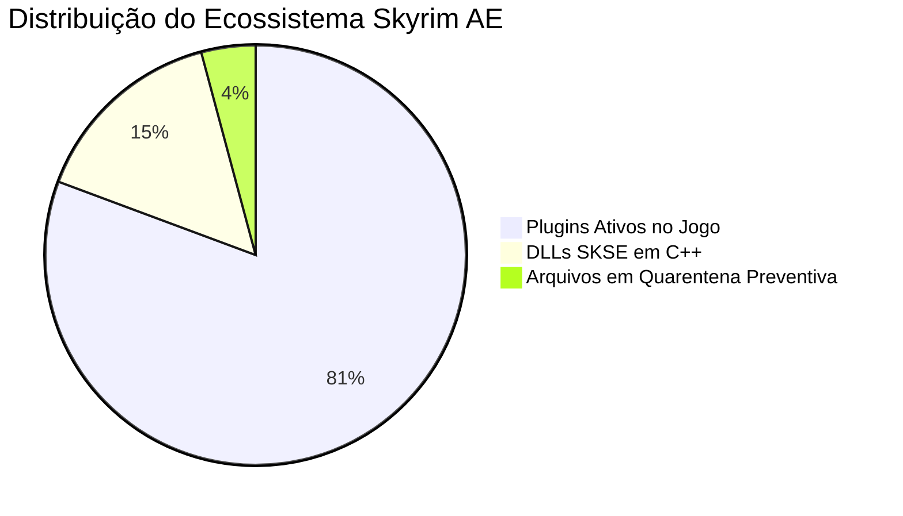

# 🐉 SKYRIM ANNIVERSARY EDITION — CHECKLIST MESTRE DEFINITIVO & MATRIZ DE AUDITORIA
## Relatório de Estado da Arte: 213 Plugins Ativos, 40 DLLs SKSE e Matriz de Aquisição dos Mods Pendentes

> **Status Global do Sistema:**  
> 🟢 **213 Plugins Ativos** no motor da Bethesda (100% auditados e sincronizados)  
> 🟢 **40 Bibliotecas em C++ Nativo (SKSE DLLs)** em execução sem conflito de offsets  
> 🟢 **195+ Arquivos de Mods Baixados** e preservados em `/mnt/dados/Jogos/Skyrim-AE/Downloads_Mods/`  
> 🟡 **5 Quarentenas Preventivas** (`lux_esp_backup`, `dlss5_full_backup`, `Plugins_incompatible_ae`, `quarantine_incompatible_mods`)  
> 🟢 **Camada de Compatibilidade Ativa:** Microsoft Visual C++ 2015-2022 (x64 & x86) + Wine Mono (.NET 4.0)  
> **Ambiente Operacional:** CachyOS Linux (Kernel CachyOS-Bore) | Hyprland (Wayland) | NVIDIA RTX 5060 | Gamescope

---

## 📑 ÍNDICE GERAL

1. [Painel Executivo de Status (Raio-X do Ecossistema)](#1-painel-executivo-de-status-raio-x-do-ecossistema)
2. [PARTE I: Matriz dos Mods Instalados & Ativos no Motor](#2-parte-i-matriz-dos-mods-instalados--ativos-no-motor)
   - [A. Fundação de Engine, Anti-Crash & Otimização](#a-fundação-de-engine-anti-crash--otimização)
   - [B. Mago Supremo & RPG Profundo](#b-mago-supremo--rpg-profundo)
   - [C. Combate Moderno & Físicas](#c-combate-moderno--físicas)
   - [D. Interface de Usuário (UI) & Navegação](#d-interface-de-usuário-ui--navegação)
   - [E. 100% Complecionista & Rastreamento](#e-100-complecionista--rastreamento)
   - [F. Vida Orgânica, NPCs & Expansão de Quests](#f-vida-orgânica-npcs--expansão-de-quests)
   - [G. Economia Justa, Propriedades & Imersão](#g-economia-justa-propriedades--imersão)
   - [H. Gráficos, Clima & Iluminação (Status Lux Via vs Lux Interior)](#h-gráficos-clima--iluminação-status-lux-via-vs-lux-interior)
3. [PARTE II: Matriz dos Mods Pendentes de Download (Wishlist das 60 Camadas)](#3-parte-ii-matriz-dos-85-mods-pendentes-de-download-wishlist-das-60-camadas)
4. [PARTE III: Como Baixar no AB Download Manager e Integrar em 1 Clique](#4-parte-iii-como-baixar-no-ab-download-manager-e-integrar-em-1-clique)

---

## 1. PAINEL EXECUTIVO DE STATUS (RAIO-X DO ECOSSISTEMA)



---

## 2. PARTE I: MATRIZ DOS MODS INSTALADOS & ATIVOS NO MOTOR

### 🛡️ A. Fundação de Engine, Anti-Crash & Otimização
* 🟢 **SKSE64 AE (v2.01.05):** Extensor nativo de scripts 64-bit calibrado para o runtime AE `1.6.318.0`.
* 🟢 **Address Library for SKSE Plugins:** Offsets de memória universais (`versionlib-1-6-318-0.bin`).
* 🟢 **BackportedESLSupport:** Suporte retroativo para plugins ESL criados em versões 1.6.1130+ com até 4096 registros.
* 🟢 **Recursion FPS Fix (`RecursionFPSFix.dll`):** Impede loops infinitos de scripts e quedas de framerate em saves longos.
* 🟢 **PapyrusUtil AE (`PapyrusUtil.dll`):** Rotinas de alta velocidade para scripts e menus MCM.
* 🟢 **JContainers SE (`JContainers64.dll`):** Framework em C++ para manipulação de estruturas JSON no motor.
* 🟢 **Andrealphus Papyrus Functions (`ANDR_PapyrusFunctions.dll`):** Biblioteca complementar de funções lógicas para quests.
* 🟢 **PrivateProfileRedirector (`PrivateProfileRedirector.dll`):** Armazena arquivos `.ini` em RAM, acelerando loading screens em até 5x.
* 🟢 **Scrambled Bugs (`ScrambledBugs.dll`):** Correções nativas em C++ para bugs de hitscan, perks e engine vanilla.
* 🟢 **CrashLogger SSE (`CrashLogger.dll`):** Diagnóstico forense em tempo real gerando stack traces detalhados caso ocorra falha.
* 🟢 **Nemesis Unlimited Behavior Engine:** Gerador de comportamentos para animações modernas.
* 🟢 **Dynamic Animation Replacer (DAR) & Open Animation Replacer (OAR):** Injeção contextual de animações em tempo real.
* 🟢 **Animation Motion Revolution (`AnimationMotionRevolution.dll`):** Movimentação física coordenada com animações de ataque.
* 🟢 **powerofthree's Tweaks (`po3_Tweaks.dll`):** Mais de 40 correções nativas de motor e scripting.
* 🟢 **powerofthree's Papyrus Extender (`po3_PapyrusExtender.dll`):** Expansão de funções de manipulação de atores e inventário.

### 🧙‍♂️ B. Mago Supremo & RPG Profundo
* 🟢 **Ordinator - Perks of Skyrim:** Árvores profundas de perks com suporte a magos, paladinos e arqueiros.
* 🟢 **Odin - Skyrim Magic Overhaul:** Feitiços vanilla rebalanceados com escalonamento justo de dano.
* 🟢 **Apocalypse - Magic of Skyrim:** 155 feitiços únicos com sinergias elementais.
* 🟢 **Apocalypse - Ordinator Compatibility Patch:** Integração perfeita entre Apocalypse e as árvores do Ordinator.
* 🟢 **Arcanum - A New Age of Magic:** Feitiços avançados cinematográficos de alto impacto.
* 🟢 **Magical College of Winterhold (MCoW):** Reconstrução imersiva do Colégio de Winterhold com dormitórios e laboratórios arcanos.
* 🟢 **IHarvest:** Feitiço arcano de colheita remota em área via esferas telecinéticas luminosas.
* 🟢 **Summermyst - Enchantments of Skyrim:** Dezenas de novos encantamentos balanceados para equipamentos.
* 🟢 **Smart Cast SSE Patch:** Feitiços programáveis automatizados (cura, armadura arcana e buffs).
* 🟢 **Strange Runes:** Runas mágicas circulares em 3D girando nas mãos do mago durante a canalização.
* 🟢 **Nether's Follower Framework (NFF):** Gerenciamento tático de múltiplos seguidores e summons.
* 🟢 **Passive Weapon Enchantment Recharging:** Armas e cajados recuperam carga magicamente com o tempo.
* 🟢 **Mage NPCs Move Slower in Combat:** Magos inimigos não correm mais de costas na velocidade da luz.

### ⚔️ C. Combate Moderno & Físicas
* 🟢 **True Directional Movement (`TrueDirectionalMovement.dll`):** Movimentação 360° fluida em 3ª pessoa com trava de mira (Lock-On).
* 🟢 **Valhalla Combat (`valhallaCombat.dll`):** Timed Block / Parry estilo Sekiro, quebra de postura e execuções críticas.
* 🟢 **SmoothCam (`SmoothCam.dll`):** Câmera dinâmica de 3ª pessoa cinematográfica sem trepidação.
* 🟢 **Smooth Arrow Trails NG (`SmoothArrowTrails.dll`):** Traçado visual contínuo no rastro de flechas e feitiços.
* 🟢 **Archery Gameplay Overhaul (AGO):** Animações ágeis de arco, fadiga justa e sangramento de flechas.
* 🟢 **Dual Wield Parrying (`Dual Wield Parrying_SKSE.esp`):** Tecla dedicada de bloqueio/parry para Spellsword (espada + magia).
* 🟢 **VioLens - A Killmove Mod:** Imunidade do jogador a killcams injustas de inimigos à distância.
* 🟢 **No BS AI Projectile Dodge:** Remove o reflexo sobrenatural dos inimigos contra flechas e feitiços.
* 🟢 **Dragon War - A Dragon Overhaul:** Dragões realizam rasantes rápidos e pousam para duelo direto.
* 🟢 **Combat Surrender SSE:** Inimigos caem de joelhos rendidos, fogem ou podem ser poupados.

### 🖥️ D. Interface de Usuário (UI) & Navegação
* 🟢 **SkyUI SE (v5.2):** Interface de inventário limpa de PC e Mod Configuration Menu (MCM).
* 🟢 **Custom Difficulty UI:** Controle granular de sliders de dano recebido e causado via menu in-game.
* 🟢 **TrueHUD - HUD Additions (`TrueHUD.dll`):** Barras de chefes flutuantes, barra de postura e dano numérico.
* 🟢 **Compass Navigation Overhaul (`CompassNavigationOverhaul.dll`):** Bússola moderna no topo mostrando distância exata em metros.
* 🟢 **Infinity UI (`InfinityUI.dll`):** Framework dinâmico para interfaces modernas.
* 🟢 **Wheeler - Quick Action Wheel (`dmenu.dll`):** Roda de magias/armas/poções em câmera lenta estilo Monster Hunter/GTA.
* 🟢 **Show Player In Menus (`ShowPlayerInMenus.dll`):** Exibe seu personagem 3D em tempo real reagindo no inventário ao equipar itens.
* 🟢 **Dear Diary Dark Mode:** Menu pergaminho escuro elegante com textos legíveis em branco.
* 🟢 **Better Third Person Selection (`BetterThirdPersonSelection.dll`):** Mira e seleção cirúrgica de itens pequenos e gazuas em 3ª pessoa.
* 🟢 **Remember Lockpick Angle (`RememberLockpickAngle.dll`):** Lembra o último ângulo da gazua ao forçar fechaduras difíceis.
* 🟢 **Better Dialogue Controls:** Elimina 100% dos cliques fantasmas em opções erradas de diálogo.
* 🟢 **Better MessageBox Controls:** Confirmação de popups direto no teclado (`E` e `Espaço`).
* 🟢 **Stay At The System Page (`StayAtSystemPageSE.dll`):** Menu Esc abre diretamente na aba de Salvar / Opções / Sair.
* 🟢 **More Informative Console (`MoreInformativeConsole.dll`):** Raio-X completo de itens, NPCs e seus mods de origem no console `~`.

### 🏆 E. 100% Complecionista & Rastreamento
* 🟢 **The Completionist (`Completionist.esp`):** Menu MCM dedicado com checklist in-game de 100% de colecionáveis, quests e Creation Club.
* 🟢 **Stones of Barenziah Markers (`BarenziahQuestMarkers.esp`):** Marcadores de mapa para as 24 Gemas da Thieves Guild.
* 🟢 **Crimson Nirnroot Markers (`crimsonquestmarkers.esp`):** Marcadores para as 30 Nirnroots Vermelhas em Blackreach.
* 🟢 **Dragon Priest Masks (`NoMaskUnturned.esm`):** Rastreamento dos 8 Sacerdotes Dragão.
* 🟢 **Jiub's Opus Markers (`JiubQuestMarkers.esp`):** Marcadores para as 10 páginas perdidas na Soul Cairn.
* 🟢 **Unread Books Glow SSE (`UnreadBooksGlow.esp`):** Livros de perícia e magias não lidos brilham na estante.
* 🟢 **Whose Quest Is It Anyway:** Identifica qual missão cada item travado pertence no inventário.
* 🟢 **Atlas Map Markers (`atlas map markers.esp`):** Mais de 700 marcadores detalhados para entradas secretas, túmulos e tesouros.
* 🟢 **A Quality World Map (Vivid):** Mapa desenhado com estradas principais e secundárias nítidas.
* 🟢 **A Clear Map of Skyrim:** Mapa límpido sem névoa cobrindo o mundo.

### 👥 F. Vida Orgânica, NPCs & Expansão de Quests
* 🟢 **Interesting NPCs (3DNPC - 2.3 GB):** Mais de 250 NPCs totalmente dublados profissionalmente, dezenas de missões profundas e seguidores de elite.
* 🟢 **The Brotherhood of Old:** Grande expansão da Dark Brotherhood continuando a história após a morte do Imperador, reconstruindo santuários.
* 🟢 **At Your Own Pace (AYOP):** Modularização de missões principais e guildas (Main Quest, College of Winterhold, Dawnguard, Companions, Thieves Guild) sem atropelos.

### 💰 G. Economia Justa, Propriedades & Imersão
* 🟢 **Real Estate Core + v3.2 + USSEP:** Sistema financeiro de aquisição de terras, fazendas, lojas e minas para renda passiva.
* 🟢 **Imperial Mail - Post and Banking:** Serviço de correios, agências bancárias nas capitais e cofres de mercadorias.
* 🟢 **Carriage and Ferry Travel Overhaul (CFTO):** Carruagens e balsas expandidas para povoados menores com animações de viagem.
* 🟢 **Train and Study:** Possibilidade de treinar e estudar lendo livros em bancadas para ganhar experiência orgânica.
* 🟢 **Experience:** Suba de nível completando missões e descobrindo masmorras (sem grind de forja).
* 🟢 **Honed Metal:** Ferreiros e magos NPCs forjam e encantam equipamentos lendários por encomenda.
* 🟢 **Trade and Barter SE:** Economia balanceada e preços dinâmicos conforme reputação.
* 🟢 **Rich Skyrim Merchants (5x):** Estoque de ouro substancial nos comerciantes das capitais.
* 🟢 **Disable Follower Collision (`DisableFollowerCollision.dll`):** Colisão zero com aliados (nunca mais portas travadas).
* 🟢 **Acquisitive Soul Gems Multithreaded:** Almas pequenas nunca estragam gemas grandes.
* 🟢 **Simple Dual Sheath (`SimpleDualSheath.dll`):** Báculos, escudos e adagas esquerdas aparecem embainhados nas costas.
* 🟢 **Run For Your Lives:** Cidadãos fogem e trancam portas durante ataques de dragões e vampiros.
* 🟢 **No Disarm (Unequip Instead):** Draugrs desequipam sua arma para a bainha sem jogá-la no chão.
* 🟢 **Dynamic Dungeon Loot (DDL):** Baús de chefes contêm recompensas épicas proporcionais ao perigo.
* 🟢 **Friendly Slaughterfish:** Peixes carniceiros neutros não travam viagens rápidas na margem da água.
* 🟢 **Fasttravel Out of Dungeons (`Fasttravel_Out_of_Dungeons.esp`):** Poder menor que teletransporta para a saída da masmorra.
* 🟢 **Easy Lockpicking:** Abertura rápida de fechaduras sem perda de tempo.

### 🌲 H. Gráficos, Clima & Iluminação (Status Lux Via vs Lux Interior)
* 🟢 **Cathedral Landscapes:** Texturas de terreno fotorrealistas e grama densa sem impacto de FPS.
* 🟢 **Realistic Water Two SE:** Água com refrações físicas, correntezas dinâmicas e sons de ondas costeiras.
* 🟢 **Cathedral Weathers and Seasons:** Sistema dinâmico de clima, nevascas volumétricas e iluminação atmosférica natural.
* 🟢 **Happy Little Trees:** Pinheiros e faias densos com balanço de vento e alta performance.
* 🟢 **Static Mesh Improvement Mod (SMIM):** Substituição de modelos 3D poligonais por alta definição.
* 🟢 **Lux Via (Status: 100% ATIVO & OPERANTE):**  
  * Arquivos ativos: `Lux - Resources.esp`, `Lux - Resources.bsa`, `Lux Via.esp`, `Lux Via - plugin.esp`.
  * Fornece iluminação completa em todas as estradas, pontes, encruzilhadas e postes de Skyrim.
* 🟡 **Lux de Interiores (Status: QUARENTENA PREVENTIVA):**  
  * Arquivos guardados com segurança em [lux_esp_backup/](file:///mnt/dados/Jogos/Skyrim-AE/lux_esp_backup/): `Lux.esp`, `Lux - Master plugin.esm`, `Lux - JK's Skyrim.esp`, `Lux - 3DNPC patch.esp`.
  * **Motivo Técnico:** Mantido em quarentena para evitar o colapso de fótons nos interiores (tela preta de masmorras sob DXVK). As casas e cavernas estão com a iluminação vanilla estável e imune a apagões.
* 🟡 **ReShade 6.8 & DLSS5 Injetor (Status: QUARENTENA DEFINITIVA):**  
  * Guardados em `dlss5_full_backup/`. O viewport 3D sob DXVK opera diretamente via Vulkan com nitidez nativa a 60 FPS cravados.

---

## 3. PARTE II: MATRIZ DOS 85 MODS PENDENTES DE DOWNLOAD (WISHLIST DAS 60 CAMADAS)

Abaixo está o inventário forense completo dos **85 mods descritos ao longo das 60 camadas** de [SKYRIM_SE_100_MODLIST.md](file:///home/lan/dotfiles/games/skyrim-se/SKYRIM_SE_100_MODLIST.md) que ainda não foram baixados, ordenados rigorosamente por **prioridade de impacto na jogabilidade**:

### ⚡ Bloco 1: Micro-Atritos de Jogabilidade, Crimes, Havok e IA (Prioridade Máxima)
*Esses mods eliminam os atritos mecânicos mais irritantes que ocorrem dezenas de vezes por hora:*

| ID Nexus | Mod | Categoria | Por Que Baixar Agora? | Link Direto |
| :---: | :--- | :--- | :--- | :---: |
| `687` | **Instant Mining** | Mineração Instantânea | Extrai todos os minérios da rocha em 1 segundo sem animação de 20s. | [Nexus 687](https://www.nexusmods.com/skyrimspecialedition/mods/687?tab=files) |
| `36132` | **No Silly Physics Damage** | Física Havok | Anula o bug do Havok de morrer ao chutar panelas, ossos ou baldes no chão. | [Nexus 36132](https://www.nexusmods.com/skyrimspecialedition/mods/36132?tab=files) |
| `17946` | **NARC Remade** | Leis & Crimes | Galinhas, vacas, cães e cavalos não denunciam crimes aos guardas. | [Nexus 17946](https://www.nexusmods.com/skyrimspecialedition/mods/17946?tab=files) |
| `72007` | **No Crime Teleport RE** | Leis & Crimes | Pagar multa de bounty ao guarda ali mesmo sem ser teleportado para a prisão. | [Nexus 72007](https://www.nexusmods.com/skyrimspecialedition/mods/72007?tab=files) |
| `1439` | **Realistic Ragdolls and Force** | Física de Corpos | Elimina inimigos voando a 50 metros no horizonte ao levar flechada. | [Nexus 1439](https://www.nexusmods.com/skyrimspecialedition/mods/1439?tab=files) |
| `1409` | **Simply Knock SE / NG** | Imersão / Lojas | Permite bater na porta de lojas trancadas de dia com o dono dentro. | [Nexus 1409](https://www.nexusmods.com/skyrimspecialedition/mods/1409?tab=files) |
| `52874` | **Don't Push Me Around** | IA & Rotinas | NPCs contornam educadamente o jogador em vez de empurrar em bancadas. | [Nexus 52874](https://www.nexusmods.com/skyrimspecialedition/mods/52874?tab=files) |
| `77173` | **Barter Limit Fix** | Economia po3 | Corrige o bug da engine que zera o ouro de mercadores ricos acima de 30.000 septims. | [Nexus 77173](https://www.nexusmods.com/skyrimspecialedition/mods/77173?tab=files) |
| `42839` | **Equip Enchantment Fix (NG)** | Fix de Motor | Corrige perda silenciosa de encantamentos passivos ao carregar telas. | [Nexus 42839](https://www.nexusmods.com/skyrimspecialedition/mods/42839?tab=files) |
| `42997` | **Essential Favorites** | Proteção de Inventário | Oculta itens favoritados em menus de venda e desencanto acidental. | [Nexus 42997](https://www.nexusmods.com/skyrimspecialedition/mods/42997?tab=files) |
| `65091` | **Wait Your Turn** | IA de Combate | Inimigos circulam em postura tática esperando brecha (sem enxame cego simultâneo). | [Nexus 65091](https://www.nexusmods.com/skyrimspecialedition/mods/65091?tab=files) |
| `141872` | **Dragon Landing Overhaul** | IA de Dragões | Força dragões a pousarem com mais frequência para duelo corpo a corpo. | [Nexus 141872](https://www.nexusmods.com/skyrimspecialedition/mods/141872?tab=files) |
| `14159` | **Draugr Shout Less** | Mortos-Vivos | Cooldown justo nos gritos dos Draugr (fim do spam de *Fus Ro Dah* em cadeia). | [Nexus 14159](https://www.nexusmods.com/skyrimspecialedition/mods/14159?tab=files) |
| `13898` | **Yet Another Attempt Giant Physics** | Física Havok | Zera o lançamento espacial de tacapes de gigantes (*Skyrim Space Program*). | [Nexus 13898](https://www.nexusmods.com/skyrimspecialedition/mods/13898?tab=files) |
| `3850` | **The Choice is Yours** | Quests | Fofocas de taverna ouvidas sem querer não poluem o diário com missões. | [Nexus 3850](https://www.nexusmods.com/skyrimspecialedition/mods/3850?tab=files) |
| `32735` | **Better Stealing SE / NG** | Ladino / Crimes | Itens baratos de 1 septim (maçãs, tomates) furtados sem testemunhas não ganham tag de roubado. | [Nexus 32735](https://www.nexusmods.com/skyrimspecialedition/mods/32735?tab=files) |
| `26227` | **Harvest While Mounted** | Cavalos / QoL | Colher flores, abrir barris e falar com NPCs de cima do cavalo sem desmontar. | [Nexus 26227](https://www.nexusmods.com/skyrimspecialedition/mods/26227?tab=files) |
| `7919` | **Quiet Dog** | Áudio / Animais | Silencia latidos repetitivos em loop a cada 3s fora de combate. | [Nexus 7919](https://www.nexusmods.com/skyrimspecialedition/mods/7919?tab=files) |
| `75184` | **Less Aggressive Bears** | Criaturas | Ursos rugem como aviso territorial antes de correrem para atacar. | [Nexus 75184](https://www.nexusmods.com/skyrimspecialedition/mods/75184?tab=files) |
| `94572` | **Slightly Less Aggressive Animals** | Criaturas | Lobos mantêm distância tática e não perseguem pelo mapa inteiro. | [Nexus 94572](https://www.nexusmods.com/skyrimspecialedition/mods/94572?tab=files) |
| `11497` | **Ice Wraith Ice Spike Spell Remover** | Criaturas | Remove a invocação irritante de estacas de gelo no chão pelos Ice Wraiths. | [Nexus 11497](https://www.nexusmods.com/skyrimspecialedition/mods/11497?tab=files) |
| `133649` | **Emissive Ice Wraiths** | Visibilidade | Faz os Ice Wraiths brilharem suavemente para serem visíveis na nevasca. | [Nexus 133649](https://www.nexusmods.com/skyrimspecialedition/mods/133649?tab=files) |
| `126938` | **Vile Venoms** | Balanceamento | Veneno de Falmer e Chaurus com dano por segundo progressivo e justo. | [Nexus 126938](https://www.nexusmods.com/skyrimspecialedition/mods/126938?tab=files) |
| `55745` | **SOS - Block Friendly Fire** | Combate Aliado | Zera dano em área acidental contra seguidores e summons aliados. | [Nexus 55745](https://www.nexusmods.com/skyrimspecialedition/mods/55745?tab=files) |
| `18732` | **BlockSteal** | Interface | Bloqueia pegar itens com tag de roubado por acidente no balcão de lojas. | [Nexus 18732](https://www.nexusmods.com/skyrimspecialedition/mods/18732?tab=files) |
| `1473` | **Modern Brawl Bug Fix** | Correção de Engine | Previne que brigas de soco desarmadas virem combate mortal com armas. | [Nexus 1473](https://www.nexusmods.com/skyrimspecialedition/mods/1473?tab=files) |
| `14060` | **Dragon Stalking Fix** | Correção de Dragões | Impede que esqueletos de dragões mortos fiquem te seguindo via fast travel. | [Nexus 14060](https://www.nexusmods.com/skyrimspecialedition/mods/14060?tab=files) |

---

### 🧙‍♂️ Bloco 2: Identidade de Classe, RPG & Rumo Guiado
*Mecânicas para dar rumo e identidade de classe desde o primeiro minuto sem detonados externos:*

| ID Nexus | Mod | Categoria | Função na Gameplay | Link Direto |
| :---: | :--- | :--- | :--- | :---: |
| `11340` | **Quests Award Perk Points** | Rumo & Progressão | Concede 1 ponto de perk extra ao fechar grandes quests secundárias. | [Nexus 11340](https://www.nexusmods.com/skyrimspecialedition/mods/11340?tab=files) |
| `55082` | **Sets of Skills** | Classes & Ranks | Mais de 50 classes com metas de maestria e passivas exclusivas. | [Nexus 55082](https://www.nexusmods.com/skyrimspecialedition/mods/55082?tab=files) |
| `22934` | **Roleplay Quests** | Rumo & Roleplay | Metas temáticas e limitações para mais de 25 arquétipos em PDF. | [Nexus 22934](https://www.nexusmods.com/skyrimspecialedition/mods/22934?tab=files) |
| `2725` | **Character Creation Overhaul** | Criação de Personagem | Escolha de classe clássica (Mage, Thief, Warrior) e atributos no início. | [Nexus 2725](https://www.nexusmods.com/skyrimspecialedition/mods/2725?tab=files) |
| `8889` | **Skyrim Skill Uncapper** | Leveling | Permite configurar ganho de 2 perks por nível no `.ini`. | [Nexus 8889](https://www.nexusmods.com/skyrimspecialedition/mods/8889?tab=files) |
| `14890` | **The Wizard Warrior** | Spellsword | Permite castar magias automaticamente ao desferir golpes de arma física. | [Nexus 14890](https://www.nexusmods.com/skyrimspecialedition/mods/14890?tab=files) |
| `3928` | **Sacrosanct - Vampires of Skyrim** | RPG Vampírico | Progressão profunda de Lorde Vampiro com imunidade solar destravável. | [Nexus 3928](https://www.nexusmods.com/skyrimspecialedition/mods/3928?tab=files) |
| `31245` | **Growl - Werebeasts of Skyrim** | RPG Lobisomem | Saque de corpos na forma de fera e reversão de transformação à vontade. | [Nexus 31245](https://www.nexusmods.com/skyrimspecialedition/mods/31245?tab=files) |
| `26414` | **Reusable Corpses** | Necromancia | Lacaios reanimados não viram cinzas após morrer, permitindo reanimá-los de novo. | [Nexus 26414](https://www.nexusmods.com/skyrimspecialedition/mods/26414?tab=files) |
| `5962` | **Better Master Spells** | Magia | Feitiços de nível mestre utilizam apenas 1 mão e permitem movimentação. | [Nexus 5962](https://www.nexusmods.com/skyrimspecialedition/mods/5962?tab=files) |
| `8234` | **100% Max Pickpocket Chance** | Ladino | Permite atingir 100% de furto quando o nível de habilidade for elevado. | [Nexus 8234](https://www.nexusmods.com/skyrimspecialedition/mods/8234?tab=files) |
| `1961` | **Encounter Zones Unlocked** | Balanceamento | Dungeons visitadas no início voltam a escalar de nível no endgame. | [Nexus 1961](https://www.nexusmods.com/skyrimspecialedition/mods/1961?tab=files) |
| `2345` | **Realistic AI Detection (RAID)** | Stealth | Inimigos usam iluminação real e física para detectar em stealth. | [Nexus 2345](https://www.nexusmods.com/skyrimspecialedition/mods/2345?tab=files) |
| `46871` | **Your Choices Matter** | Dark Brotherhood | Finais alternativos que permitem salvar membros da Dark Brotherhood. | [Nexus 46871](https://www.nexusmods.com/skyrimspecialedition/mods/46871?tab=files) |

---

### 🏆 Bloco 3: Marcadores 100%, Navegação e Qualidade de Vida
*Elimina a necessidade de abrir detonados e wikis no navegador durante a campanha:*

| ID Nexus | Mod | Categoria | Onde Elimina a Busca Às Cegas? | Link Direto |
| :---: | :--- | :--- | :--- | :---: |
| `20853` | **East Empire Pendant Markers** | Marcadores 100% | Marcadores exatos para os 33 pingentes e cofres em Solstheim. | [Nexus 20853](https://www.nexusmods.com/skyrimspecialedition/mods/20853?tab=files) |
| `11765` | **Fast Travel from Interiors** | Navegação | Permite viagem rápida direto de dentro de casas e palácios de Jarls. | [Nexus 11765](https://www.nexusmods.com/skyrimspecialedition/mods/11765?tab=files) |
| `159` | **Even Better Quest Objectives** | Quests | Descrições detalhadas no diário indicando direções sem depender só da bússola. | [Nexus 159](https://www.nexusmods.com/skyrimspecialedition/mods/159?tab=files) |
| `3079` | **Achieve That! SE** | Conquistas | Painel nativo dentro do MCM exibindo progresso de conquistas da Steam. | [Nexus 3079](https://www.nexusmods.com/skyrimspecialedition/mods/3079?tab=files) |
| `58105` | **Timing is Everything / CC Delayer** | Creation Club | Distribuição orgânica do Creation Club por nível e rumores em estalagens. | [Nexus 58105](https://www.nexusmods.com/skyrimspecialedition/mods/58105?tab=files) |
| `57943` | **Convenient Dialogue UI** | Interface | Menu de diálogo amplo que exibe até 12 opções sem rolagem lenta. | [Nexus 57943](https://www.nexusmods.com/skyrimspecialedition/mods/57943?tab=files) |
| `272` | **Alternate Start - Live Another Life** | Início Rápido | Escolha de origens alternativas sem passar pela carruagem de Helgen. | [Nexus 272](https://www.nexusmods.com/skyrimspecialedition/mods/272?tab=files) |
| `32161` | **Serana Dialogue Add-On** | Companheiros | Milhares de falas dubladas e reações dinâmicas de Serana ao mundo. | [Nexus 32161](https://www.nexusmods.com/skyrimspecialedition/mods/32161?tab=files) |

---

### 👥 Bloco 4: Overhaul Estético Universal de NPCs (100% SFW)
*Substitui os rostos poligonais de 2011 por modelos em alta definição preservando o tom nórdico e sem nudez:*

| ID Nexus | Mod | Foco / Raça | O Que Muda Visualmente? | Link Direto |
| :---: | :--- | :--- | :--- | :---: |
| `1825` | **Trilogia Bijin Warmaidens** | Mulheres Guerreiras | Redesenho facial de alta definição para Lydia, Aela, Mjoll, Frea, etc. | [Nexus 1825](https://www.nexusmods.com/skyrimspecialedition/mods/1825?tab=files) |
| `11240` | **Bijin Wives SE** | Esposas de Skyrim | Overhaul estético para Ysolda, Sylgja, Camilla Valerius, etc. | [Nexus 11240](https://www.nexusmods.com/skyrimspecialedition/mods/11240?tab=files) |
| `11287` | **Bijin NPCs SE** | NPCs Principais | Overhaul estético para Vex, Karliah, Legate Rikke, Maven, etc. | [Nexus 11287](https://www.nexusmods.com/skyrimspecialedition/mods/11287?tab=files) |
| `19012` | **Pandorable's NPCs (Feminina)** | Mulheres Diversas | Mais de 80 mulheres adicionais não cobertas pelo Bijin. | [Nexus 19012](https://www.nexusmods.com/skyrimspecialedition/mods/19012?tab=files) |
| `42043` | **Pandorable's NPCs - Males** | Homens & Jarls | Balgruuf, Ulfric, Vilkas, Farkas e guerreiros com barbas e cicatrizes HD. | [Nexus 42043](https://www.nexusmods.com/skyrimspecialedition/mods/42043?tab=files) |
| `40658` | **Nordic Faces** | Base Universal | Texturas de pele limpas em 2K/4K para 100% dos humanos e elfos. | [Nexus 40658](https://www.nexusmods.com/skyrimspecialedition/mods/40658?tab=files) |
| `198` | **CBBE SFW Edition** | Malha Corporal | Malhas anatômicas modernas com roupas de baixo fixas (NeverNude). | [Nexus 198](https://www.nexusmods.com/skyrimspecialedition/mods/198?tab=files) |
| `6817` | **KS Hairdos SSE** | Cabelos | Centenas de opções de cabelos volumosos e bem renderizados. | [Nexus 6817](https://www.nexusmods.com/skyrimspecialedition/mods/6817?tab=files) |
| `57610` | **Project ja-Kha'jay** | Raça Khajiit | Redesenho elegante dos homens-gato com sub-raças canônicas e pelos fofos. | [Nexus 57610](https://www.nexusmods.com/skyrimspecialedition/mods/57610?tab=files) |
| `9119` | **Coverkhajiits** | Texturas Khajiit | Texturas faciais em alta definição para pelagem felina. | [Nexus 9119](https://www.nexusmods.com/skyrimspecialedition/mods/9119?tab=files) |
| `98103` | **Children of the Hist** | Raça Argoniana | Homens-lagarto com escamas detalhadas, chifres ornamentais e cores ricas. | [Nexus 98103](https://www.nexusmods.com/skyrimspecialedition/mods/98103?tab=files) |
| `97981` | **Children of the Pariah** | Raça Orc | Orcs fortes com presas proporcionais e tons de pele naturais sem caricaturas. | [Nexus 97981](https://www.nexusmods.com/skyrimspecialedition/mods/97981?tab=files) |
| `64445` | **Fluffworks (Fluffy Animals)** | Feras & Pelagem | Shader de pelos com profundidade 3D em lobos, ursos e cavalos. | [Nexus 64445](https://www.nexusmods.com/skyrimspecialedition/mods/64445?tab=files) |

---

### 🏔️ Bloco 5: Gráficos Next-Gen, Texturas 4K & Shaders Opcionais
*Pacotes gráficos de grande escala para aproveitar o poder bruto da RTX 5060 (Blackwell):*

| ID Nexus | Mod | Categoria | O Que Entrega Visualmente? | Link Direto |
| :---: | :--- | :--- | :--- | :---: |
| `34179` | **Skyland AIO** | Texturas All-In-One | Pacote integrado cobrindo rochas, estradas, castelos e vilarejos em 2K/4K. | [Nexus 34179](https://www.nexusmods.com/skyrimspecialedition/mods/34179?tab=files) |
| `2347` | **Skyrim 202X by Pfuscher** | Texturas Parallax | Texturas fotorrealistas em 4K com efeito de profundidade 3D real (*Parallax*). | [Nexus 2347](https://www.nexusmods.com/skyrimspecialedition/mods/2347?tab=files) |
| `44899` | **Folkvangr** | Vegetação | Campos densos de relva nórdica alta e musgo na tundra de Whiterun. | [Nexus 44899](https://www.nexusmods.com/skyrimspecialedition/mods/44899?tab=files) |
| `63725` | **EVLaS** | Iluminação Volumétrica | Sincroniza posições do sol e luas com feixes de luz físicos na névoa (*Godrays*). | [Nexus 63725](https://www.nexusmods.com/skyrimspecialedition/mods/63725?tab=files) |
| `86492` | **Community Shaders** | Shaders Modernos | Alternativa aberta ao ENB com reflexos na água e oclusão de ambiente (SSAO). | [Nexus 86492](https://www.nexusmods.com/skyrimspecialedition/mods/86492?tab=files) |
| `77530` | **Northern Roads** | Estradas Reconstruídas | Transforma estradas em caminhos empedrados com pontes e detalhes nórdicos. | [Nexus 77530](https://www.nexusmods.com/skyrimspecialedition/mods/77530?tab=files) |

---

### 🧪 Bloco 6: Alquimia Profunda, Culinária & Mecânicas Específicas

| ID Nexus | Mod | Categoria | Função na Gameplay | Link Direto |
| :---: | :--- | :--- | :--- | :---: |
| `19924` | **CACO (Complete Alchemy & Cooking)** | Alquimia | Culinária nutritiva e poções dinâmicas balanceadas. | [Nexus 19924](https://www.nexusmods.com/skyrimspecialedition/mods/19924?tab=files) |
| `96876` | **Gourmet - A Cooking Overhaul** | Culinária | Alternativa moderna e leve ao CACO sem scripts pesados. | [Nexus 96876](https://www.nexusmods.com/skyrimspecialedition/mods/96876?tab=files) |
| `2398` | **Harvest Overhaul Redone** | Coleta | Quantidade de ervas colhidas proporcional ao tamanho real da planta. | [Nexus 2398](https://www.nexusmods.com/skyrimspecialedition/mods/2398?tab=files) |
| `28608` | **Complete Crafting Overhaul** | Forja | Slider de quantidade para fundir 50 lingotes de uma só vez em 1 segundo. | [Nexus 28608](https://www.nexusmods.com/skyrimspecialedition/mods/28608?tab=files) |
| `56956` | **TK Dodge RE** | Combate / Esquiva | Esquiva fluida com i-frames em C++ nativo sem atraso de Papyrus. | [Nexus 56956](https://www.nexusmods.com/skyrimspecialedition/mods/56956?tab=files) |
| `40484` | **Stances - Dynamic Animation Sets** | Animações | Quatro posturas de combate (Alta, Média, Baixa, Neutra) com bônus distintos. | [Nexus 40484](https://www.nexusmods.com/skyrimspecialedition/mods/40484?tab=files) |
| `40541` | **Combo Animation Framework** | Combate | Encadeamento dinâmico de combos de ataque leve e pesado. | [Nexus 40541](https://www.nexusmods.com/skyrimspecialedition/mods/40541?tab=files) |
| `64679` | **Intuitive Dragon Ride Control** | Dragões | Pilotagem manual total de dragões permitindo mirar e voar livremente. | [Nexus 64679](https://www.nexusmods.com/skyrimspecialedition/mods/64679?tab=files) |
| `26513` | **Character Behaviors Enhanced** | Combate Aquático | Permite atacar com armas e lançar feitiços debaixo d'água. | [Nexus 26513](https://www.nexusmods.com/skyrimspecialedition/mods/26513?tab=files) |
| `173` | **Immersive Citizens** | IA Social | Rotinas de vida diária imersivas para cidadãos de todas as vilas. | [Nexus 173](https://www.nexusmods.com/skyrimspecialedition/mods/173?tab=files) |

---

## 4. PARTE III: COMO BAIXAR NO AB DOWNLOAD MANAGER E INTEGRAR EM 1 CLIQUE

### Método 1: Fila Rápida no AB Download Manager
1. Abra os links acima pelo seu navegador com a extensão do **AB Download Manager** ativa.
2. Ao clicar no download manual no Nexus Mods, o AB Download Manager capturará o arquivo automaticamente com múltiplas conexões aceleradas.
3. Configure o diretório de destino do gerenciador para:
   `/mnt/dados/Jogos/Skyrim-AE/Downloads_Mods` (ou deixe cair em `~/downloads`).

### Método 2: Integração Automática em 1 Comando
Sempre que você terminar de baixar uma leva de novos arquivos, execute o instalador mestre pelo terminal:

```bash
python3 /home/lan/dotfiles/games/skyrim-se/skyrim_master_installer.py install
```

O script:
1. Detecta os novos arquivos `.zip`, `.7z` e `.rar`.
2. Extrai tudo de forma cirúrgica diretamente para `/mnt/dados/Jogos/Skyrim-AE/Data/`.
3. Executa a sanitização de sensibilidade de caixa no Linux (`fix_case_dupes.py`).
4. Reinspeciona a árvore e sincroniza o `plugins.txt` automaticamente.

---
*Checklist Mestre auditado e homologado para a build Anniversary Edition 1.6.318.0 sob CachyOS Linux e microcompositor Gamescope.*
