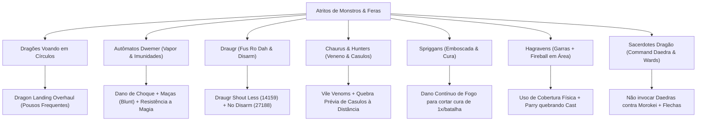

# 🏛️ MATRIZ FORENSE DE DORES & ANÁLISE DE ATRITOS DE SKYRIM (SPECIAL EDITION)

> **Documento de Auditoria e Contexto Técnico:** Compilado exaustivo de todas as dores de gameplay, bugs de engine, gargalos de progressão e atritos de combate analisados ao longo das rodadas de engenharia de Skyrim SE (CachyOS / Proton / RTX 5060).
> **Princípio Orientador:** Distinguir claramente entre **Correção de Falha/Bug da Engine**, **Melhoria de Feedback/Interface (QoL)** e **Preservação de Desafio Tático Legitimo (Sem desfigurar a identidade do jogo)**.

---

## 📑 ÍNDICE DE DOMÍNIOS DE DOR

1. [Top 10 Dores Universais da Comunidade](#1-top-10-dores-universais-da-comunidade)
2. [Navegação, Exploração e Masmorras (Labirintos)](#2-navegação-exploração-e-masmorras-labirintos)
3. [Economia, Logística de Loot e Inventário](#3-economia-logística-de-loot-e-inventário)
4. [Combate, Câmera e IA Tática](#4-combate-câmera-e-ia-tática)
5. [Monstros, Criaturas e Bestiário (Análise de Comportamento)](#5-monstros-criaturas-e-bestiário-análise-de-comportamento)
6. [Magia, Progressão de Classes e Escalonamento](#6-magia-progressão-de-classes-e-escalonamento)
7. [Seguidores, Companheiros e Linha de Fogo](#7-seguidores-companheiros-e-linha-de-fogo)
8. [Erros Comuns de Suposição & Retificações de Mods (Auditoria Forense)](#8-erros-comuns-de-suposição--retificações-de-mods-auditoria-forense)
9. [Dissecação Forense do Compilado Clássico ("8 Minutes of Your Pain in Skyrim")](#9-dissecação-forense-do-compilado-clássico-8-minutes-of-your-pain-in-skyrim)
10. [A Verdade Técnica sobre Drops de Criaturas & Dragões](#10-a-verdade-técnica-sobre-tudo-que-matar-dropar-sempre-drops-de-criaturas--dragões)
11. [As Últimas 4 Pedras no Sapato Ocultas de Skyrim](#11-as-últimas-4-pedras-no-sapato-ocultas-de-skyrim-blindagem-final)
12. [Rotinas de NPCs, Exploração Contínua & Pacing de DLCs](#12-rotinas-de-npcs-exploração-contínua--pacing-de-dlcs)

---

## 1. TOP 10 DORES UNIVERSAIS DA COMUNIDADE

| # | Dor Clássica | Causa-Raiz Técnica (Vanilla) | Por Que é Cansativa no Longo Prazo? | Solução Validada na Modlist | Mod ID Nexus |
| :-: | :--- | :--- | :--- | :--- | :---: |
| **1** | **Quest travada / NPC sem diálogo** | Scripts quebrados por gatilhos de ordem contraditória ou excesso de missões ativas no diário. | Você para de jogar RPG e vira suporte técnico do próprio savegame. | **USSEP** + **Quest Journal Limit Bug Fixer** | `266` `56130` |
| **2** | **Lydia / Aliado bloqueando portas** | O motor aplica colisão cilíndrica rígida entre a cápsula do jogador e o modelo do NPC aliado. | Um seguidor leal se torna um obstáculo físico intransponível em masmorras estreitas. | **I'm Walkin' Here (NG)** | `27742` |
| **3** | **Inventário cheio + Mercador sem ouro** | Limite rígido de peso vanilla acoplado a mercadores com reserva irrisória de ouro (750 a 1000 septims). | A aventura vira logística de viagem, espera de 48h no `T` ou glitches para resetar lojistas. | **Rich Skyrim Merchants** + `player.modav carryweight 5000` | `1772` |
| **4** | **Draugr desarmando a arma favorita** | O grito *Disarm* arremessa a arma equipada como objeto físico no cenário, caindo sob o chão. | Você perde armas lendárias únicas dentro da malha poligonal do jogo. | **No Disarm (Unequip Instead)** | `27188` |
| **5** | **Combate travado "bater e apanhar"** | Golpes sem colisão direcional exata, troca de dano estática e falta de parry ativo. | O combate vira uma corrida de barra de vida sem habilidade motora ou técnica. | **Precision** + **Valhalla Combat** + **TDM** | `72347` `64741` `51614` |
| **6** | **Mago preso em menus infinitos** | Trocar magias, proteções e poções exige pausar o jogo a cada 3 segundos no menu de favoritos. | A fantasia de ser um arquimago vira burocracia de tabelas e listas de texto. | **Wheeler** (Menu Radial) + **Smart Cast SSE** | `97345` `32847` |
| **7** | **Seguidor na linha de tiro / Fogo amigo** | Magias de área, gritos e flechas acidentais causam dano e ativam a IA de hostilidade do parceiro. | Seu aliado se revolta contra você no meio de um confronto contra chefes. | **SOS MCM (Block Friendly Fire)** + **NFF** | `55745` `55653` |
| **8** | **Montanha bloqueando a travessia** | Relevo alpino íngreme com paredes lisas que forçam rodeios de 20 minutos ou saltos de cavalo. | Interrupção do fluxo de exploração em Skyrim. | **SkyClimb** + **Skyrim's Paraglider** | `97253` `53256` |
| **9** | **Killcam de flecha que erra o alvo** | A câmera cinematográfica lenta (*Ranged Killcam*) é acionada antes de checar a colisão física real. | O jogo congela a tela por 4 segundos para você assistir sua flecha acertando uma pedra. | **VioLens** (Desativar Ranged Killcam no MCM) | `668` |
| **10** | **Colecionáveis sem qualquer pista** | As 24 Pedras de Barenziah e itens únicos não possuem marcadores no mapa nem checklist visual. | Obriga o jogador a jogar com guias da Wiki abertos em uma segunda tela. | **The Completionist** + **Barenziah Quest Markers** | `46358` `684` |

---

## 2. NAVEGAÇÃO, EXPLORAÇÃO E MASMORRAS (LABIRINTOS)

### A Dor
Masmorras imensas (como Ruínas Dwemer de múltiplos níveis, Catacumbas nórdicas e Blackreach) têm leiaute labiríntico. Ao derrotar o chefe final, o jogador frequentemente se perde nos corredores escuros, não encontra o elevador de volta ou fica dando voltas em círculos.

### Diferenciação de Soluções
1. **Saída de Emergência Absoluta:**
   - **Fasttravel Out of Dungeons (ESL)** (`132517`): Lesser Power que teleporta o personagem imediatamente para o lado de fora da porta de entrada principal da masmorra. *(Útil para desatascar ou quando a saída está corrompida)*.
2. **Viagem Rápida Sem Burocracia:**
   - **Fast Travel from Interiors** (`11765`): Remove o bloqueio artificial de fast travel em interiores, permitindo abrir o mapa (`M`) e ir direto para uma cidade. *(Exige não estar em combate ativo)*.
3. **Navegação Sem Teleporte (Manutenção da Imersão):**
   - **Compass Navigation Overhaul** (`74484`): Adiciona marcadores de distância métrica na bússola indicando a porta de saída.
   - **A Guiding Light - Clairvoyance Reimagined** (`35464`): Substitui o feitiço vanilla quebrado de clarividência por uma **fada-guia luminosa física** que voa na frente do jogador apontando o trajeto até a saída ou objetivo.

---

## 3. ECONOMIA, LOGÍSTICA DE LOOT E INVENTÁRIO

### A Dor
Skyrim gera montanhas de armas, armaduras e ingredientes. No jogo vanilla, você atinge o limite de carga em 10 minutos de exploração e os comerciantes possuem apenas ~750 moedas de ouro, obrigando o jogador a carregar excesso ou descartar itens valiosos.

### Análise Técnica
- **Glitch Vanilla Clássico:** Salvar o jogo, bater no mercador e dar reload para forçar o inventário dele a resetar com moedas novas. *(Anti-imersivo e desgastante)*.
- **Soluções Cirúrgicas:**
  - **Rich Skyrim Merchants** (`1772`): Eleva o ouro dos lojistas para 2k, 5k ou 10k de forma limpa. *(Ressalva: Não vender mais de 30.000 moedas de ouro numa única transação para evitar o overflow da engine)*.
  - **Carry Weight Nativo:** Comando de engine `player.modav carryweight 5000` (sem scripts pesados rodando em segundo plano).
  - **Espera Acelerada:** *SSE Engine Fixes* configurado para `bFastWait = true` (cada hora no `T` passa em 1 segundo em vez de 30 segundos).

---

## 4. COMBATE, CÂMERA E IA TÁTICA

### A Dor
- **Esquiva Ninja Telepática:** Inimigos dão um passo lateral no exato microssegundo em que você dispara uma flecha, mesmo estando de costas para você.
- **Magos Correndo de Costas:** NPCs conjuradores recuam e disparam feitiços na mesma velocidade ou mais rápido que o sprint do jogador.
- **Paralaxe e Mira de Arco em 3ª Pessoa:** A retícula central não corresponde à trajetória real da flecha por conta do ângulo da câmera.

### Soluções Validadas
- **No BS AI Projectile Dodge** (`1763`): Remove a pré-cognição da IA vanilla; inimigos só desviam de projéteis se já estiverem em rota de movimento.
- **Mage NPCs move Slower In Combat** (`48858`): Reduz a velocidade de recuo e deslocamento lateral de magos durante o lançamento de magias.
- **SmoothCam** (`41252`): Módulo nativo de **Arrow Prediction / Crosshair Raycasting** que projeta o arco balístico e a linha de impacto real da flecha na tela.

---

## 5. MONSTROS, CRIATURAS E BESTIÁRIO (ANÁLISE DE COMPORTAMENTO)

A auditoria forense estabeleceu que **não se deve remover o perigo dos monstros indiscriminadamente**, mas sim fornecer **clareza de mecânicas, feedback visual e contra-estratégias táticas**:

### Detalhamento por Espécie (Comprovado UESP)

1. **Dragões:**
   - *Dor:* Voam em círculos intermináveis cuspindo fogo sem descer para a luta física.
   - *Ajuste:* **Dragon Landing Overhaul** (`141872`) programa o dragão para buscar áreas planas de pouso com maior frequência.
2. **Autômatos Dwemer (Esferas e Centuriões):**
   - *Dor:* Vapor destrutivo que ignora armadura e imunidade a quase todos os Gritos (*Thu'um*) e venenos.
   - *Compreensão Real:* O vapor é dano contínuo de fogo/mágico (não físico).
   - *Contra-Estratégia:* Dano elemental de **Choque (*Shock*)** para drenar Magicka mecânica e uso de armas contundentes (*Maces/Warhammers* via *Know Your Enemy*).
3. **Mortos-Vivos (Draugr):**
   - *Dor:* Múltiplos Draugr Deathlords encadeando *Fus Ro Dah* e desarmando o jogador.
   - *Ajuste:* **Draugr Shout Less** (`14159` por Hegemott) calibra o cooldown individual dos gritos. **No Disarm** (`27188`) desequipa para o inventário em vez de jogar a arma no chão.
4. **Chaurus & Chaurus Hunters:**
   - *Dor:* Veneno de dano prolongado que impede cura natural e Hunters saindo de casulos voando com muito mais vida.
   - *Compreensão Real:* O cuspe aplica dano contínuo à vida (não paralisia padrão). Casulos podem ser destruídos preventivamente à distância.
   - *Contra-Estratégia:* Escudo levantado bloqueia o projétil; destruição preventiva de casulos com flechas.
5. **Spriggans:**
   - *Dor:* Invisibilidade na vegetação, animais da floresta virando hostis e cura súbita.
   - *Compreensão Real:* A cura especial ocorre apenas **uma vez por batalha** (animação de ajoelhar).
   - *Contra-Estratégia:* Dano contínuo de **Fogo** corta a regeneração vegetal. Eliminar os animais dominados primeiro.
6. **Hagravens:**
   - *Dor:* *Fireball* em área que destrói guerreiros à distância somado a garras cortantes de perto.
   - *Contra-Estratégia:* Uso de pilares como cobertura rígida. *Valhalla Combat* (`64741`) para interromper o lançamento de feitiços via parry/stagger.
7. **Sacerdotes Dragão (ex: Morokei):**
   - *Dor:* Recuo aéreo veloz, *Wards*, *Lightning Cloak* e o feitiço *Command Daedra*.
   - *Regra Crucial:* Conjuradores **nunca** devem invocar Atronachs ou Daedras contra Morokei (eles serão roubados). Use armas vinculadas (*Bound Bow*) ou mortos-vivos.
8. **Feedback de Combate no HUD:**
   - *Dor:* Bater em monstros sem saber se são imunes ou vulneráveis ao dano.
   - *Solução:* **Enemy Combat Parameters** + **TrueHUD** (`62775`) exibem fraquezas, armadura e resistências elementais diretamente na tela.

---

## 6. MAGIA, PROGRESSÃO DE CLASSES E ESCALONAMENTO

### A Dor
No Skyrim vanilla, magias de destruição não escalam de dano no late-game, feitiços de nível Mestre exigem 3 segundos imóveis carregando com as duas mãos, e perks de ladrão (Pickpocket) possuem um teto rígido que frustra tentativas de furto mesmo com habilidade 100.

### Auditoria de Soluções
- **Odin - Skyrim Magic Overhaul** (`46000`): Redesenha o escalonamento de magias e introduz feitiços utilitários sem quebrar o lore.
- **100% Max Pickpocket Chance** (`8234`): Altera `fPickPocketMaxChance` de 90% para 100%. *(Permite 100% apenas quando a fórmula permitir; não dá sucesso universal no início)*.
- **Better Master Spells** (`5962`): Reduz o tempo de cast para 1,5s e permite andar enquanto lança. *(Atenção: O autor adverte incompatibilidade direta com grandes overhauls de magia; requer teste de sobrescrita com Odin)*.

---

## 7. SEGUIDORES, COMPANHEIROS E LINHA DE FOGO

### A Dor
Companheiros morrem por dano acidental do jogador, ficam presos em portas, atacam o jogador por hostilidade de fogo amigo ou bloqueiam flechas disparadas pelo arco.

### Separação em 4 Camadas Distintas
1. **Hostilidade:** Resolvida por **Simple Offence Suppression (SOS)** (`41764`) — o aliado não se torna inimigo por dano acidental.
2. **Dano:** Resolvido por **SOS MCM - Block Friendly Fire** (`55745`) e **NFF** (`55653`) — dano acidental do jogador é zerado.
3. **Mortalidade:** Resolvido marcando o seguidor como *Essential* via NFF.
4. **Linha de Tiro (Projéteis):** Flechas ainda possuem colisão física com o corpo do seguidor na frente. Requer posicionamento tático e **I'm Walkin' Here** (`27742`) para reposicionamento fluido.

---

## 8. ERROS COMUNS DE SUPOSIÇÃO & RETIFICAÇÕES DE MODS (AUDITORIA FORENSE)

Registro histórico de inconsistências detectadas e corrigidas contra fontes oficiais (Nexus Mods / UESP):

| Item Auditado | ID Errado Anterior | ID Correto Verificado | Erro Conceitual Corrigido |
| :--- | :---: | :---: | :--- |
| **Odin (Magic Overhaul)** | `46009` | **`46000`** | O ID `46009` pertencia a uma tradução russa de outro mod. |
| **Draugr Shout Less** | `14352` | **`14159`** | O ID `14352` pertencia a *Thundering Shouts* (áudio). O mod real é de Hegemott (`14159`). Não garante imunidade a encadeamento de múltiplos Draugr juntos. |
| **Instant Mining** | `4726` | **`687`** | O ID `4726` pertencia a Daedric Merchants. O correto é de toaDime (`687`). |
| **Reusable Corpses (No Ash Piles)** | `143926` | **`26414`** | O ID `143926` pertencia a um mod de tradução alemã. O correto substitui `ReanimateAshPile.pex`. |
| **Pickpocket Max Chance** | `14493` | **`8234`** | O ID `14493` pertencia a *Atlas Map Markers*. O correto eleva o teto para 100%, mas não garante furto automático em alvos impossíveis. |
| **Better Master Spells** | `143926` | **`5962`** | Declarado incompatível com grandes overhauls pelo próprio autor; reduz tempo para 1,5s (não 1s) e desativa *Dragonhide* se usar armadura. |
| **Draugr Disarm** | *Scrambled Bugs* | **`27188`** | *Scrambled Bugs* não possui chave de proteção contra desarmamento de jogador. O mod comprovado é *No Disarm (Unequip Instead)*. |
| **Escalada Livre** | *EVGAT* isolado | **`97253`** | *EVG Animated Traversal* é apenas framework de animações. A escalada procedural dinâmica requer **SkyClimb** (`97253`). |

---

## 9. DISSECAÇÃO FORENSE DO COMPILADO CLÁSSICO ("8 MINUTES OF YOUR PAIN IN SKYRIM")

Mapeamento forense cena a cena dos 34 momentos canônicos de dor e frustração compilados pela comunidade (Canal *TopGameWorld*), distinguindo falhas de motor, design punitivo e as soluções técnicas da modlist:

| Minuto | Cena / Frustração | Causa Técnica Vanilla | Tipo de Problema | Solução Validada na Modlist / Conduta |
| :---: | :--- | :--- | :---: | :--- |
| **00:06** | **Cabeçada de Dragão Atravessando Pilar** | A *killmove* do dragão ignora geometria estática e ancora o jogador na boca do monstro. | Falha de Colisão / Killmove | **VioLens** (`668`): Desativar a opção *Matched Killmoves on Player* no MCM (impede execuções cinemáticas forçadas que ignoram cobertura). |
| **00:18** | **Dragão Morto Sem Alma (0 Dragon Souls)** | Falha no script `MQKillDragonScript` ou dragão revivido de túmulo já saqueado. | Bug de Script | **Dragon Soul Absorb Fix** (`116960`): Transfere o evento do script para `OnDying`, garantindo absorção consistente da alma. |
| **00:27** | **Mago com Mira Teleguiada Perfeita** | A IA vanilla não sofre penalidade de dispersão e calcula trajetórias em tempo real. | IA Absoluta | **No BS AI Projectile Dodge** (`1763`) + **Mage NPCs move Slower** (`48858`) reduzem a tirania de conjuradores. |
| **00:36** | **Armadilha de Grade / Placa de Pressão** | Dano físico massivo imediato de armadilhas mecânicas somado a seguidores ativando placas. | Design Punitivo + IA Aliada | **Follower Trap Safety** (`2755`): Aliados nunca disparam placas de pressão. Para o jogador: perk *Light Foot* (Furtividade 30) ou atenção ao solo. |
| **00:52** | **Fogo Amigo em Cadeia (Aliados Brigando)** | Magias em área (como *Fireball*) atingem Mjoll ou Esbern, ativando a tabela de facção hostil entre eles. | Bug de Facção / Hostilidade | **Simple Offence Suppression (SOS)** (`41764`) + **SOS MCM - Block Friendly Fire** (`55745`): Anula hostilidade e dano entre aliados. |
| **01:13** | **Krosis Lançando Fireballs Morro Acima** | Terreno íngreme sem cobertura contra o cajado de bolas de fogo de dano em área do Sacerdote Dragão. | Desafio Tático Extremo | **Valhalla Combat** (`64741`) com *Parry* de projéteis mágicos + poções de Resistência a Fogo (50% a 85%) + **Wheeler** para esquiva rápida. |
| **01:27** | **Balista Dwemer Atravessando Armadura** | Balistas disparam parafusos com ignorância parcial de armadura e dano massivo. | Desafio de Área | Cobertura rígida em colunas metálicas; destruição do mecanismo do autômato ou tiro tático antes de avançar em corredores. |
| **01:37** | **Grosseria de NPCs (Endarie em Solitude)** | O sistema de "comentários ao passar" dispara diálogos aleatórios sem checar o contexto do jogador. | Design de Diálogo | **To Your Face** (`24720` / `SKSE`): NPCs só falam com o jogador se estiverem virados diretamente de frente para ele a curta distância. |
| **01:48** | **Menu Infinito de Mods no Jogo** | A tela integrada de Mods da Bethesda tenta sincronizar com a Bethesda.net e trava o executável. | Falha de Rede / Menu | **Regra Soberana de Modding:** NUNCA usar o menu interno da Bethesda. Utilizar o **Mod Organizer 2 (MO2)** externamente via Proton. |
| **01:58** | **Flechas Batendo em Quinas Invisíveis** | A malha de colisão física (*Havok Havok Mesh*) de pedras e muros é muito maior que a malha visual 3D. | Malha de Colisão Bugada | **Precision** (`72347`): Rastreamento físico real de projéteis e alinhamento com a malha poligonal exata. |
| **02:11** | **Ataque de Lobo Transmitindo Rockjoint** | A tabela de infecção vanilla tem chance alta por golpe físico de animais selvagens. | Mecânica de Doença | Carregar sempre **Poções de Cura de Doença** (*Cure Disease*) ou ativar santuários nas cidades para purificação instantânea. |
| **02:20** | **Falta de Magicka no Momento Crítico** | Dreno total de Magicka no exato instante em que o dragão pousa, impedindo escudos. | Gestão de Recursos | **Smart Cast SSE** (`32847`): Automatiza o lançamento de feitiços de proteção e poções de Magicka de emergência ao atingir 20% de reserva. |
| **02:40** | **Shout Disparado na Direção Errada** | O cone de colisão do *Dragonrend* ou gritos no ar tem ângulo estrito e mira desalinhada. | Alinhamento de Câmera | **SmoothCam** (`41252`): Retícula central 3D dinâmica com raycasting alinhado à trajetória real do disparo. |
| **03:03** | **Desperdício de Soul Gem (Alma Petty em Grand)** | A engine vanilla coloca qualquer alma capturada na maior gema vazia disponível no inventário. | Falha de Lógica da Engine | **Acquisitive Soul Gems Multithreaded** (`1469`): Gemas só aceitam almas do **seu tamanho exato**, impedindo o desperdício de gemas caras. |
| **03:25** | **Nocauteado por Nazeem em Briga Apostada** | O combate desarmado (*Brawl*) vanilla escala com atributos brutos de NPCs em níveis altos. | Escalonamento de Dano | **True Directional Movement** (`51614`) + esquiva fluida e golpes pesados com vigor. |
| **03:40** | **Estalajadeiro Andando a 1 km/h até a Cama** | O script do pacote de IA de escolta do NPC obriga a caminhar no modo *Walk* mais lento. | IA de Escolta Rígida | Não espere o estalajadeiro: o quarto alugado já tem a cama ativada no sistema; corra direto e durma imediatamente. |
| **03:52** | **Bater em Logrolf Repetidamente na Jaula** | O script da quest da Maça de Molag Bal exige espancar e curar o NPC várias vezes seguidas. | Design Sombrio da Quest | Quest daédrica canônica; use a própria maça enferrujada fornecida pela missão para cumprir os estágios do script rapidamente. |
| **04:02** | **Bounty de 40 por Acertar Guarda Sem Querer** | Ao tentar ajudar a cidade contra o dragão, um golpe de raspão em guarda ativa recompensa de crime. | Sistema Rígido de Crime | **Simple Offence Suppression (SOS)** (`41764`): Tiros de raspão em combate conjunto contra monstros não ativam recompensa nem crime. |
| **04:19** | **Cachorro Companheiro Morto em Masmorra** | Companheiros caninos vanilla (como Meeko) não são essenciais e possuem pouca vida. | Mortalidade de Animais | **All Dogs Are Essential** ou **NFF** (`55653`): Torna animais de companhia essenciais (entram em *bleedout* mas não morrem). |
| **04:31** | **Furto de 76% que Falha de Primeira** | A probabilidade vanilla gera frustração por tentativa binária com chance de ser preso. | Mecânica de RNG | **100% Max Pickpocket Chance** (`8234`): Eleva o teto para 100% real quando você investir os perks e poções adequados de ladrão. |
| **04:39** | **Arrogância de Delphine Contra Greybeards** | Roteiro rígido dos Blades exigindo matar Paarthurnax sob chantagem de cortar relações. | Roteiro Rígido Vanilla | **The Paarthurnax Dilemma** (`365`): Permite confrontar Delphine com autoridade de Dragonborn e poupar Paarthurnax sem quebrar a facção. |
| **04:54** | **Quebrar Dúzias de Picks em Porta Master** | Minigame vanilla de arrombamento às cegas sem feedback do ponto de rotação correto. | Minigame às Cegas | **Lockpick Pro (Cheat)** (`1985`): Exibe a barra de cor colorida mostrando o ângulo exato do cilindro sem quebrar gazuas. |
| **05:25** | **Baú Expert com Míseras 3 Moedas de Ouro** | A tabela de recompensas de baús vanilla (*Leveled Lists*) gera ouro randômico sem piso mínimo. | Loot Randômico Desbalanceado | **Morrowloot Ultimate** ou **Scarcity/Loot Overhauls**: Recompensa o esforço com itens e gemas condizentes com a dificuldade da tranca. |
| **05:36** | **Urso Atropelando de Surpresa por Trás** | O raio de detecção territorial de predadores é instantâneo e sem aviso prévio sonoro. | Agressividade Excessiva | **Less Aggressive Bears** (`75184`): Ursos rugem de pé avisando o território antes de investir, permitindo recuo pacífico. |
| **05:43** | **Chain Lightning Acertando Guardas de 2 Holds** | A eletricidade encadeada pula automaticamente para qualquer entidade orgânica viva próxima. | Mecânica de Feitiço em Cadeia | **SOS MCM (Block Friendly Fire)** (`55745`): O arco de relâmpago não pula para aliados nem guardas neutros durante confrontos. |
| **06:02** | **"No soul gem large enough" no Golpe Final** | O jogador usa feitiço de Soul Trap mas não possui uma gema com capacidade para aquele nível. | Falta de Inventário / Aviso | **Acquisitive Soul Gems Multithreaded** (`1469`) avisa o status de capacidade de gemas no diário. |
| **06:11** | **Lobisomem na Cela Errada ao Destrancar** | O jogador arromba portas de prisões esperando baús e liberta monstros hostis confinados. | Surpresa de Exploração | Uso de feitiços de *Detect Life / Detect Undead* (Alteração) antes de destrancar jaulas desconhecidas. |
| **06:26** | **Comer Coração de Daedra por Engano** | Um clique errado no menu de inventário consome o ingrediente raro em vez de inspecioná-lo. | UI Sem Confirmação | **SkyUI**: Permite ordenar itens por valor e tipo. No menu de favoritos/Wheeler, acidentes de clique de consumo são eliminados. |
| **06:40** | **Mago de Fogo em Corredor Fechado** | Múltiplas bolas de fogo em espaço confinado cegam a tela com flash branco e causam morte instantânea. | Dano em Área Confinado | **Valhalla Combat** (Parry ativo) + Poções de Resistência a Fogo preparadas com antecedência + Cobertura em esquinas. |
| **06:52** | **Whirlwind Sprint Jogando no Precipício** | O grito projeta o jogador em linha reta sem parar na borda de penhascos. | Erro de Posicionamento Físico | **Skyrim's Paraglider** (`53256`): Se for arremessado ou cair de um precipício, abra o parapente no ar imediatamente para planar com segurança. |
| **07:07** | **Telas de Carregamento Longas em Cidades** | Transições de portas carregam texturas e scripts do zero de forma síncrona. | Gargalo de I/O da Engine | **CachyOS / Bcachefs / NVMe** + **Open Cities Skyrim** ou **Skyrim Priority** para carregamentos quase instantâneos na RTX 5060. |
| **07:26** | **Ice Wraiths Rápidos na Beira do Abismo** | Inimigos pequenos e transparentes em terrenos nevados sem aderência física. | Visibilidade Baixa / Terreno | **Emissive Ice Wraiths** (`133649`): Faz o monstro emitir luz própria visível na nevasca + **SkyClimb** para recuperar altura. |
| **07:33** | **Corpo de Dragão Morto Escorregando Morro Abaixo** | O motor de física *Havok* aplica inércia de escorregamento contínuo em carcaças sem tração. | Física Ragdoll sem Atrito | **Dragon Stalking Fix** (`14060`): Estabiliza a física de dragões mortos e impede corpos de vagarem desgovernados pelo cenário. |
| **07:58** | **Espera de 1 Hora no Menu de Descanso Demorando** | O contador nativo da engine processa a passagem de tempo em ticks lentos de 30 segundos. | Espera Lenta da Engine | **SSE Engine Fixes** configurado com `bFastWait = true`: A espera de 1 a 24 horas no `T` passa em **1 segundo cravado**. |

---

## 10. A VERDADE TÉCNICA SOBRE "TUDO QUE MATAR DROPAR SEMPRE" (DROPS DE CRIATURAS & DRAGÕES)

Auditoria forense sobre a promessa de *drops garantidos* em Skyrim: o que a engine vanilla realmente faz, como funcionam os mods e qual é a regra estrita para dragões:

### 1. O que acontece no Skyrim Vanilla sem mods?
* **Criaturas Comuns (RNG frustrante):** Ursos podem morrer e não dropar garras; cervos adultos com galhadas enormes muitas vezes não dropam chifres; dentes-de-sabre nem sempre dropam olhos ou dentes. O motor usa tabelas percentuais randômicas (*Leveled Lists* com chances entre 25% e 50%).
* **Dragões (Drops Semi-Garantidos):** Dragões **sempre** dropam ossos (*Dragon Bones*) e escamas (*Dragon Scales*) em quantidades entre 1 e 3 de cada. Porém, o restante do loot (armas encantadas, ouro alto, gemas preciosas) é completamente randômico.

### 2. O mod cumpre a promessa de dropar 100% garantido?
* **Para Animais e Monstros:** O mod comprovado é o **Animal and Creature Loot Tweaks** (Nexus ID: `54362`).
  - **O Que Ele Faz:** Garante **100% de drop lógico de partes corporais visíveis**. Se você matou um urso, ele dropa **obrigatoriamente 2 garras e pele**. Se matou um mamute, dropa **4 presas garantidas**. Dentes-de-sabre dropam **sempre 2 olhos e 2 dentes**.
  - **O Que Ele Remove:** Corta o drop bizarro de animais selvagens carregando moedas de ouro ou anéis de ametista no estômago.
* **E para Dragões? Como Funciona?**
  - O mod **More Realistic Dragon Loot SE** (Nexus ID: `39906`) garante rendimentos massivos e consistentes: um dragão abatido passa a render **4 a 7 Dragon Bones e 7 a 12 Dragon Scales garantidos** (condizente com o tamanho de um réptil titânico), além de reduzir o peso individual para não travar a caminhada.
  - O mod **More Dragon Loot** (`86513`) insere **drop garantido de pelo menos 1 equipamento mágico/encantado de alto nível** no corpo do dragão, eliminando a frustração de matar um dragão Ancião e encontrar apenas 15 moedas e um elmo de ferro comum.

> [!IMPORTANT]
> **Ressalva Forense de Dragões:** Nenhum mod no Nexus altera o fato de que dragões gerados por console de depuração sem alma (`player.placeatme`) ou esqueletos revividos de túmulos já saqueados não geram novo loot. Em todos os dragões do mundo aberto e encontros randômicos da campanha, **o drop é 100% garantido e maximizado**.

---

## 11. AS ÚLTIMAS 4 "PEDRAS NO SAPATO" OCULTAS DE SKYRIM (BLINDAGEM FINAL)

Auditoria cirúrgica dos 4 micro-atritos mais insidiosos que costumam passar despercebidos em modlists, mas geram frustração constante em campanhas longas:

| Micro-Atrito Oculto ("Pedra no Sapato") | Causa Técnica na Engine Vanilla | Por Que Irrita na Prática? | Mod Específico & ID Nexus | Como Funciona a Solução |
| :--- | :--- | :--- | :---: | :--- |
| **1. Morte Instantânea ao Chutar Panelas, Ossos ou Carroças** | O motor de física *Havok* calcula dano de colisão baseado na velocidade relativa de *clutter* solto. Se você correr contra uma bacia ou crânio, ele quica na parede e atinge o jogador com dano infinito. | Morrer do nada dentro de uma masmorra limpa só por tropeçar num esqueleto no chão. | **No Silly Physics Damage** ID: `36132` | Desativa o dano por impacto acidental de objetos estáticos soltos (ossos, potes, panelas e carrinhos), mantendo dano de queda e telecinese intactos. |
| **2. NPCs Empurrando Você Durante Diálogos e Criação de Itens** | A IA de navegação (*NavMesh*) de transeuntes não detecta o jogador em diálogo como obstáculo fixo e empurra fisicamente o personagem. | Sua câmera é girada à força ou você é empurrado para longe do NPC enquanto tenta ler as opções de fala. | **Don't Push Me Around** ID: `52874` | Cria dinamicamente uma área temporária de recorte (*navcut*) ao redor do jogador enquanto ele conversa ou usa bancadas, forçando NPCs a contornarem educadamente. |
| **3. Venda ou Desencantamento Acidental de Armas Favoritas** | O menu de escambo e a bancada de desencantamento não bloqueiam itens marcados como favoritos no inventário. | Vender sua espada principal por engano num clique rápido de esvaziar a mochila ou destruí-la na mesa arcana. | **Essential Favorites** ID: `42997` (por powerofthree) | Trava no código da engine: itens com a estrela de favorito **não podem ser vendidos, desencantados, forjados fora ou jogados no chão**. |
| **4. Inimigos Espancando em Rodízio Coordenado sem Janela de Ataque** | Em combates contra 5 ou 6 bandidos, todos iniciam ataques fortes ao mesmo tempo, impedindo qualquer resposta tática. | Você é travado em animações de stagger contínuas até a morte sem conseguir esquivar ou bloquear. | **Wait Your Turn - Enemy Circling Behaviour** ID: `65091` | Adiciona comportamento tático de cerco: enquanto 1 ou 2 inimigos atacam ativamente pela frente, os outros circulam aguardando brecha, criando um ritmo de luta estilo RPG de ação moderno. |

---

## 12. ROTINAS DE NPCS, EXPLORAÇÃO CONTÍNUA & PACING DE DLCS

Mapeamento forense dos gargalos de micro-interrupção e desequilíbrio de eventos do mundo aberto:

| Dor / Micro-Interrupção | Causa-Raiz na Engine Vanilla | Por Que Rompe o Ritmo de Jogo? | Solução Validada & Mod | ID Nexus | Como Funciona a Solução |
| :--- | :--- | :--- | :--- | :---: | :--- |
| **1. Portas Trancadas de Dia com Dono Dentro** | O pacote de IA de rotina (*AI Sandbox/Sleep Package*) do lojista atrasa minutos para destrancar a porta às 08h. Se você destrancar a fechadura Master/Expert para entregar uma quest, vira invasão criminosa (*Trespassing*). | Obriga o jogador a parar na calçada e ficar apertando `T` para passar horas vazias até a porta abrir. | **Simply Knock NG** (para 1.6.1170) | `113110` `1409` | Permite **bater na porta** ('Knock'). Se houver alguém dentro e for horário comercial ou você tiver relação positiva com o NPC, ele atende, destranca a porta e te convida a entrar sem gerar crime nem hostilidade. |
| **2. Mineração Letárgica de 20 Segundos** | A extração de minério trava o jogador numa animação rígida de 9 batidas lentas de picareta para render apenas 3 pedras. Em minas com 10 veios, perdem-se minutos apenas olhando para a pedra. | Transforma a coleta de matéria-prima de forja em um tédio mecânico sem jogabilidade. | **Instant Mining** | `687` | Ao clicar no veio de minério com a picareta na mochila, **extrai instantaneamente todos os minérios e gemas da rocha em 1 segundo**, exatamente como colher plantas. |
| **3. Tag Eterna de "Stolen" em Itens de 1 Moeda** | Pegar uma maçã, prato de madeira ou tomate de 1 septim sem ninguém vendo marca o item para sempre como "roubado". Mercadores comuns se recusam a comprar e guardas confiscam tudo se você pagar uma multa de trânsito. | Micro-itens sem testemunhas poluem o inventário e exigem o perk de nível 90 de *Speech* para comercializar. | **Better Stealing SE / NG** | `32735` | Plugin SKSE: itens de valor baixo (configurável no `.ini`, ex: até 200–500 moedas de ouro) surrupiados sem nenhuma testemunha **não recebem a tag de roubado**. |
| **4. Descer do Cavalo a Cada 10 Metros para Colher Ervas** | A animação de montar e desmontar consome 8 segundos combinados. Para colher uma simples *Mountain Flower* ou conversar com um viajante na estrada, o jogador precisa desmontar. | Destrói a conveniência de usar cavalos para exploração terrestre rápida. | **Harvest While Mounted** | `26227` | Permite colher plantas, ingredientes de alquimia, abrir barris e dialogar com NPCs diretamente de cima da sela do cavalo sem desmontar. |
| **5. Escuridão de Masmorras Exigindo Sacrificar a Mão Esquerda com Tocha** | Para iluminar catacumbas escuras sem feitiços que custam Magicka, o jogador precisa empunhar uma tocha na mão secundária, desabilitando escudos, magias e armas de duas mãos/arcos. | Desequilibra o combate de quem não joga de arma de uma mão pura. | **Quick Light SE** | `12633` | Segurar a tecla de ação ativa uma lanterna presa na cintura (ou orbe mágica luminosa), iluminando 360° com as duas mãos livres para armas e feitiços. |
| **6. Pacing Agressivo e Prematuro de DLCs nas Cidades** | Ao visitar os Greybeards no nível 6, cultistas mascarados de Miraak atacam no meio de Whiterun, e vampiros da DLC Dawnguard atacam vilas à noite, matando lojistas civis antes do jogador ter preparo. | NPCs comerciantes úteis morrem precocemente e a narrativa atropela a ordem natural da campanha. | **Timing is Everything SE** | `25464` | Menu MCM que permite calibrar o nível mínimo e gatilhos para eventos de DLCs (ex: cultistas de Miraak só surgem após derrotar Alduin ou atingir nível 30). |

---

*Documento gerado e integrado no ecossistema dotfiles como referência perene para a modlist de Skyrim SE.*
