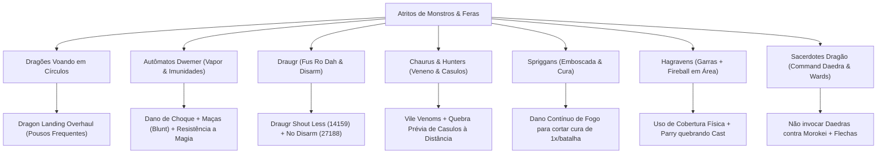

# 🏛️ MATRIZ FORENSE DE DORES & ANÁLISE DE ATRITOS DE SKYRIM (SPECIAL EDITION)

> **Documento de Auditoria e Contexto Técnico:** Compilado exaustivo de todas as dores de gameplay, bugs de engine, gargalos de progressão e atritos de combate analisados ao longo das rodadas de engenharia de Skyrim SE (CachyOS / Proton / RTX 5060).
> **Princípio Orientador:** Distinguir claramente entre **Correção de Falha/Bug da Engine**, **Melhoria de Feedback/Interface (QoL)** e **Preservação de Desafio Tático Legitimo (Sem desfigurar a identidade do jogo)**.

---

## 📑 ÍNDICE DE DOMÍNIOS DE DOR

1. [Top 10 Dores Universais da Comunidade](#1-top-10-dores-universais-da-comunidade)
2. [Navegação, Exploração e Masmorras (Labirintos)](#2-navegação-exploração-e-masmorras-labirintos)
3. [Economia, Logística de Loot e Inventário](#3-economia-logística-de-loot-e-inventário)
4. [Combate, Câmera e IA Tática](#4-combate-câmera-e-ia-tática)
5. [Monstros, Criaturas e Bestiário (Análise de Comportamento)](#5-monstros-criaturas-e-bestiário-análise-de-comportamento)
6. [Magia, Progressão de Classes e Escalonamento](#6-magia-progressão-de-classes-e-escalonamento)
7. [Seguidores, Companheiros e Linha de Fogo](#7-seguidores-companheiros-e-linha-de-fogo)
8. [Erros Comuns de Suposição & Retificações de Mods (Auditoria Forense)](#8-erros-comuns-de-suposição--retificações-de-mods-auditoria-forense)

---

## 1. TOP 10 DORES UNIVERSAIS DA COMUNIDADE

| # | Dor Clássica | Causa-Raiz Técnica (Vanilla) | Por Que é Cansativa no Longo Prazo? | Solução Validada na Modlist | Mod ID Nexus |
| :-: | :--- | :--- | :--- | :--- | :---: |
| **1** | **Quest travada / NPC sem diálogo** | Scripts quebrados por gatilhos de ordem contraditória ou excesso de missões ativas no diário. | Você para de jogar RPG e vira suporte técnico do próprio savegame. | **USSEP** + **Quest Journal Limit Bug Fixer** | `266` `56130` |
| **2** | **Lydia / Aliado bloqueando portas** | O motor aplica colisão cilíndrica rígida entre a cápsula do jogador e o modelo do NPC aliado. | Um seguidor leal se torna um obstáculo físico intransponível em masmorras estreitas. | **I'm Walkin' Here (NG)** | `27742` |
| **3** | **Inventário cheio + Mercador sem ouro** | Limite rígido de peso vanilla acoplado a mercadores com reserva irrisória de ouro (750 a 1000 septims). | A aventura vira logística de viagem, espera de 48h no `T` ou glitches para resetar lojistas. | **Rich Skyrim Merchants** + `player.modav carryweight 5000` | `1772` |
| **4** | **Draugr desarmando a arma favorita** | O grito *Disarm* arremessa a arma equipada como objeto físico no cenário, caindo sob o chão. | Você perde armas lendárias únicas dentro da malha poligonal do jogo. | **No Disarm (Unequip Instead)** | `27188` |
| **5** | **Combate travado "bater e apanhar"** | Golpes sem colisão direcional exata, troca de dano estática e falta de parry ativo. | O combate vira uma corrida de barra de vida sem habilidade motora ou técnica. | **Precision** + **Valhalla Combat** + **TDM** | `72347` `64741` `51614` |
| **6** | **Mago preso em menus infinitos** | Trocar magias, proteções e poções exige pausar o jogo a cada 3 segundos no menu de favoritos. | A fantasia de ser um arquimago vira burocracia de tabelas e listas de texto. | **Wheeler** (Menu Radial) + **Smart Cast SSE** | `97345` `32847` |
| **7** | **Seguidor na linha de tiro / Fogo amigo** | Magias de área, gritos e flechas acidentais causam dano e ativam a IA de hostilidade do parceiro. | Seu aliado se revolta contra você no meio de um confronto contra chefes. | **SOS MCM (Block Friendly Fire)** + **NFF** | `55745` `55653` |
| **8** | **Montanha bloqueando a travessia** | Relevo alpino íngreme com paredes lisas que forçam rodeios de 20 minutos ou saltos de cavalo. | Interrupção do fluxo de exploração em Skyrim. | **SkyClimb** + **Skyrim's Paraglider** | `97253` `53256` |
| **9** | **Killcam de flecha que erra o alvo** | A câmera cinematográfica lenta (*Ranged Killcam*) é acionada antes de checar a colisão física real. | O jogo congela a tela por 4 segundos para você assistir sua flecha acertando uma pedra. | **VioLens** (Desativar Ranged Killcam no MCM) | `668` |
| **10** | **Colecionáveis sem qualquer pista** | As 24 Pedras de Barenziah e itens únicos não possuem marcadores no mapa nem checklist visual. | Obriga o jogador a jogar com guias da Wiki abertos em uma segunda tela. | **The Completionist** + **Barenziah Quest Markers** | `46358` `684` |

---

## 2. NAVEGAÇÃO, EXPLORAÇÃO E MASMORRAS (LABIRINTOS)

### A Dor
Masmorras imensas (como Ruínas Dwemer de múltiplos níveis, Catacumbas nórdicas e Blackreach) têm leiaute labiríntico. Ao derrotar o chefe final, o jogador frequentemente se perde nos corredores escuros, não encontra o elevador de volta ou fica dando voltas em círculos.

### Diferenciação de Soluções
1. **Saída de Emergência Absoluta:**
   - **Fasttravel Out of Dungeons (ESL)** (`132517`): Lesser Power que teleporta o personagem imediatamente para o lado de fora da porta de entrada principal da masmorra. *(Útil para desatascar ou quando a saída está corrompida)*.
2. **Viagem Rápida Sem Burocracia:**
   - **Fast Travel from Interiors** (`11765`): Remove o bloqueio artificial de fast travel em interiores, permitindo abrir o mapa (`M`) e ir direto para uma cidade. *(Exige não estar em combate ativo)*.
3. **Navegação Sem Teleporte (Manutenção da Imersão):**
   - **Compass Navigation Overhaul** (`74484`): Adiciona marcadores de distância métrica na bússola indicando a porta de saída.
   - **A Guiding Light - Clairvoyance Reimagined** (`35464`): Substitui o feitiço vanilla quebrado de clarividência por uma **fada-guia luminosa física** que voa na frente do jogador apontando o trajeto até a saída ou objetivo.

---

## 3. ECONOMIA, LOGÍSTICA DE LOOT E INVENTÁRIO

### A Dor
Skyrim gera montanhas de armas, armaduras e ingredientes. No jogo vanilla, você atinge o limite de carga em 10 minutos de exploração e os comerciantes possuem apenas ~750 moedas de ouro, obrigando o jogador a carregar excesso ou descartar itens valiosos.

### Análise Técnica
- **Glitch Vanilla Clássico:** Salvar o jogo, bater no mercador e dar reload para forçar o inventário dele a resetar com moedas novas. *(Anti-imersivo e desgastante)*.
- **Soluções Cirúrgicas:**
  - **Rich Skyrim Merchants** (`1772`): Eleva o ouro dos lojistas para 2k, 5k ou 10k de forma limpa. *(Ressalva: Não vender mais de 30.000 moedas de ouro numa única transação para evitar o overflow da engine)*.
  - **Carry Weight Nativo:** Comando de engine `player.modav carryweight 5000` (sem scripts pesados rodando em segundo plano).
  - **Espera Acelerada:** *SSE Engine Fixes* configurado para `bFastWait = true` (cada hora no `T` passa em 1 segundo em vez de 30 segundos).

---

## 4. COMBATE, CÂMERA E IA TÁTICA

### A Dor
- **Esquiva Ninja Telepática:** Inimigos dão um passo lateral no exato microssegundo em que você dispara uma flecha, mesmo estando de costas para você.
- **Magos Correndo de Costas:** NPCs conjuradores recuam e disparam feitiços na mesma velocidade ou mais rápido que o sprint do jogador.
- **Paralaxe e Mira de Arco em 3ª Pessoa:** A retícula central não corresponde à trajetória real da flecha por conta do ângulo da câmera.

### Soluções Validadas
- **No BS AI Projectile Dodge** (`1763`): Remove a pré-cognição da IA vanilla; inimigos só desviam de projéteis se já estiverem em rota de movimento.
- **Mage NPCs move Slower In Combat** (`48858`): Reduz a velocidade de recuo e deslocamento lateral de magos durante o lançamento de magias.
- **SmoothCam** (`41252`): Módulo nativo de **Arrow Prediction / Crosshair Raycasting** que projeta o arco balístico e a linha de impacto real da flecha na tela.

---

## 5. MONSTROS, CRIATURAS E BESTIÁRIO (ANÁLISE DE COMPORTAMENTO)

A auditoria forense estabeleceu que **não se deve remover o perigo dos monstros indiscriminadamente**, mas sim fornecer **clareza de mecânicas, feedback visual e contra-estratégias táticas**:

### Detalhamento por Espécie (Comprovado UESP)

1. **Dragões:**
   - *Dor:* Voam em círculos intermináveis cuspindo fogo sem descer para a luta física.
   - *Ajuste:* **Dragon Landing Overhaul** (`141872`) programa o dragão para buscar áreas planas de pouso com maior frequência.
2. **Autômatos Dwemer (Esferas e Centuriões):**
   - *Dor:* Vapor destrutivo que ignora armadura e imunidade a quase todos os Gritos (*Thu'um*) e venenos.
   - *Compreensão Real:* O vapor é dano contínuo de fogo/mágico (não físico).
   - *Contra-Estratégia:* Dano elemental de **Choque (*Shock*)** para drenar Magicka mecânica e uso de armas contundentes (*Maces/Warhammers* via *Know Your Enemy*).
3. **Mortos-Vivos (Draugr):**
   - *Dor:* Múltiplos Draugr Deathlords encadeando *Fus Ro Dah* e desarmando o jogador.
   - *Ajuste:* **Draugr Shout Less** (`14159` por Hegemott) calibra o cooldown individual dos gritos. **No Disarm** (`27188`) desequipa para o inventário em vez de jogar a arma no chão.
4. **Chaurus & Chaurus Hunters:**
   - *Dor:* Veneno de dano prolongado que impede cura natural e Hunters saindo de casulos voando com muito mais vida.
   - *Compreensão Real:* O cuspe aplica dano contínuo à vida (não paralisia padrão). Casulos podem ser destruídos preventivamente à distância.
   - *Contra-Estratégia:* Escudo levantado bloqueia o projétil; destruição preventiva de casulos com flechas.
5. **Spriggans:**
   - *Dor:* Invisibilidade na vegetação, animais da floresta virando hostis e cura súbita.
   - *Compreensão Real:* A cura especial ocorre apenas **uma vez por batalha** (animação de ajoelhar).
   - *Contra-Estratégia:* Dano contínuo de **Fogo** corta a regeneração vegetal. Eliminar os animais dominados primeiro.
6. **Hagravens:**
   - *Dor:* *Fireball* em área que destrói guerreiros à distância somado a garras cortantes de perto.
   - *Contra-Estratégia:* Uso de pilares como cobertura rígida. *Valhalla Combat* (`64741`) para interromper o lançamento de feitiços via parry/stagger.
7. **Sacerdotes Dragão (ex: Morokei):**
   - *Dor:* Recuo aéreo veloz, *Wards*, *Lightning Cloak* e o feitiço *Command Daedra*.
   - *Regra Crucial:* Conjuradores **nunca** devem invocar Atronachs ou Daedras contra Morokei (eles serão roubados). Use armas vinculadas (*Bound Bow*) ou mortos-vivos.
8. **Feedback de Combate no HUD:**
   - *Dor:* Bater em monstros sem saber se são imunes ou vulneráveis ao dano.
   - *Solução:* **Enemy Combat Parameters** + **TrueHUD** (`62775`) exibem fraquezas, armadura e resistências elementais diretamente na tela.

---

## 6. MAGIA, PROGRESSÃO DE CLASSES E ESCALONAMENTO

### A Dor
No Skyrim vanilla, magias de destruição não escalam de dano no late-game, feitiços de nível Mestre exigem 3 segundos imóveis carregando com as duas mãos, e perks de ladrão (Pickpocket) possuem um teto rígido que frustra tentativas de furto mesmo com habilidade 100.

### Auditoria de Soluções
- **Odin - Skyrim Magic Overhaul** (`46000`): Redesenha o escalonamento de magias e introduz feitiços utilitários sem quebrar o lore.
- **100% Max Pickpocket Chance** (`8234`): Altera `fPickPocketMaxChance` de 90% para 100%. *(Permite 100% apenas quando a fórmula permitir; não dá sucesso universal no início)*.
- **Better Master Spells** (`5962`): Reduz o tempo de cast para 1,5s e permite andar enquanto lança. *(Atenção: O autor adverte incompatibilidade direta com grandes overhauls de magia; requer teste de sobrescrita com Odin)*.

---

## 7. SEGUIDORES, COMPANHEIROS E LINHA DE FOGO

### A Dor
Companheiros morrem por dano acidental do jogador, ficam presos em portas, atacam o jogador por hostilidade de fogo amigo ou bloqueiam flechas disparadas pelo arco.

### Separação em 4 Camadas Distintas
1. **Hostilidade:** Resolvida por **Simple Offence Suppression (SOS)** (`41764`) — o aliado não se torna inimigo por dano acidental.
2. **Dano:** Resolvido por **SOS MCM - Block Friendly Fire** (`55745`) e **NFF** (`55653`) — dano acidental do jogador é zerado.
3. **Mortalidade:** Resolvido marcando o seguidor como *Essential* via NFF.
4. **Linha de Tiro (Projéteis):** Flechas ainda possuem colisão física com o corpo do seguidor na frente. Requer posicionamento tático e **I'm Walkin' Here** (`27742`) para reposicionamento fluido.

---

## 8. ERROS COMUNS DE SUPOSIÇÃO & RETIFICAÇÕES DE MODS (AUDITORIA FORENSE)

Registro histórico de inconsistências detectadas e corrigidas contra fontes oficiais (Nexus Mods / UESP):

| Item Auditado | ID Errado Anterior | ID Correto Verificado | Erro Conceitual Corrigido |
| :--- | :---: | :---: | :--- |
| **Odin (Magic Overhaul)** | `46009` | **`46000`** | O ID `46009` pertencia a uma tradução russa de outro mod. |
| **Draugr Shout Less** | `14352` | **`14159`** | O ID `14352` pertencia a *Thundering Shouts* (áudio). O mod real é de Hegemott (`14159`). Não garante imunidade a encadeamento de múltiplos Draugr juntos. |
| **Instant Mining** | `4726` | **`687`** | O ID `4726` pertencia a Daedric Merchants. O correto é de toaDime (`687`). |
| **Reusable Corpses (No Ash Piles)** | `143926` | **`26414`** | O ID `143926` pertencia a um mod de tradução alemã. O correto substitui `ReanimateAshPile.pex`. |
| **Pickpocket Max Chance** | `14493` | **`8234`** | O ID `14493` pertencia a *Atlas Map Markers*. O correto eleva o teto para 100%, mas não garante furto automático em alvos impossíveis. |
| **Better Master Spells** | `143926` | **`5962`** | Declarado incompatível com grandes overhauls pelo próprio autor; reduz tempo para 1,5s (não 1s) e desativa *Dragonhide* se usar armadura. |
| **Draugr Disarm** | *Scrambled Bugs* | **`27188`** | *Scrambled Bugs* não possui chave de proteção contra desarmamento de jogador. O mod comprovado é *No Disarm (Unequip Instead)*. |
| **Escalada Livre** | *EVGAT* isolado | **`97253`** | *EVG Animated Traversal* é apenas framework de animações. A escalada procedural dinâmica requer **SkyClimb** (`97253`). |

---

*Documento gerado e integrado no ecossistema dotfiles como referência perene para a modlist de Skyrim SE.*
