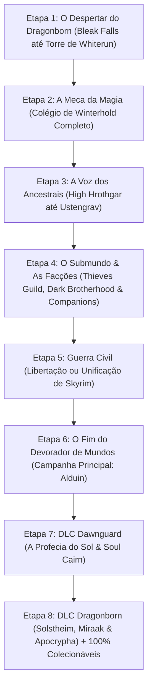
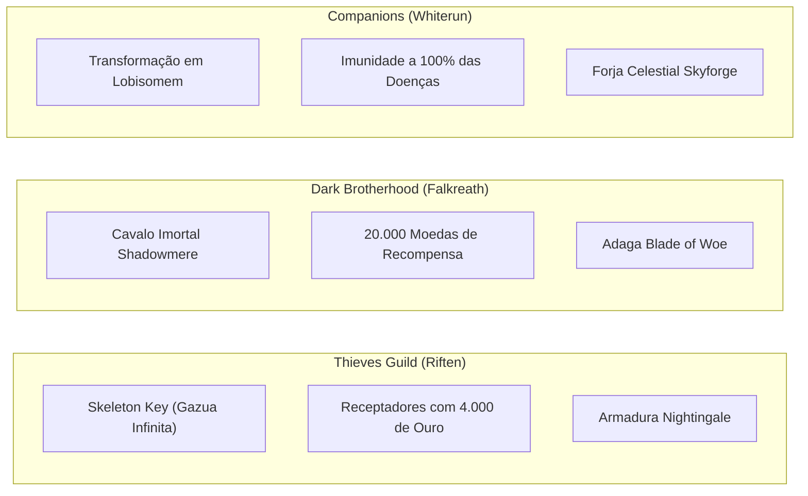
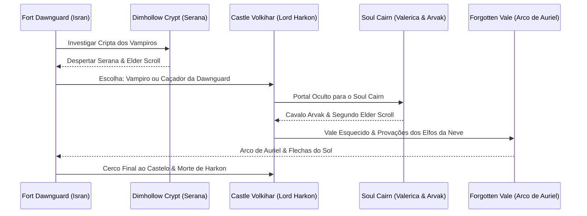

# 🏆 BÍBLIA DO 100% DE SKYRIM: ROTEIRO CRONOLÓGICO ETAPA POR ETAPA (SPECIAL & ANNIVERSARY EDITION)

> **Manual Soberano de Conclusão Total (Platina Absoluta)**  
> **Filosofia:** Ordem de engenharia perfeita. Cada missão, facção, DLC, artefato Daédrico e colecionável posicionado na ordem que previne conflitos de lore, bugs de script de portas e bloqueios de NPCs. Sem necessidade de detonados em vídeo.

---

## 🧭 O MAPA DAS 8 GRANDES ETAPAS

---

## 📍 ETAPA 1: O DESPERTAR DO DRAGONBORN (WHITERUN)

Esta etapa estabelece sua presença em Skyrim, libera o status de Thane e ativa o surgimento de dragões no mapa.

### Missão 1.1: Bleak Falls Barrow
1. **Origem:** Farengar Secret-Fire em Dragonsreach (Whiterun) solicita a pedra rúnica *Dragonstone*.
2. **Localização:** Montanhas a sudoeste de Whiterun, acima de Riverwood.
3. **Passo a Passo de Engenharia:**
   * **Enigma dos Três Pilares:** Na primeira sala com alavanca, gire as pedras para a ordem: **Serpente, Serpente, Peixe** (olhe para a pedra quebrada acima do portão). Puxe a alavanca. Se errar, dardos venenosos disparam.
   * **Ninho da Teia:** Corte as teias com sua magia ou adaga. Derrote a Aranha Congelante Gigante (*Frostbite Spider*).
   * **Arvel the Swift:** Fale com o ladrão preso na teia. Liberte-o. Ele tentará fugir: abata-o com feitiços de raio/fogo e reviste seu corpo para pegar a **Golden Claw (Garra Dourada)** e seu diário.
   * **Porta Selada da Garra:** Gire os anéis de pedra da porta circular para a combinação marcada na palma da Garra Dourada: **Urso (Anel Externo), Mariposa (Anel do Meio), Coruja (Anel Interno)**. Insira a garra na fechadura central.
   * **Câmara do Chefe:** Aproxime-se da parede curva para aprender a Palavra de Poder **Fus (Força)** do grito *Unrelenting Force*. O sarcófago central abrirá com um Draugr Overlord. Derrote-o e pegue a **Dragonstone** em seu corpo.
   * **Saída Rápida:** Suba as escadarias à esquerda da parede de palavras e ative a maçaneta na pedra para abrir uma passagem secreta para fora da montanha.

### Missão 1.2: Dragon Rising (O Primeiro Dragão)
1. **Origem:** Volte a Dragonsreach e entregue a Dragonstone para Farengar. Irileth (a guarda-costas do Jarl) entrará correndo alertando que um dragão foi avistado na Torre de Vigia Ocidental.
2. **Localização:** *Western Watchtower* (a oeste dos portões de Whiterun).
3. **Passo a Passo:**
   * Corra até a torre com Irileth e os guardas.
   * O dragão **Mirmulnir** atacará dos céus.
   * Fique atrás das ruínas da torre de pedra para se proteger do sopro de fogo. Convoque seu Atronach/Familiar para chamar a atenção dele e dispare magias de eletricidade/fogo quando ele pousar.
   * Ao morrer, o corpo de Mirmulnir se desfaz em chamas e seu personagem absorve sua alma.
   * Um grito estrondoso ecoará pelo céu vindo do topo do mundo: **"DO-VAH-KIIN!"**.
4. **Desfecho:** Retorne ao Jarl Balgruuf. Ele concederá a você o título de **Thane de Whiterun**, a espada encantada *Axe of Whiterun* e sua leal seguidora **Lydia** (que ficará à sua disposição em Dragonsreach ou na sua casa).

---

## 📍 ETAPA 2: A MECA DA MAGIA (COLLEGE OF WINTERHOLD COMPLETO)

Fazer o Colégio de Winterhold no início transforma seu personagem num mago completo e autossuficiente com os melhores equipamentos de regeneração e custo zero de mana.

### Missão 2.1: First Lessons (O Teste de Entrada)
1. Pague 20 moedas para a carruagem nos estábulos de Whiterun levar você até **Winterhold**.
2. Aproxime-se da longa ponte de pedra. **Faralda** bloqueará seu caminho.
3. Peça para entrar no Colégio. Ela pedirá uma demonstração mágica (lance o feitiço que ela solicitar no selo no chão). Se você não conhecer o feitiço, ela vende o grimório por apenas 30 moedas.
4. Atravesse a ponte, fale com **Mirabelle Ervine** no pátio, receba as vestes de mago e visite seu quarto no *Hall of the Attainment*.
5. Vá para o *Hall of the Elements* assistir à aula do mestre **Tolfdir**. Equipe a magia de escudo básico (*Lesser Ward*), fique no círculo e segure a magia para bloquear o disparo de fogo que ele lançará.

### Missão 2.2: Under Saarthal (A Primeira Grande Masmorra)
1. Encontre Tolfdir e os outros aprendizes nas ruínas congeladas de **Saarthal** (a sudoeste de Winterhold).
2. Ajude Arniel Gane procurando quatro artefatos mágicos no chão. Ao pegar o quarto (o **Saarthal Amulet**), você fica preso numa armadilha de grades de ferro.
3. **Resolução da Armadilha:** Equipe o *Saarthal Amulet*. A parede atrás de você começará a ressonar. Dispare qualquer feitiço na parede para despedaçá-la.
4. Tolfdir entrará com você. A visão profética de **Nirya / Psijic Order (Nerien)** aparecerá alertando sobre o perigo iminente.
5. **Enigmas dos Pilares de Saarthal:**
   * *Primeira sala de 6 pilares:* Olhe para a parede atrás de cada pilar. Gire cada pilar para mostrar o exato animal entalhado na pedra atrás dele.
   * *Segunda sala de 4 pilares (Enigma em Cadeia):* Mudar um pilar vira os outros. A ordem correta de interação:
     1. Gire o pilar do fundo à esquerda até o símbolo correto.
     2. Gire o do fundo à direita até o símbolo correto.
     3. Gire o da frente à esquerda.
     4. Gire o da frente à direita.
6. **Chefe Jyrik Gauldurson:** Ele fica imune até Tolfdir disparar no orbe azul gigante. Quando o escudo cair, ataque-o. Ele alterna elementos (se estiver pegando fogo, use raio; se estiver elétrico, use fogo).
7. Saqueie o corpo dele para pegar um fragmento do amuleto de Gauldur e a palavra de poder do grito *Ice Form*.
8. Descubra a esfera monumental: **The Eye of Magnus (O Olho de Magnus)**.

### Missão 2.3: Hitting the Books & Good Intentions
1. O Arquimago Savos Aren envia você para conversar com o bibliotecário orc **Urag gro-Shub** no *Arcanaeum*.
2. Urag explica que um mago expulso chamado Orthorn roubou os livros sagrados do colégio e fugiu para o forte de **Fellglow Keep**.
3. Vá até Fellglow Keep, limpe os magos renegados e liberte Orthorn das jaulas se desejar ajuda.
4. Derrote a feiticeira **The Caller** na câmara final (você pode conversar com ela e trocar Orthorn pelos livros, ou matá-la com feitiços de choque).
5. Recupere os 3 livros raros e leve-os a Urag.
6. Fale com Mirabelle e desça até os porões do *The Midden* abaixo do Colégio para consultar a entidade ancestral **The Augur of Dunlain**. Ele avisa que o Olho de Magnus não pode ser controlado sem o **Staff of Magnus (Cajado de Magnus)**.

### Missão 2.4: Revealing the Unseen (Ruínas de Mzulft)
1. Vá até as gigantescas ruínas anãs de **Mzulft** (a sudeste de Windhelm).
2. Encontre os cientistas moribundos da facção *Synod*. Pegue a chave no corpo do pesquisador e avance pelas salas cheias de autômatos Dwemer e Falmers.
3. Derrote o *Falmer Gloomlurker* na sala final para pegar o cristal de foco (**Focusing Crystal**).
4. Suba até a câmara monumental do **Oculory**:
   * Insira o cristal no console central no teto.
   * Equipe um feitiço de **Fogo** em uma mão e um de **Gelo** na outra.
   * Dispare gelo ou fogo no centro do cristal para expandir ou contrair o feixe de luz até que cada raio aponte exatamente para o centro de cada um dos três anéis de metal do domo.
   * Suba as escadas até o painel de três botões e pressione cada botão para girar os anéis até que os espelhos reflitam os feixes de luz perfeitamente.
5. Um mapa holográfico revelará a localização do cajado: o cemitério de magos de **Labyrinthian**.

### Missão 2.5: The Staff of Magnus & O Olho Revelado
1. Volte ao Colégio: Ancano fechou o *Hall of the Elements* com uma barreira impenetrável de energia pura.
2. Savos Aren e Mirabelle tentam quebrar a barreira; uma explosão colossal ocorre. O Arquimago é arremessado no pátio e morre.
3. Derrote as aberrações mágicas soltas em Winterhold usando feitiços de choque.
4. Receba de Mirabelle o amuleto e anel de Savos Aren e viaje até a lendária tumba de **Labyrinthian**.
5. **Em Labyrinthian:**
   * Enfrente o esqueleto de dragão na primeira câmara.
   * Conforme você avança, a voz espectral de **Morokei** drena periodicamente toda a sua barra de Magicka. Use poções de restauração e avance confiando nas suas criaturas de Conjuração.
   * **Confronto com o Sacerdote Dragão Morokei:** Dois magos escravizados mantêm Morokei protegido por um feixe azul. Mate primeiro os dois magos nos pedestais superiores.
   * Imediatamente quando a barreira cair, martele Morokei com feitiços de destruição de Dual Cast com o perk `Impact` para mantê-lo atordoado.
   * Saqueie Morokei: recolha a máscara lendária **Morokei** (+100% de regeneração de Magicka) e o **Staff of Magnus**.
6. **Batalha Final (The Eye of Magnus):**
   * Retorne ao Colégio. Aponte o Staff of Magnus para o portão do pátio para dissolver o vendaval arcano.
   * Entre no Hall of the Elements. Aponte o cajado diretamente para o Olho de Magnus fechado até a energia azul se dissipar.
   * No momento em que Ancano se tornar vulnerável, bombardeie-o até a morte.
   * Os monges da Ordem Psijic aparecerão, teleportarão o Olho de Magnus para um local seguro fora de Nirn e declararão você o novo **Archmage de Winterhold**.
7. **Espólios:** Receba as **Archmage's Robes** (-15% no custo de todos os feitiços, +50 Magicka, +100% Regen) e o acesso aos luxuosos aposentos do topo da torre com todas as plantas e mesas de alquimia e encantamento do jogo.

---

## 📍 ETAPA 3: A VOZ DOS ANCESTRAIS (HIGH HROTHGAR ATÉ DELPHINE)

Com o poder arcano consolidado, avance a campanha principal para destravar os gritos mais poderosos.

### Missão 3.1: The Way of the Voice (Os 7.000 Degraus)
1. Vá até a vila de **Ivarstead** (no sopé leste da montanha *Throat of the World*).
2. Suba os 7.000 degraus de pedra.
   * *Aviso de Inimigo:* Na marca do sexto santuário, um Troll do Gelo (*Frost Troll*) emboscará você na fenda da montanha. Use feitiços de fogo contínuos para cancelar a rápida regeneração natural dele.
3. Entre no monastério de **High Hrothgar**. Demonstre seu grito para os monges Greybeards.
4. Mestre Arngeir, Borri, Einarth e Wulfgar ensinarão a segunda e terceira palavra de **Unrelenting Force (Ro e Dah)** e a primeira palavra de **Whirlwind Sprint (Wuld)**.
5. Complete o teste do portão usando o *Whirlwind Sprint* para passar pelas grades antes de fecharem.

### Missão 3.2: The Horn of Jurgen Windcaller (Ustengrav)
1. Os Greybeards enviam você para recuperar a buzina do fundador na tumba de **Ustengrav** (nos pântanos de Morthal).
2. Desça pela masmorra até a câmara subterrânea monumental com cachoeiras.
3. **O Quebra-Cabeça das Três Pedras Vermelhas:** Três pedras abrem três portões de ferro consecutivos que fecham em menos de 2 segundos.
   * *Solução:* Posicione-se em linha reta com as três pedras. Comece a correr em disparada passando rente a elas (elas brilharão em vermelho) e, no exato segundo em que passar pela terceira, ative o grito **Whirlwind Sprint**. Você voará para frente atravessando as três grades antes de baterem no chão.
4. No túmulo final, a buzina não está lá: há apenas um bilhete irônico deixado por "Um Amigo" pedindo para alugar o sótão na taverna de Riverwood.
5. Vá para Riverwood, entre na *Sleeping Giant Inn* e fale com **Delphine**. Peça o quarto do sótão.
6. Ela levará você para um quarto secreto atrás de um guarda-roupa falso, entregará o corno legítimo de Jurgen e revelará ser uma das últimas sobreviventes dos **Blades**.
7. *(Retorne a High Hrothgar quando quiser entregar o corno: os monges realizarão a cerimônia de batismo formal com os cânticos nórdicos que concedem o título canônico de Ysmir).*

### Missão 3.3: A Blade in the Dark (O Renascimento em Kynesgrove)
1. Delphine diz que outro dragão morto há séculos está sendo ressuscitado em **Kynesgrove** (ao sul de Windhelm).
2. Vá com ela até o monte funerário.
3. Assista à cena de arrepiar: **Alduin** paira sobre o monte, fala em idioma dragão e ressuscita o dragão ancestral **Sahloknir**.
4. Derrote Sahloknir ao lado de Delphine. Após absorver a alma, ela se convence sem sombra de dúvidas de que você é o verdadeiro Dragonborn.

---

## 📍 ETAPA 4: O SUBMUNDO E AS GRANDES FACÇÕES DE SKYRIM

Fazer as três facções secundárias agora traz enormes vantagens de economia, transporte e imunidade a doenças.

### 1. Thieves Guild (Guilda dos Ladrões - Riften)
* **Entrada:** Vá à praça do mercado de Riften durante o dia e fale com **Brynjolf**. Plante o anel de Madesi no bolso de Brand-Shei para passar no teste.
* **QG:** Desça nos esgotos (*The Ratway*) até o bar secreto *The Ragged Flagon*.
* **Caminho das Missões:**
  1. *Taking Care of Business:* Cobre as dívidas de Keerava, Bersi e Haelga.
  2. *Loud and Clear:* Incinere 3 colmeias na fazenda Goldenglow (não queime mais que três para não perder o bônus de ouro).
  3. *Speaking with Silence:* Explore as ruínas de Snow Veil Sanctum com Mercer Frey. Mercer trai e esfaqueia você; **Karliah** resgata sua vida.
  4. *Trinity Restored:* Jure lealdade a Nocturnal no santuário secreto com Karliah e Brynjolf e torne-se um **Nightingale**.
  5. *Blindsighted:* Derrote Mercer Frey na caverna submersa de Irkngthand e recupere a lendária **Skeleton Key**.
  * 💡 *Dica de Mestre:* Você **NÃO** precisa devolver a Skeleton Key imediatamente. Enquanto ela estiver no seu inventário, suas gazuas nunca quebram e você abre qualquer fechadura Master de Skyrim instantaneamente!

### 2. Dark Brotherhood (Irmandade Sombria - Falkreath)
* **Como Despertar a Facção:**
  1. Vá até **Windhelm**, entre na residência Aretino arrombando a porta fácil. Encontre o menino **Aventus Aretino** realizando o Sacramento Negro.
  2. Aceite a missão *Innocence Lost*: vá até o orfanato de Riften e abata a cruel Grelod the Kind.
  3. Durma em qualquer cama de estalagem por algumas horas. Você acordará numa cabana abandonada trancada com **Astrid**.
  4. Mate um dos três prisioneiros amarrados. Astrid entrega a senha do santuário secreto nos pinheiros de Falkreath: *"Silence, my brother"*.
* **Recompensas Chave da Facção:**
  * **Shadowmere:** O cavalo mais resistente do jogo, com olhos vermelhos brilhantes e regeneração de vida absurda, que surge de uma poça de lodo negro durante a missão *The Cure for Madness*.
  * **Windshear:** A espada curvada cravada na proa do navio do Imperador Katariah (que atordoa inimigos a cada golpe).
  * **20.000 Septims:** Recompensa direta depositada no baú ao concluir o assassinato do Imperador Titus Mede II.

### 3. Os Companions (Companheiros de Jorrvaskr - Whiterun)
* **Entrada:** Entre na grande casa em formato de barco virado (*Jorrvaskr*) em Whiterun e fale com **Kodlak Whitemane**.
* **O Segredo do Círculo:** Na missão *The Silver Hand*, Skjor leva você para o subterrâneo sob a Skyforge e oferece o sangue da besta. Você adquire a habilidade de virar **Lobisomem** (*Beast Form*).
* **Vantagem Permanente:** Enquanto for lobisomem, seu personagem tem **100% de Imunidade a TODAS as doenças de Skyrim** (incluindo vampirismo acidental, ataxia e febre do osso).
* **Glory of the Dead:** Desça na tumba de Ysgramor, cure o espírito de Kodlak e torne-se o líder supremo (**Harbinger**) dos Companions.

---

## 📍 ETAPA 5: A GUERRA CIVIL DE SKYRIM

Fazer a Guerra Civil agora organiza a liderança das 9 cidades e evita a conferência de paz maçante (*Season Unending*) da campanha principal.

### Escolhendo seu Estandarte:
* **Legião Imperial (General Tullius em Solitude - Castle Dour):** Lado da lei, cosmopolita e sustentado pelo Império Cyrodílico.
* **Stormcloaks (Ulfric Stormcloak em Windhelm - Palace of Kings):** Lado tradicional nórdico lutando pelo culto livre a Talos e independência provincial.

### Roteiro Tático das Batalhas:
1. *Joining the Legion / Stormcloaks:* Limpar Fort Hraggstad ou matar o Ice Wraith nas ilhas congeladas.
2. *The Jagged Crown:* Recuperar a coroa ancestral na masmorra nórdica de Korvanjund.
3. *Battle for Whiterun:* Batalha monumental nos portões de Whiterun com catapultas e barricadas.
4. *Campanhas de Fortes:* Conquiste sucessivamente os fortes das províncias inimigas (Falkreath, The Reach, Hjaalmarch, The Rift).
5. *Cerco Final:* Batalha massiva pelas ruas de Solitude ou Windhelm, culminando na execução do líder rival.

---

## 📍 ETAPA 6: O FIM DO DEVORADOR DE MUNDOS (ALDUIN & SOVNGARDE)

Agora retome a campanha principal até sua conclusão cinematográfica.

1. **Diplomatic Immunity (Infiltração Thalmor):**
   * Encontre Delphine e Malborn. Entregue seus itens essenciais para Malborn contrabandear para dentro da Embaixada Thalmor.
   * Participe da festa, cause uma distração através de Erikur ou Razelan, escape pelos fundos, recupere seus itens no baú e descubra nos documentos secretos que os Thalmor não sabem nada sobre o retorno dos dragões e estão procurando um velho Blades chamado Esbern.
2. **A Cornered Rat & Alduin's Wall:**
   * Encontre Esbern escondido nos esgotos de Riften (*The Ratway Warrens*).
   * Leve-o até o templo esquecido de **Sky Haven Temple** nas montanhas do Reach.
   * Esbern decifra o relevo de pedra na parede: os heróis da antiguidade usaram um grito esquecido para derrubar Alduin dos céus: **Dragonrend**.
3. **The Throat of the World & Paarthurnax:**
   * Suba além de High Hrothgar até o topo absoluto do pico mais alto de Tamriel usando o grito *Clear Skies*.
   * Conheça o lendário dragão ancião **Paarthurnax**, líder benevolente dos Greybeards.
4. **Elder Knowledge (A Descida a Blackreach):**
   * Fale com o eremita **Septimus Signus** em sua caverna de gelo ao norte de Winterhold.
   * Receba a esfera e o cubo de léxico para abrir a passagem subterrânea Dwemer em **Mzinchaleft** ou **Alftand**.
   * Entre na colossal cidade subterrânea de **Blackreach** iluminada por cogumelos bioluminescentes gigantescos.
   * Na *Tower of Mzark*, resolva o quebra-cabeça dos consoles de luz para transcrever o cubo e extrair o artefato supremo: o **Elder Scroll (Dragon)**.
5. **Alduin's Bane:**
   * Volte ao topo do mundo com o Elder Scroll e abra-o na fenda temporal (*Time Wound*).
   * Assista à visão do passado dos heróis nórdicos e aprenda o grito **Dragonrend (Joor Zah Frul)**.
   * Alduin atacará imediatamente. Use o grito *Dragonrend* para forçar Alduin a pousar na terra e martele-o até ele fugir derrotado para o além-mundo.
6. **The Fallen & Odahviing:**
   * Peça a ajuda do Jarl Balgruuf para usar a varanda traseira de Dragonsreach como uma jaula gigante.
   * Lance o grito *Call Dragon* para atrair o tenente de Alduin, **Odahviing**. Atraia-o para dentro da varanda e solte a viga de madeira para prendê-lo pelo pescoço.
   * Interrogue Odahviing: ele aceitará trair Alduin e levar você voando em suas costas até o portal exclusivo de Skuldafn.
7. **Sovngarde (O Paraíso Nórdico):**
   * Atravesse as ruínas de Skuldafn, derrote o sacerdote dragão Nahkriin e salte dentro do turbilhão de luz.
   * Caminhe pela névoa mística de **Sovngarde**, atravesse a ponte monumental feita de osso de baleia após duelar amigavelmente com o deus **Tsun**.
   * Entre no imponente *Hall of Valor*. Reúna-se com os três heróis míticos: Gormlaith Golden-Handle, Felldir the Old e Hakon One-Eye.
   * Juntos, marchem para o campo exterior, usem *Clear Skies* três vezes para dissipar a névoa de Alduin, derrubem o Devorador de Mundos com *Dragonrend* e aniquilem-no para sempre.
   * Tsun concede a você o grito **Call of Valor** e envia você de volta em glória para o cume de Skyrim.

---

## 📍 ETAPA 7: DLC DAWNGUARD (A PROFECIA DO SOL)

Uma das maiores expansões da história dos RPGs, contendo a história de Serana e o vale esquecido.

1. **Início:** Ao atingir o nível 10, fale com os guardas ou com o orc Durak nas capitais e viaje até o desfiladeiro escondido de **Fort Dawnguard** (a sudeste de Riften). Fale com o líder **Isran**.
2. **Dimhollow Crypt:** Explore a cripta ancestral e resolva o quebra-cabeça dos braseiros roxos. O monólito abrirá revelando a vampira **Serana**, carregando um Elder Scroll nas costas após dormir por milênios.
3. **A Escolha de Sangue:**
   * Escolte Serana até o misterioso **Castle Volkihar** na costa norte.
   * O pai dela, **Lord Harkon**, oferecerá seu sangue:
     * *Opção A (Vampire Lord):* Você ganha asas demoníacas e a forma de combate voadora de vampiro.
     * *Opção B (Recusar / Lado Dawnguard - RECOMENDADO PARA MAGOS):* Harkon expulsa você do castelo. Você volta para Isran, fortalece a fortaleza com novos aliados, ganha as **Enhanced Crossbows** (que ignoram 50% de armadura física) e feitiços sagrados de sol de Restauração.
4. **O Portal do Soul Cairn:**
   * Acompanhe Serana até o laboratório secreto de sua mãe Valerica no pátio arruinado de Volkihar.
   * Entre no reino sombrio do **Soul Cairn** (o mundo para onde vão as almas aprisionadas por encantamentos).
   * **Recompensa Imperdível:** Faça a rápida mini-quest da caveira para ganhar o feitiço **Summon Arvak** (um cavalo esquelético com chamas roxas que você pode invocar em qualquer lugar de Skyrim e Solstheim instantaneamente).
   * Recupere o *Elder Scroll (Blood)* com Valerica e derrote o dragão zumbi Durnehviir (aprendendo o grito para invocá-lo como aliado nos céus).
5. **The Forgotten Vale (O Vale Esquecido):**
   * Localize a passagem subterrânea para o santuário intocado dos últimos Elfos da Neve (*Snow Elves*).
   * Encha a jarra cerimonial de água nos 5 santuários espalhados pelo vale glacial.
   * Derrote o elfo corrompido Arquicurador Vyrthur no topo do terraço e recolha o **Auriel's Bow (Arco de Auriel)** e as flechas sagradas *Sunhallowed Elven Arrows*.
6. **Batalha por Castle Volkihar:**
   * Conduza o cerco com os guerreiros da Dawnguard contra o ninho de vampiros.
   * No confronto final na capela contra Lord Harkon, use o Arco de Auriel para dissipar o escudo impenetrável de sangue dele e elimine-o com suas magias.

---

## 📍 ETAPA 8: DLC DRAGONBORN (A ILHA DE SOLSTHEIM) & 100% LIMPEZA

A conclusão definitiva de Skyrim leva você de volta à mítica terra de Morrowind.

1. **O Ataque dos Cultistas:**
   * Dois cultistas mascarados abordarão você em qualquer cidade perguntando sobre o "Falso Dragonborn". Abata-os e leia a ordem no corpo assinada por **Miraak**.
2. **Viagem a Solstheim:**
   * Vá aos docas de Windhelm e pague o capitão Gjalund Salt-Sage para navegar no barco *The Northern Maiden* até o porto de **Raven Rock**.
3. **O Domínio Mental de Miraak:**
   * Observe que os habitantes de Solstheim constroem monumentos em transe hipnótico ao redor das pedras mágicas.
   * Suba as montanhas até o vilarejo dos nórdicos de **Skaal Village**. Conheça Frea e o xamã Storn.
4. **O Livro Negro e o Reino de Apocrypha:**
   * Explore o *Temple of Miraak*. Abra o primeiro **Black Book** e seja sugado para o reino de pesadelo cósmico do Príncipe Daédrico Hermaeus Mora: **Apocrypha**.
   * Conheça Miraak pessoalmente antes de ser expulso de volta para o mundo real.
5. **Libertação de Solstheim:**
   * Aprenda o grito **Bend Will (Gol Hah Dov)**.
   * Use o grito em cada uma das 5 pedras rúnicas da ilha (*Earth Stone*, *Water Stone*, *Wind Stone*, *Beast Stone*, *Sun Stone*) para destruir o transe de Miraak e libertar os cidadãos.
6. **O Clímax no Cume de Apocrypha:**
   * Aprenda as três palavras completas do grito *Bend Will*.
   * Abra o último livro negro *Waking Dreams*.
   * Use o grito *Bend Will* para domar o dragão de Miraak, **Sahrotaar**, e voe montado nele até o cume do templo no céu verde de Apocrypha.
   * Duelo lendário contra Miraak: Toda vez que ele ficar fraco, ele absorverá a alma de um dragão para se regenerar. Derrube-o até o tentáculo de Hermaeus Mora empalá-lo pelas costas.
   * **Recompensa Suprema:** Acesso ao círculo de livros negros que permite redistribuir pontos de perks de qualquer árvore de habilidades a qualquer momento do jogo sem penalidades.

---

## 💎 CHECKLIST DE MESTRE: OS 100% DE COLECIONÁVEIS

Ao terminar as etapas acima, o mundo de Skyrim estará em suas mãos. Use esta tabela para marcar o 100% de colecionáveis de elite:

### 1. Os 15 Artefatos Daédricos (Troféu *Oblivion Walker*)
- [ ] **The Black Star / Azura's Star:** *(Feito na Etapa 2)*.
- [ ] **Dawnbreaker:** Santuário de Meridia (Ouvir a voz: *"A NEW HAND TOUCHES THE BEACON"*).
- [ ] **Mace of Molag Bal:** Casa abandonada em Markarth com o Vigilante Tyranus.
- [ ] **Wabbajack:** Ala isolada do Blue Palace em Solitude (Falar com Pelagius e Sheogorath).
- [ ] **Mehrunes' Razor:** Museu de Dawnstar (Juntar as peças da adaga para Silus Vesuius).
- [ ] **Spellbreaker:** Santuário de Peryite perto de Markarth (O melhor escudo anti-magia).
- [ ] **Volendrung:** Forte orc de Largashbur (O martelo Daédrico de Malacath).
- [ ] **Sanguine Rose:** Desafio de bebida com Sam Guevenne em qualquer taverna aos 14+ anos de nível.
- [ ] **Oghma Infinium:** Quest de Septimus Signus (*Discerning the Transmundane*).
- [ ] **Ebony Blade:** Falar com o estalajadeiro de Whiterun sobre os filhos estranhos do Jarl Balgruuf.
- [ ] **Ebony Mail:** Santuário de Boethiah (Sacrifique um mercenário no pilar aos 30+ anos de nível).
- [ ] **Ring of Namira:** Catacumbas do Hall of the Dead em Markarth (Eola).
- [ ] **Skull of Corruption:** Taverna de Dawnstar com o sacerdote Erandur (Não pegue o cajado se quiser salvar o padre, mas para a conquista, mate-o).
- [ ] **Masque of Clavicus Vile / Rueful Axe:** Cachorro falante Barbas na entrada de Falkreath.
- [ ] **Savior's Hide / Ring of Hircine:** Prisão de Falkreath com o lobisomem Sinding.

### 2. As 24 Pedras de Barenziah (No Stone Unturned)
* Como você tem o mod **`BarenziahQuestMarkers`** ativo, todas as 24 gemas têm **marcadores de bússola na sua tela**!
* Colete as 24 pedras nas capitais, masmorras e mansões, entregue a Vex na Thieves Guild de Riften e recupere a coroa de Barenziah.
* **Passiva Conquistada (*Prowler's Profit*):** Todo baú, urna ou pote de Skyrim passa a dropar múltiplos rubis, diamantes e safiras impecáveis. Você terá ouro infinito para sempre.

### 3. As 8 Máscaras dos Dragon Priests (+ Konahrik)
Derrote os 8 sacerdotes dragões em suas respectivas tumbas nórdicas e leve suas máscaras até o templo no passado de Labyrinthian:
- [ ] **Morokei** *(Labyrinthian - Colégio de Winterhold)*
- [ ] **Krosis** *(Shearpoint)*
- [ ] **Volsung** *(Volskygge)*
- [ ] **Nahkriin** *(Skuldafn - Campanha Principal)*
- [ ] **Hevnoraak** *(Valthume)*
- [ ] **Otar** *(Ragnvald)*
- [ ] **Rahgot** *(Forelhost)*
- [ ] **Vokun** *(High Gate Ruins)*
- [ ] 👑 **Konahrik:** A nona máscara dourada secreta, conquistada ao colocar as 8 máscaras nos pedestais do santuário de madeira de Labyrinthian. Ela invoca um espectro protetor e cura você automaticamente em perigo mortal!
