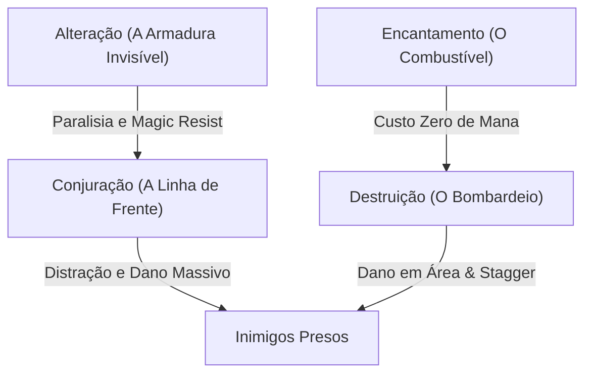

# 🧙‍♂️ GUIA DO MAGO SUPREMO: CONJURAÇÃO & DESTRUIÇÃO APOCALÍPTICA (SKYRIM AE)

> **Arquétipo Soberano:** O Senhor das Feras e do Caos Elemental (*Conjurador / Arquimago*).
> **Conceito:** Enquanto dois Dremora Lords desossam os inimigos na linha de frente e absorvem todo o dano, você bombardeia o campo com tempestades elétricas e bolas de fogo com custo zero de mana e sem sujar as mãos.

---

## 🧬 1. A ESCOLHA DA RAÇA: QUAL PEGAR?

Existem duas raças de elite absoluta para Mago no Skyrim. Escolha a que mais combina com o seu estilo:

### 🥇 Opção 1: **Breton (Bretão) — O Mago Tanque / Imortal (RECOMENDADO)**
* **Por que é o melhor no longo prazo:** No Skyrim, dano físico de machado e flecha você desvia ou seus demônios seguram. O que te dá *one-shot* na dificuldade alta são **magos inimigos e baforadas de dragão**.
* **Passiva Nativa:** **25% de Resistência Mágica Permanente** contra qualquer feitiço, fogo, gelo e eletricidade.
* **Poder Diário (*Dragonskin*):** Absorve **50% de todo o dano mágico** recebido e converte em Magicka própria por 60 segundos.
* **Bônus Inicial:** Já começa com `Conjuration` em nível 25 e o feitiço **Conjure Familiar** desbloqueado desde o segundo zero.
* **O Combo Quebrado:** Bretão (25%) + *Lord Stone* (25%) + 3 Perks de *Magic Resistance* na árvore de Alteration (30%) = **80% de Resistência Mágica Passiva** sem precisar de nenhum equipamento!

---

### 🥈 Opção 2: **Altmer (High Elf / Elfo Alto) — A Máquina de Mana no Early Game**
* **Por que escolher:** Se você odeia ficar sem Magicka nos primeiros 20 níveis do jogo.
* **Passiva Nativa:** Já começa o jogo com **+50 de Magicka extra** (o equivalente a 5 níveis inteiros de graça).
* **Poder Diário (*Highborn*):** Sua Magicka regenera **25x mais rápido** durante 60 segundos (você pode spammar feitiços sem parar contra chefes).
* **Velocidade:** É o modelo de personagem mais alto do jogo, o que faz ele correr ligeiramente mais rápido que as outras raças.

> 💡 **Veredito:** 
> * Escolha **Breton** para imunidade a dano e sobrevivência inabalável no final do jogo.
> * Escolha **Altmer** se quiser agressividade pura e mana infinita desde o minuto 1.

---

## 📊 2. DISTRIBUIÇÃO DE ATRIBUTOS (AO SUBIR DE NÍVEL)

Não coloque pontos em Vigor (Stamina) — magos não precisam correr maratona carregando armadura de ferro.

* **Do Nível 1 ao 20:** **80% Magicka / 20% Vida** (para cada 4 níveis de Magicka, suba 1 de Vida).
* **Do Nível 21 em diante:** **50% Magicka / 50% Vida**.
* **Meta Final com Encantamento:** Assim que colocar 100 em *Enchanting*, seus feitiços de Destruição e Conjuração vão custar **0 de Magicka** (100% de redução de custo em anéis, tiara, peitoral e colar). A partir daí, coloque **tudo em Vida** para virar um titã.

---

## 📜 3. AS ESCOLAS DE MAGIA ESSENCIAIS

### 1. Conjuração (Conjuration) — A espinha dorsal
* **Early Game:** *Flame Atronach* (ataque à distância com fogo) e *Bound Sword* (espada invocada que sobe sua perícia rápido).
* **Mid Game:** *Frost Atronach* (um golem tanque que bloqueia portas e segura chefes).
* **Late Game Supremo:** **Dremora Lord**. O feitiço mais quebrado do jogo. Ele grita *"I SMELL WEAKNESS!"*, corre com uma Greatsword Daédrica e corta Dragões Antigos e Sacerdotes Dragão ao meio.
* **Perk Chave:** **Twin Souls** (Nível 100 de Conjuração). Permite invocar **dois Dremora Lords simultâneos** ou dois golens ao mesmo tempo. Você vira general de um exército.

### 2. Destruição (Destruction) — O artilheiro
* **Perk Chave:** **Impact** (Nível 40 com Dual Casting). 
  * *O que faz:* Toda vez que você usa magia com as duas mãos ao mesmo tempo (Dual Cast), **o inimigo cambaleia (stagger)**. 
  * *Impacto:* Dragões, gigantes e chefes ficam eternamente atordoados sem conseguir dar um único golpe em você até a morte.
* **Elemento Ideal:** **Raio (Shock)**. Não tem tempo de viagem de projétil (acerta instantaneamente como laser) e drena a Magicka de magos inimigos.

### 3. Alteração (Alteration) — Proteção sem peso
* Permite jogar com roupas leves de mago (robes com regeneração de Magicka absurda) e usar feitiços como *Oakflesh*, *Stoneflesh* e *Ebonyflesh*.
* Com o perk **Mage Armor**, sua armadura mágica triplica de valor se você não estiver vestindo armadura pesada.
* Concede o feitiço **Paralysis** (paralisa qualquer inimigo no chão por 10 segundos).

---

## 🗿 4. PEDRAS GUIA (STANDING STONES)

1. **Na saída de Helgen:** Pegue a **Mage Stone** (suas habilidades mágicas sobem 20% mais rápido).
2. **Ao chegar em Whiterun / Falkreath:** Mude para a **The Atronach Stone**:
   * Dá **+50 de Magicka**.
   * Dá **50% de Absorção Mágica** (metade de qualquer feitiço ou sopro de dragão que te atinja é engolido e vira mana para você).
   * Se combinado com a raça Bretão, você atinge imunidade quase total contra ataques mágicos.

---

## 🎒 5. EQUIPAMENTOS DE ELITE DO INÍCIO (SEM GLITCH)

1. **Novice / Apprentice Hood & Robes:** Pegue no corpo do mago morto dentro da jaula de tortura de Helgen.
2. **Morokei (Máscara de Dragon Priest):** Recompensa da questline da *College of Winterhold* (dá +100% de regeneração de Magicka).
3. **Archmage's Robes:** Recompensa ao zerar a guilda dos magos (reduz o custo de **todas** as magias de todas as escolas em 15%, dá +50 de Magicka e +100% de regeneração).
4. **The Black Star (Estrela de Azura Negra):** O artefato Daédrico mais importante para magos. Uma gema da alma infinita que nunca quebra e pode ser recarregada infinitamente matando bandidos humanos para encantar seus equipamentos com poder máximo.

---

## 🎯 6. ROTEIRO DOS PRIMEIROS 30 MINUTOS

1. **Saia de Helgen:** Pegue as roupas de mago na gaiola e ative a *Mage Stone* na estrada para Riverwood.
2. **Vá para Whiterun:** Pegue a carruagem nos estábulos por 20 moedas direto para **Winterhold**.
3. **Entre no College of Winterhold:** Faça o teste de entrada com a Faralda. Você ganha acesso imediato aos melhores vendedores de livros de magia de Skyrim (Phinis Gestor vende todas as invocações de Conjuração).
4. **Compre o feitiço Soul Trap:** Use nas criaturas mortas para subir Conjuração rapidamente até liberar o *Dremora Lord*.
