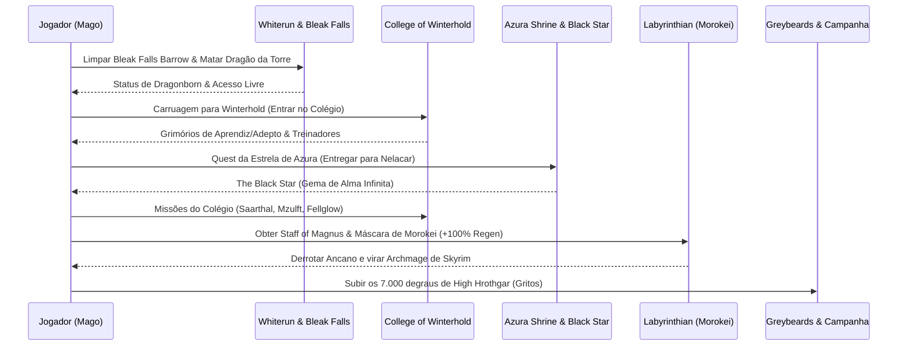

# 🧙‍♂️ BÍBLIA DO ARQUIMAGO SUPREMO: DA PRIMEIRA CENTELHA AO DEUS ARCANO (SKYRIM AE)

> **Perfil Operacional:** Mago de Puro Conhecimento & Arquimago de Guerra  
> **Modlist Ativa Integrada:** `Ordinator`, `Apocalypse`, `Odin`, `Arcanum`, `Wintersun`, `Andromeda`, `Smart Cast`, `Train and Study`, `Experience`, `Smart Training Tweaked`  
> **Filosofia:** 0% Glitches, 0% Exploits, 100% Mecânicas Orgânicas de RPG de Alta Engenharia.

---

## 🧭 SUMÁRIO EXECUTIVO DA JORNADA
1. [Regras Soberanas do Mago Sem Trapaças](#-1-as-regras-soberanas-do-mago-orgânico)
2. [Estado Atual: O Que Fazer Saindo de Dragonsreach (Nível 4-5)](#-2-estado-atual-saindo-de-dragonsreach-nível-4-a-5)
3. [Guia de Evolução Orgânica: Como Upar Sem Exploits](#-3-guia-de-evolução-orgânica-estudo-treinadores-e-prática)
4. [Árvore Completa e Cronológica de Perks (Nível 1 ao 50)](#-4-árvore-completa-e-cronológica-de-perks-ordinador-nível-1-ao-50)
5. [Roteiro de Missões Etapa por Etapa (Do Nível 5 ao Endgame)](#-5-roteiro-de-missões-etapa-por-etapa-para-magos)
6. [Automação Tática com o Smart Cast](#-6-automação-tática-com-o-smart-cast-mcm)
7. [Arsenal Arcano Definitivo: Grimórios, Vestes e Relíquias](#-7-arsenal-arcano-definitivo)

---

## ⚡ 1. AS REGRAS SOBERANAS DO MAGO ORGÂNICO

1. **Nunca use armadura física (Metal ou Couro):**
   * Por que: O perk `Mage Armor` do Ordinator triplica (ou quadruplica) sua classe de armadura mágica se você estiver usando **100% vestes de tecido** (Robes, Túnicas, Botas de Tecido/Couro Macio sem armadura, Luvas sem armadura, Diademas).
   * Se colocar uma única manopla de ferro, você perde o bônus de 300% de armadura e o bônus de +30% de dano do perk `Robes of the Magi`.
2. **Magicka é a sua Moeda de Sobrevivência:**
   * Atributos nos Níveis 1 ao 20: **80% Magicka / 20% Vida (Zero Stamina)**.
   * Atributos nos Níveis 21 ao 40: **50% Magicka / 50% Vida**.
   * Atributos nos Níveis 41+: **100% Vida** (seus feitiços já custarão quase nada e o dano escalará com seu nível de escola).
3. **Mago Luta por Posição, Não por Trocação:**
   * O fluxo de qualquer confronto:
     1. Lançar armadura mágica (*Oakflesh* ou automatizado pelo *Smart Cast*).
     2. Invocar o lacaio de Conjuração na linha de visão do inimigo (ele vira o para-raios).
     3. Recuar 5 passos e bombardear com magias de Destruição com as duas mãos (Dual Cast) para manter o inimigo atordoado (*Stagger*).

---

## 🏰 2. ESTADO ATUAL: SAINDO DE DRAGONSREACH (NÍVEL 4 A 5)

Você acabou de falar com o Jarl Balgruuf e precisa pegar a *Dragonstone* em Bleak Falls Barrow. Sua Alteração está em 15 e você precisa de 20 para o perk `Mage Armor`.

### Roteiro Imediato nos Próximos 10 Minutos:
1. **Fale com Farengar Secret-Fire (Dragonsreach):**
   * Ele está na sala dos fundos à direita do trono.
   * Compre o livro **`Spell Tome: Oakflesh`** (cerca de 70-90 septims).
   * Se você não comprou ainda, adquira também **`Spell Tome: Firebolt`** ou **`Spell Tome: Lightning Bolt`**.
2. **Compre ou Pegue Livros para Estudar:**
   * Na sala de Farengar, inspecione a estante e a mesa de alquimia. Existem livros sobre escolas de magia.
3. **Decisão sobre o Ponto de Perk do Nível 4/5:**
   * **NÃO GASTE EM COISA INÚTIL:** Como a sua Alteração está em 15, **guarde o ponto de perk no bolso** (o jogo permite acumular pontos sem gastar imediatamente!).
   * Assim que você bater Alteration 20 na primeira dungeon, abra o menu de estrelas e ative `Mage Armor (1/3)`.

---

## 📚 3. GUIA DE EVOLUÇÃO ORGÂNICA: ESTUDO, TREINADORES E PRÁTICA

Sem recorrer a exploits antigos (como spammar *Muffle* pelas ruas ou bater em cavalos), você tem três ferramentas nobres instaladas:

### Ferramenta A: O Mod `Train and Study` (O Estudo Acadêmico)
* **Como funciona:** Você estuda livros de Skyrim para ganhar conhecimento arcano.
* **Passo a passo:**
  1. Entre na taverna *The Bannered Mare* em Whiterun ou sente-se em uma cadeira em Dragonsreach.
  2. Abra seu inventário, vá na aba **Books** e selecione um livro de magia (ex: *Breathing Water*, *The Lunar Lorkhan*, *Mystery of Talara*).
  3. O menu do mod vai abrir perguntando: **"Read"** ou **"Study"**. Escolha **Study**.
  4. Escolha estudar por **2 a 4 horas**. A tela escurece, o tempo avança e você ganha uma barra de XP limpa na perícia correspondente ao assunto do livro.

### Ferramenta B: Treinadores de Skyrim (Com o mod `Smart Training Tweaked`)
* No jogo vanilla, você só podia pagar 5 aulas por nível de personagem. Se passasse de nível sem usar, perdia as aulas para sempre.
* Com o **Smart Training**, **todos os treinos não utilizados acumulam**!
* **Onde treinar escolas de magia licitamente pagando ouro de missões:**
  * **Alteration (Alteração):**
    * *Dravynea the Stoneweaver* (Kynesgrove - Perto de Windhelm): Treina até o nível 50.
    * *Tolfdir* (College of Winterhold): Mestre, treina até o nível 90.
  * **Destruction (Destruição):**
    * *Wuunferth the Unliving* (Palace of Kings em Windhelm): Treina até o nível 50.
    * *Faralda* (College of Winterhold): Mestre, treina até o nível 90.
  * **Conjuration (Conjuração):**
    * *Runil* (Falkreath, no cemitério): Treina até o nível 50.
    * *Phinis Gestor* (College of Winterhold): Mestre, treina até o nível 90.
  * **Restoration (Restauração):**
    * *Danica Pure-Spring* (Templo de Kynareth em Whiterun): Treina até o nível 75 após curar a árvore Gildergreen.
    * *Colette Mence* (College of Winterhold): Mestre, treina até o nível 90.

### Ferramenta C: O Mod `Experience`
* Você ganha XP ao **completar missões, descobrir novos locais no mapa, ler livros pela primeira vez e limpar masmorras**.
* Portanto, explorar o mundo e avançar nas histórias recompensa o seu personagem com níveis orgânicos sem exigir repetições robóticas.

---

## 🌟 4. ÁRVORE COMPLETA E CRONOLÓGICA DE PERKS (ORDINATOR: NÍVEL 1 AO 50)

Aqui está a sequência exata de cada ponto que você ganhará ao subir de nível.

### 🛡️ Fundação de Sobrevivência (Níveis 1 ao 10)
* **Nível 2:** `Destruction Mastery (1/2)` — *[-35% custo de magias de destruição e +0.5% dano por nível]* (Já pego).
* **Nível 3:** `Conjuration Mastery (1/2)` — *[-35% custo de invocações e +1% duração por nível]* (Já pego).
* **Nível 4:** `Alteration Mastery (1/2)` — *[-35% custo de alteração e +1% duração por nível]* (Já pego).
* **Nível 5 (Guardar até Alteration bater 20):** **`Mage Armor (1/3)`** — *[Seus feitiços de proteção dão +100% de armadura se você estiver usando apenas tecido]*.
* **Nível 6:** **`Destruction Dual Casting`** — *[Permite preparar feitiços com as duas mãos juntas para dano concentrado]*.
* **Nível 7:** **`Force of Nature`** *(Destruição)* — *[-30% de custo de magias de destruição enquanto se move em combate]*.
* **Nível 8:** **`Planemeld`** *(Conjuração)* — *[Permite conjurar criaturas a 5x mais distância, invocando direto na retaguarda inimiga]*.
* **Nível 9:** **`Combustion (1/2)`** *(se você preferir Fogo)* OU **`Scarring Burns (1/2)`** *(se você preferir Raio)* — *[Inicia os efeitos críticos de destruição]*.
* **Nível 10:** **`Geomancer`** *(Alteração)* — *[Você recebe 30% a menos de dano de qualquer fonte enquanto canaliza ou prepara feitiços]*.

---

### ⚡ O Combo da Tirania e Controle (Níveis 11 ao 20)
* **Nível 11:** **`Impact`** *(Destruição 40)* — **O MAIOR PODER DO MAGO.** *Feitiços de destruição lançados com Dual Cast causam Stagger (atordoamento físico garantido). Chefes, dragões e gigantes ficam travados sem conseguir andar até você.*
* **Nível 12:** **`Mage Armor (2/3)`** *(Alteração)* — *[Sua armadura mágica sobe para +150% de bônus]*.
* **Nível 13:** **`Atromancy`** *(Conjuração)* — *[Atronachs ganham +100 de vida e duram 5 vezes mais tempo]*.
* **Nível 14:** **`Robes of the Magi`** *(Destruição)* — *[Se estiver vestindo túnicas sem armadura física, feitiços de Destruição causam +30% de dano extra]*.
* **Nível 15:** **`Restoration Mastery (1/2)`** *(Restauração)* — *[-35% de custo de magias de cura e proteção]*.
* **Nível 16:** **`Flash Fire`** *(Fogo - explosão crítica em área)* OU **`Static Field`** *(Raio - arranca 8% da vida MÁXIMA do alvo instantaneamente no primeiro impacto)*.
* **Nível 17:** **`Wild Shrines`** *(Alteração 40)* — *[Faz aparecer 5 santuários mágicos secretos nas florestas e montanhas de Skyrim; ao rezar em cada um, você ganha permanentemente +15% de poder naquela escola de magia]*.
* **Nível 18:** **`Maelstrom`** *(Conjuração)* — *[Enquanto sua criatura invocada estiver viva no campo, seus feitiços de destruição causam +20% de dano]*.
* **Nível 19:** **`Destruction Mastery (2/2)`** *(Destruição 50)* — *[-50% no custo de todos os feitiços de destruição]*.
* **Nível 20:** **`Welloc's Dormant Arcana`** *(Alteração 50)* — *[Permite criar um elixir mental: ao conjurar sua armadura (Stoneflesh/Ironflesh), você ganha 3 efeitos à sua escolha: +50 Magicka, +50% Regeneração de Magicka e +20% de Resistência Mágica]*.

---

### 👑 O Mestre Arcano e a Linha Sagrada (Níveis 21 ao 35)
* **Nível 21:** **`Mage Armor (3/3)`** *(Alteração 70)* — *[Armadura de mago triplica (+200%), atingindo o teto de defesa de armaduras pesadas]*.
* **Nível 22:** **`Edgewalker`** *(Restauração)* — *[Quando sua vida cair abaixo de 50%, todas as suas magias de cura curam 30% a mais]*.
* **Nível 23:** **`False Light`** *(Restauração 40)* — **A ARMA SECRETA:** *Feitiços de cura direcionados a alvos vivos inimigos agora causam dano sagrado puro equivalente à quantidade de cura!*
* **Nível 24:** **`Lightwielder`** *(Restauração 50)* — *[Feitiços de cura causam ainda mais dano contra inimigos vivos através do False Light]*.
* **Nível 25:** **`War of the Elements`** *(Destruição)* — *[Inimigos atingidos por fogo sofrem dano amplificado por raio e vice-versa]*.
* **Nível 26:** **`Alteration Mastery (2/2)`** *(Alteração)* — *[-50% no custo total de alteração]*.
* **Nível 27:** **`Conjuration Mastery (2/2)`** *(Conjuração)* — *[-50% no custo total de conjuração]*.
* **Nível 28:** **`Enchanting Mastery (1/2)`** *(Encantamento)* — *[Inicia a rota para fabricar joias com redução de custo de mana]*.
* **Nível 29:** **`Spellscribe`** *(Encantamento 50)* — *[Permite vincular uma magia de destruição a um golpe de cajado ou ataque corpo a corpo, disparando de graça sem gastar mana]*.
* **Nível 30:** **`Energy Shield`** *(Alteração 60)* — *[35% de todo o dano físico e mágico que você tomar é absorvido pela sua barra de Magicka em vez da sua Vida]*.
* **Nível 31:** **`Twin Souls`** *(Conjuração 100)* — **O ÁPICE DA CONJURAÇÃO:** *Permite manter 2 criaturas invocadas ao mesmo tempo (dois Dremora Lords ou dois Frost Atronachs)*.
* **Nível 32:** **`World in Flames`** *(Destruição 80)* — *[Suas explosões de fogo deixam o chão em chamas incinerando qualquer coisa que passar por cima]*.
* **Nível 33:** **`Show of Strength`** *(Destruição 90)* — *[Gera rajadas de vento místico que derrubam inimigos no chão ao usar feitiços de choque]*.
* **Nível 34:** **`Vancian Magic`** *(Alteração 30 - Opcional)* — *[Se você quiser estilo D&D: você ganha 20 feitiços diários que custam ZERO de mana e causam o DOBRO de dano. Recarrega dormindo em camas]*.
* **Nível 35:** **`Nullification`** *(Alteração 90)* — *[Inimigos em um raio de 20 metros perto de você têm a regeneração de Magicka reduzida a ZERO e perdem qualquer resistência elemental]*.

---

## 📜 5. ROTEIRO DE MISSÕES ETAPA POR ETAPA PARA MAGOS

Siga esta ordem rigorosa para obter o melhor equipamento na hora certa:

### Etapa 1: O Teste de Sangue (Bleak Falls Barrow)
1. Saia de Whiterun a pé em direção a Riverwood e suba o monte até **Bleak Falls Barrow**.
2. **Entrada:** Use o feitiço `Oakflesh` antes de abrir a porta de madeira.
3. **Sala do Quebra-Cabeça das Pedras:** A combinação das três estátuas é: **Serpente, Serpente, Peixe** (olhe para as pedras que caíram no chão e acima da porta). Puxe a alavanca.
4. **Ninho da Aranha Gigante:** Convoque seu Familiar/Atronach. Fique atrás da teia e dispare feitiços de fogo (aranhas são vulneráveis a fogo).
5. **Câmara Final:** A combinação da Garra Dourada na porta circular é: **Urso, Mariposa, Coruja** (inspecione a garra dourada no seu inventário para ver os símbolos na palma dela).
6. **Chefe Draugr:** Quando o caixão de pedra abrir, invoque sua criatura na frente dele, recue e atire feitiços até derrotá-lo. Pegue a **Dragonstone** e a palavra de grito na parede (*Unrelenting Force*).
7. Volte a Dragonsreach, entregue a pedra a Farengar e corra até a **Western Watchtower** para derrubar o primeiro dragão com raios e fogo.

### Etapa 2: A Peregrinação a Winterhold (A Meca dos Magos)
1. Vá até o estábulo de Whiterun e pague 20 moedas para o cocheiro levar você até **Winterhold**.
2. Na ponte do Colégio, fale com **Faralda**. Ela exigirá uma demonstração mágica básica (lance o feitiço no selo no chão). Se você não tiver o feitiço, ela vende para você por apenas 30 moedas.
3. Entre no pátio e fale com **Mirabelle Ervine**. Pegue suas vestes de estudante e seu dormitório privativo no *Hall of the Attainment*.
4. **Primeira Aula:** No *Hall of the Elements*, fale com **Tolfdir**. Quando ele pedir, equipe a magia de proteção básica (*Lesser Ward*) e segure o botão enquanto ele dispara uma bola de fogo em você.
5. Vá com a turma para a escavação de **Saarthal**:
   * No colar preso na parede, equipe o amuleto para quebrar a parede encantada.
   * Resolva os pilares de pedra girando conforme os símbolos atrás de cada um.
   * Derrote Jyrik Gauldurson (ele muda de elemento: quando estiver pegando fogo, ataque com raio; quando estiver eletrificado, ataque com fogo).

### Etapa 3: A Estrela Negra (Combustível Eterno de Encantamento)
1. Vá até a estalagem *The Frozen Hearth* em Winterhold e fale com **Nelacar**. Ele contará sobre a estrela de Azura e como o mago Malyn Varen enlouqueceu.
2. Suba até o **Shrine of Azura** no pico a sudeste de Winterhold. Fale com a elfa Aranea para ativar a quest.
3. Vá até a masmorra submersa de **Ilinalta's Deep** (a oeste de Riverwood). Derrote os necromantes e pegue a *Broken Azura's Star*.
4. ⚠️ **DECISÃO INEGOCIÁVEL PARA O 100%:**
   * **NÃO** leve a estrela de volta para a elfa no santuário de Azura!
   * Leve a estrela para **Nelacar** na taverna de Winterhold.
   * Ele consertará a estrela e transformará o artefato na **`The Black Star`**.
   * *Vantagem Suprema:* Ela aceita almas de bandidos humanos (que SEMPRE são almas de nível máximo / Grand Souls), permitindo que você encante qualquer item no poder máximo para sempre.

### Etapa 4: O Caminho do Arquimago (Labyrinthian & Morokei)
1. Continue a história do Colégio:
   * *Hitting the Books:* Resgate os livros roubados em Fellglow Keep.
   * *Mzulft:* Use magias de fogo e gelo para calibrar o observatório Dwemer (*Oculory*).
2. O evento do Olho de Magnus ocorre: o Colégio é selado por Ancano.
3. Viaje até a lendária ruína de **Labyrinthian**:
   * Uma masmorra longa com esqueletos de dragão e fantasmas. Use magias de choque para drenar os fantasmas magos.
   * No confronto final, você enfrenta o sacerdote dragão **Morokei**. Mantenha Morokei atordoado com o perk `Impact` e deixe seu Atronach bater nele.
   * Saqueie o corpo dele: pegue o **Staff of Magnus** e a máscara **Morokei** (+100% de regeneração de Magicka).
4. Volte ao Colégio, use o cajado para quebrar o escudo de Ancano e incinere-o.
5. **Consagração:** Tolfdir declara você oficialmente o **Archmage de Winterhold**. Você recebe os aposentos do Arquimago e as lendárias **Archmage's Robes**.

---

## ⚙️ 6. AUTOMAÇÃO TÁTICA COM O SMART CAST (MCM)

Para transformar sua experiência num combate ágil e cinematográfico sem abrir favoritos toda hora:

1. Aperte `Esc` ➔ **Mod Configuration** ➔ **Smart Cast**.
2. **Aba "Spell Rings" (Anéis de Feitiço):**
   * Você pode criar itens vinculados no inventário que disparam magias com um único toque de tecla rápida.
3. **Aba "Auto-Cast" (Conjuração Automática por Condições):**
   * **Regra 1 (Armadura Automática):**
     * Feitiço: `Oakflesh` (depois `Stoneflesh`, depois `Ebonyflesh`).
     * Condição: **In Combat == True**.
     * Efeito: No momento em que um inimigo avistar você e a música de batalha começar, seu personagem ativa a armadura de tecido instantaneamente sem você precisar trocar de magia!
   * **Regra 2 (Cura de Emergência):**
     * Feitiço: `Fast Healing` ou `Grand Healing`.
     * Condição: **Player Health <= 40%**.
     * Efeito: Se você tomar um golpe surpresa de flecha, seu corpo cura sozinho na hora!

---

## 🏺 7. ARSENAL ARCANO DEFINITIVO

| Equipamento | Como Conseguir | Bônus Proporcionados |
| :--- | :--- | :--- |
| **Archmage's Robes** | Concluir o Colégio de Winterhold | -15% de custo para TODAS as escolas de magia, +50 Magicka, +100% Regen. |
| **Máscara Morokei** | Derrotar o boss em Labyrinthian | +100% de Regeneração de Magicka permanente. |
| **The Black Star** | Quest de Azura entregue para Nelacar | Gema de alma inquebrável para almas humanas infinitas. |
| **Ring of the Erudite** | Quest dos Vampiros (*Dawnguard - Volkihar*) | +100 Magicka e regeneração de mana que multiplica com outros bônus. |
| **Staff of Magnus** | Quest principal de Winterhold | Absorve 20 de Magicka por segundo do alvo; se o alvo estiver seco, absorve Vida. |
| **Amulet of Saarthal** | Primeira missão de Winterhold | -3% de custo de todos os feitiços de todas as escolas. |
