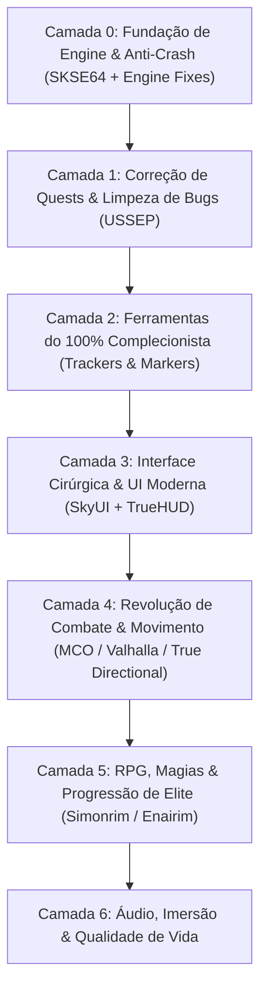

# 🐉 SKYRIM SPECIAL EDITION: PROTOCOLO DEFINITIVO 100% & MASTER GAMEPLAY

> **Objetivo Soberano:** Transformar o Skyrim SE na sua versão definitiva: combate moderno responsivo, estabilidade inabalável (zero crash), preservação de lore, reativação de conquistas e rastreamento cirúrgico de 100% de colecionáveis, quests e perks.
> **Ambiente Alvo:** Linux (Proton + Mod Organizer 2 via `mo2-linux-installer`) / Windows (MO2 Nativo).
> **Conta Nexus Vinculada:** `Mercenary308` (API Key persistida em `~/.config/nexusmods/credentials.json`).

---

## 🏗️ ARQUITETURA EM 7 CAMADAS



---

## 🛠️ CAMADA 0: FUNDAÇÃO DA ENGINE, ESTABILIDADE & CONQUISTAS STEAM
*Sem isso, mods quebram a engine e a Bethesda bloqueia as conquistas da Steam.*

| Mod / Ferramenta | Nexus ID | Função Vital | Por que é Obrigatório no 100% |
| :--- | :--- | :--- | :--- |
| **SKSE64** | *Externo* | Extensor de Scripts 64-bit | Base para 95% dos mods avançados. |
| **Address Library for SKSE Plugins** | `32444` | Header universal de offsets de memória | Evita que updates quebrem DLLs de mods. |
| **SSE Engine Fixes** | `17230` | Patch em C++ direto na engine da Bethesda | **Reabilita Conquistas Steam com mods**, corrige física em >60 FPS e vazamento de memória. |
| **Scrambled Bugs** | `43532` | Correções profundas de engine do jogo | Conserta bugs de perks, feitiços e cálculos de acerto do motor vanilla. |
| **Recursion Fix** | `105248` | Correção de loops infinitos de scripts | Impede que scripts do jogo fiquem travados consumindo CPU em saves longos (run 100%). |
| **Crash Logger SSE** | `59818` | Diagnóstico de falhas | Se o jogo fechar, gera log apontando exatamente qual arquivo/malha causou o crash. |

---

## 🐛 CAMADA 1: CORREÇÃO DE QUESTS & INTEGRIDADE DE SAVEGAME
*Skyrim possui dezenas de missões que travam permanentemente sem estes patches.*

| Mod | Nexus ID | Função Vital | Impacto no 100% |
| :--- | :--- | :--- | :--- |
| **USSEP (Unofficial Skyrim SE Patch)** | `266` | Compilado massivo de correções | Resolve mais de 10.000 bugs de diálogos, gatilhos de quests e itens inacessíveis. |
| **Quest Journal Limit Bug Fixer** | `56130` | Correção de limite de missões ativas | Previne corrupção quando você acumula centenas de quests secundárias. |
| **Encounter Zones Unlocked SE** | `1961` | Zonas de encontro dinâmicas | Garante que dungeons visitadas no início voltem a escalar de nível no endgame. |

---

## 🏆 CAMADA 2: ARSENAL DO 100% COMPLECIONISTA
*Rastreamento cirúrgico de cada gema, quest, máscara, livro e conquista sem precisar consultar wiki externa o tempo todo.*

| Mod | Nexus ID | O que faz no Jogo | Por que é Indispensável |
| :--- | :--- | :--- | :--- |
| **Completionist - Skyrim Quest Tracker** | `46358` | Menu MCM com checklist completa | Rastreador de missões primárias, secundárias, daédricas, livros de skill e itens únicos. |
| **Stones of Barenziah Quest Markers** | `684` | Marcadores para as 24 Gemas | Elimina a agonia de vasculhar Skyrim procurando a última gema da Thieves Guild. |
| **Jiub's Opus & Arvak's Skull Markers** | `818` | Marcadores na Soul Cairn | Transforma a pior busca cega da DLC Dawnguard em algo rápido e objetivo. |
| **Dragon Priest Masks Quest Markers** | `11604` | Marcadores para os 8 Sacerdotes Dragão | Rastreamento direto para fechar o santuário de Bromjunaar. |
| **Crimson Nirnroot Quest Markers** | `1016` | Marcadores para as 30 Nirnroots Vermelhas | Agiliza a quest lendária de Blackreach sem frustração. |
| **Unread Books Glow SSE** | `1296` | Destaca livros de perícia e feitiços não lidos | Garante que nenhum Skill Book passe despercebido para upar habilidades. |

---

## 🖥️ CAMADA 3: INTERFACE DE USUÁRIO (UI) CIRÚRGICA & MODERNA
*Substitui a UI arcaica de console por uma interface de PC fluida, legível e informativa.*

| Mod | Nexus ID | Função | Experiência de Jogo |
| :--- | :--- | :--- | :--- |
| **SkyUI SE** | `12604` | Interface lendária de inventário e menus | Menu MCM, filtros por peso/valor/dano, busca textual rápida. |
| **TrueHUD - HUD Additions** | `62775` | Barras de vida e estamina estilo souls/RPG moderno | Barra flutuante sobre chefes, indicador de poise e dano numérico opcional. |
| **Better Third Person Selection (BTPS)** | `64339` | Seleção precisa de itens em 3ª pessoa | Permite pegar moedas, plantas e chaves em 3ª pessoa sem errar a mira. |
| **Dear Diary Dark Mode (ou SkyUI Flashing Save Fix)** | `60837` | Tema escuro elegante com textura de papel | Elimina o cinza cansativo do SkyUI vanilla para longas sessões de jogo. |
| **Compass Navigation Overhaul** | `66816` | Bússola aprimorada no topo | Mostra distância exata, nome da localização e marcadores verticais. |

---

## ⚔️ CAMADA 4: REVOLUÇÃO TOTAL DE COMBATE (SOULS-LIKE / ARPG)
*Skyrim vanilla tem combate travado de 2011 ("bater em esponja de dano"). Esta camada transforma a jogabilidade em algo no nível de The Witcher 3 / Elden Ring.*

| Mod | Nexus ID | O que altera na Gameplay |
| :--- | :--- | :--- |
| **True Directional Movement (TDM)** | `51614` | Movimentação 360° fluida em 3ª pessoa com trava de mira (Lock-On) perfeita. |
| **MCO/DXP (Modern Combat Overhaul)** | *Distr. Guild* | Sistema de ataque com combos, peso real nas armas e animações dedicadas por classe de arma. |
| **Valhalla Combat** | `64741` | Sistema de bloqueio perfeito (Timed Block), execução por quebra de postura e estamina agressiva. |
| **Precision - Accurate Melee Collisions** | `72347` | Hitbox cirúrgica baseada na malha da arma (fim das espadas cortando o ar e acertando você). |
| **SmoothCam** | `41638` | Câmera de 3ª pessoa fluida com presets cinematográficos e sem tremor. |

---

## 🧙‍♂️ CAMADA 5: RPG, BUILDS & PROGRESSÃO
*Atualização do antigo pacote de 2021 (Ordinator).*

| Mod | Nexus ID | Vantagem Técnica e de Gameplay |
| :--- | :--- | :--- |
| **Ordinator - Perks of Skyrim** | `1137` | Mais de 400 novos perks que viabilizam qualquer arquétipo (Bardo, Paladino, Necromante, Ladino Trapmaster). |
| **Apocalypse - Magic of Skyrim** | `1090` | 155 feitiços com efeitos únicos e sinergia com o Ordinator. |
| **Nether's Follower Framework (NFF)** | `55653` | Substitui o antigo *AFT*. Muito mais estável em scripts, permite treinar companheiros e definir residências. |
| **Summermyst - Enchantments of Skyrim** | `6285` | Dezenas de novos encantamentos balanceados para o late game do 100%. |

---

## 🐎 CAMADA 6: QUALIDADE DE VIDA & IMERSÃO
*Melhorias pontuais que eliminam irritações do jogo base.*

| Mod | Nexus ID | Impacto |
| :--- | :--- | :--- |
| **Auto Unequip Shield to Back / Simple Dual Sheath** | `50049` | Escudos e adagas vão para as costas e cintura de forma elegante. |
| **Timing is Everything SE** | `25464` | Permite calibrar em que nível começam os ataques de vampiros e cultistas (evita mortes prematuras de NPCs em cidades). |
| **Rich Skyrim Merchants** | `1772` | Aumenta o ouro dos mercadores para você conseguir vender o loot do 100% sem precisar esperar 48h a cada venda. |
| **Quick Loot RE** | `21085` | Menu de saque rápido em tempo real ao olhar para baús e cadáveres (estilo Fallout 4). |

---

## 🚀 GUIA DE IMPLANTAÇÃO FUTURA NO LINUX / STEAM

### Pré-requisitos do Sistema
1. Instalar o **Skyrim Special Edition** via Steam com Proton Experimental ou GE-Proton.
2. Abrir o jogo vanilla uma vez até o menu principal para gerar os arquivos `.ini` iniciais.

### Roteiro de Instalação do MO2:
```bash
# 1. Clonar o instalador automatizado para Proton
git clone https://github.com/rockerbacon/modorganizer2-linux-installer.git
cd modorganizer2-linux-installer

# 2. Rodar o assistente (ele detecta a pasta do jogo na Steam automaticamente)
./install.sh
```

### Configurações Iniciais dentro do MO2:
1. Em `Settings > Nexus`, vincular com a conta `Mercenary308`.
2. Baixar os mods compactados na pasta de downloads do MO2.
3. Instalar seguindo estritamente a ordem das Camadas (0 a 6).
4. Executar o jogo **sempre através do atalho do SKSE** dentro do MO2.

---

## ⚖️ CAMADA 7: QUEBRA DO PARADOXO DO LEVELING & ECONOMIA JUSTA
*No Skyrim vanilla, você é punido por jogar normalmente: o ferreiro é forçado a forjar 5.000 adagas de ferro, os treinadores custam fortunas e limitam 5 aulas por nível (perdidas se você upar antes de pagar), e o gold dos mercadores é ridículo (750 septims).*
*Esta camada elimina a necessidade de qualquer glitch ou grind maçante:*

| Mod | Nexus ID | Como Resolve o Paradoxo | Benefício na Run 100% |
| :--- | :--- | :--- | :--- |
| **Experience** | `17751` | **Muda a lógica de XP para padrão RPG moderno:** Você ganha nível completando missões, descobrindo masmorras e explorando o mapa — e **NÃO** spamando magias na parede ou forjando adagas. | Você avança e zera o jogo jogando as quests, sem precisar grindar skills secundárias. |
| **Smart Training - Tweaked SE** | `18048` | **Fim do desperdício de aulas:** No vanilla, se você upa de nível sem usar os 5 treinos de mestre, eles somem para sempre. Com este mod, os treinos acumulam como créditos. | Se você passar 10 níveis sem ir a um mestre, você terá 50 treinos acumulados quando tiver dinheiro. |
| **Train and Study** | `17578` | **Treinamento orgânico:** Bonecos de treino (*dummies*), alvos de arquearia e livros comuns agora concedem treino real passando tempo in-game. | Alternativa imersiva para subir armas e arco sem exploits de bater nos Greybeards ajoelhados. |
| **Trade and Barter** | `23081` | **Economia balanceada e dinâmica:** Ajusta preços com base no seu status social, guilda e reputação local, além de dar estoque de ouro real aos mercadores. | O ouro acumulado nas dungeons tem valor real e você não precisa esperar 48h no botão T a cada 3 itens vendidos. |
| **Skyrim Skill Uncapper** | `8889` | **Personalização cirúrgica de limites:** Permite calibrar ganho de XP por skill, pontos de perk por nível e quantidade de treinos por mestre via arquivo `.ini`. | Dá total controle se quiser aumentar o limite de 5 treinos/nível para 10 ou 15 sem quebrar o jogo. |

---

## 🔮 CAMADA 8: O FIM DA PAUSA EM COMBATE & MAGIA AUTOMÁTICA
*No Skyrim vanilla, jogar de mago ou conjurador exige pausar o jogo a cada 3 segundos para equipar feitiço na mão. Os dois mods lendários que você lembrava:*

| Mod | Nexus ID | Mecânica | O que Resolve |
| :--- | :--- | :--- | :--- |
| **Smart Cast SSE Patch** | `32847` | **Casting Automático & Lógica "If / Then":** Você configura no SkyUI regras automáticas: *Se Vida < 50% ➔ Castar Fast Healing automaticamente*; *Se entrar em combate ➔ Castar Oakflesh/Ironflesh*; *Se equipar espada ➔ Castar Cloak de Fogo*. Sem pausar o jogo, sem ocupar as mãos. | Acaba com a morte estúpida por esquecer de curar ou ficar abrindo menu de favoritos em pânico. |
| **Wheeler - Quick Action Wheel** | `97345` | **Roda de Ações Rápida (Estilo GTA V / Doom Eternal / Monster Hunter):** Abre uma roda em slow-motion no botão do mouse/teclado. Você troca magias, armas, gritos e poções instantaneamente com o cursor. | Elimina 100% da necessidade de parar o jogo no menu de favoritos arcaico. |
| **The Wizard Warrior** | `14890` | **Castar Magias no Golpe de Arma (Spellsword Real):** Permite atribuir qualquer feitiço para ser disparado ao balançar a espada, bloquear com escudo ou atirar flecha. | Mago-Guerreiro definitivo sem ficar trocando itens de mão. |
| **Disable Follower Collision** | `35925` | **Fim da Lydia travando portas:** Remove totalmente a caixa de colisão física entre você e seus seguidores / invocações. Você atravessa o NPC se ele parar na sua frente. | Acaba com o ódio clássico de ficar preso em corredores estreitos de catacumbas. |

---

## 🛑 CAMADA 9: PROTOCOLO ZERO-GLITCH (ELIMINAÇÃO TOTAL DE EXPLOITS)
*Por que os jogadores usavam exploits no Skyrim vanilla e como eliminamos a necessidade de cada um deles com engenharia de jogo limpa:*

### 1. Fim do Glitch do Baú do Khajiit em Dawnstar (Falta de Ouro/Itens)
* **O Glitch:** Pegar baús invisíveis enterrados no chão em Dawnstar para conseguir ouro e itens fáceis.
* **A Solução:** **Trade and Barter** (`23081`) + **Rich Skyrim Merchants** (`1772`). Os mercadores têm até 10.000 septims e compram tudo de forma justa. Você fica rico apenas limpando masmorras e explorando o mundo normalmente.

### 2. Fim do Glitch do "Resto-Loop" (Poções Infinitas de Encantamento)
* **O Glitch:** Abusar do loop infinito de Fortify Restoration + Fortify Enchanting para criar armas de 1.000.000 de dano que quebram o jogo.
* **A Solução:** **USSEP** (`266`) bloqueia o bug matemático do motor. Em conjunto com **Ordinator** (`1137`) e **Summermyst** (`6285`), você atinge alto poder de dano e defesa através de sinergias legítimas da árvore de habilidades sem precisar bugar o motor.

### 3. Fim do Glitch de Espadas em Baldes / Fim de Upar Ferreiro com 3.000 Adagas
* **O Glitch:** Mesmo jogando de mago puro ou ladino, o jogador era obrigado a virar ferreiro lendário para conseguir uma armadura ou arma com dano decente.
* **A Solução:** **Honed Metal - NPC Crafting and Enchanting Services** (`61015`):
  * **O que faz:** Ferreiros famosos (como Eorlund Gray-Mane na Skyforge) e magos da corte (como Farengar) **trabalham para você por encomenda**.
  * Você leva o minério e o ouro, e eles forjam, aprimoram e encantam os seus itens no nível máximo deles. Você nunca mais precisa tocar em uma forja se o seu personagem não for ferreiro.

### 4. Fim do Glitch do Prato na Parede (Atravessar Portas Trancadas / Pular Dungeons)
* **O Glitch:** Segurar um prato contra uma parede para atravessar portões trancados e não ter que passar por quebra-cabeças longos ou fechaduras master.
* **A Solução:** **Remember Lockpick Angle** (`26838`) + Perks de Lockpicking do **Ordinator** (`1137`) (que incluem o perk *Lockpick Mastery* e gazuas autônomas que abrem portas automaticamente com base em perks legítimos).

### 5. Fim do Desperdício de Gemas da Alma (Soul Gem Trap)
* **O Glitch / Frustração:** Uma *Grand Soul Gem* caríssima capturando uma alma de rato pequeno (*Petty*) e sendo estragada para sempre.
* **A Solução:** **Acquisitive Soul Gems Multithreaded** (`1469`):
  * Garante que gemas só aceitem almas do seu tamanho exato. Ratos vão para Petty Gems; almas humanas/monstros vão para Black/Grand Gems. Nenhuma gema é desperdiçada.

---

## 🎭 CAMADA 10: FLUIDEZ DE CLASSES, BUILDS & RESPEC LIVRE
*No Skyrim vanilla, se você investe 40 níveis jogando de Guerreiro de Armadura Pesada e quer virar Mago ou Arqueiro Furtivo, você está travado: seus perks estão presos, sua magia é fraca e o jogo só permite redistribuir perks no final da DLC Dragonborn (Apocrypha).*
*Esta camada transforma as classes em um sistema dinâmico e flexível:*

| Mod | Nexus ID | Mecânica | Impacto na Troca de Classes |
| :--- | :--- | :--- | :--- |
| **Ish's Respec Mod** | `1960` | **Poção de Respec de Perks:** Alquimistas e boticários vendem a *Potion of Respec*. Ao beber, todos os seus perks investidos voltam para o saldo do personagem. | Permite trocar de Guerreiro para Mago ou Ladino instantaneamente a qualquer momento, sem precisar usar comandos de console. |
| **Andromeda - Unique Standing Stones** | `14910` | **Pedras Guia Vivas e Reconfiguráveis:** As pedras do zodíaco de Skyrim (Mage, Thief, Warrior, Shadow, Atronach) agora concedem habilidades passivas e ativas profundas. | Mudar de estilo de jogo basta visitar uma Standing Stone diferente pelo mapa para mudar drasticamente o comportamento da sua build. |
| **Wintersun - Faiths of Skyrim** | `22506` | **Sistema de Devoção e Divindades (RPG de Verdade):** Permite rezar e seguir deuses (Nove Divinos, Príncipes Daédricos, deuses Élficos). Cada deus dá bônus radicais específicos (ex: Stendarr buffa paladino, Nocturnal buffa ladrão, Hermaeus Mora buffa magias). | Você molda a identidade da sua classe através da sua religião e pode trocar de divindade conforme sua história evolui. |
| **Dragon Souls to Perk Points** | `2879` | **Conversão Orgânica de Almas de Dragão:** Permite converter o excesso de almas de dragão acumuladas na campanha em pontos de perk. | Recompensa a caçada aos dragões e dá os pontos necessários para você desenvolver uma segunda classe no mesmo personagem sem precisar grindar níveis. |
| **SkyUI Equipment Sets / Group Hotkeys** | `12604` | **Loadouts Rápidos de Equipamento (F1 a F8):** Você salva conjuntos inteiros de armas + armaduras + feitiços em teclas de atalho. | Transição instantânea: com um toque de tecla você guarda a armadura pesada e espada e veste a túnica de mago com báculos e anéis mágicos. |

---

## 🧭 GUIA DINÂMICO DE BUILDS & TRANSIÇÃO DE CLASSES (100% RUN)

Como o nosso pacote conta com **Experience** (`17751`), **Ordinator** (`1137`) e **Ish's Respec Mod** (`1960`), a melhor estratégia de progressão para fazer 100% sem frustração é avançar em **3 Fases Temáticas**:


1. **Fase Inicial (Níveis 1 ao 25) — O Guerreiro / Paladino:**
   * **Foco:** One-Handed, Block, Heavy Armor.
   * **Facções:** Companions e Main Quest inicial.
   * **Vantagem:** Maior margem de erro enquanto você se acostuma com o combate do MCO/Valhalla.
2. **Fase Intermediária (Níveis 25 ao 50) — O Mestre das Sombras:**
   * **Transição:** Beba a *Potion of Respec* do Ish's Mod. Mude seus pontos para Sneak, Archery, Light Armor, Pickpocket e Lockpicking.
   * **Facções:** Thieves Guild e Dark Brotherhood.
   * **Vantagem:** Limpeza das 24 Gemas de Barenziah e acúmulo de riqueza absurda.
3. **Fase Endgame (Níveis 50+) — O Mestre Arcano / Spellsword:**
   * **Transição:** Use os pontos acumulados e almas de dragão convertidas para abrir Destruction, Conjuration e Alteration no Ordinator.
   * **Facções:** College of Winterhold e DLC Dragonborn (Solstheim).
   * **Vantagem:** Controle absoluto de campo com o Smart Cast disparando buffs e dano em área em tempo real.

---

## 🗺️ CAMADA 11: MUNDO VIVO & EXPLORAÇÃO ESTILO RDR2 (SEM FAST TRAVEL)
*No Skyrim vanilla, andar a pé ou a cavalo pelas estradas é monótono: caminhos de terra genéricos, encontros repetitivos de bandidos e cidades desconectadas. No Red Dead Redemption 2, cavalgar é prazeroso porque a estrada é viva, cheia de eventos aleatórios, pontos de interesse, iluminação cênica e marcos visuais.*
*Esta camada transforma a travessia de Skyrim em uma jornada viva onde você naturalmente não sente falta de fast travel:*

| Mod | Nexus ID | O que Adiciona ao Mundo | Por que Torna o Mundo Vivo (Estilo RDR2) |
| :--- | :--- | :--- | :--- |
| **Northern Roads** | `77530` | **Estradas Completamente Reconstruídas:** Substitui a terra batida genérica por caminhos empedrados, pontes rústicas de madeira, ruínas nórdicas nas encostas e santuários na beira das trilhas. | A travessia ganha identidade geográfica real. Cada região tem seu próprio estilo de estrada. |
| **Lux Via** | `63588` | **Iluminação & Pontos de Interesse nas Vias:** Adiciona postes de iluminação de época, fogueiras de viajantes, pontes reformadas e pequenas paradas ao longo das rotas comerciais. | Andar à noite deixa de ser um breu vazio e vira uma travessia atmosférica e envolvente. |
| **Interesting NPCs SE (3DNPC)** | `29194` | **Mais de 250 NPCs Únicos com Histórias Próprias:** Encontrados acampando na beira da estrada, cantando em tavernas remotas ou precisando de ajuda em encruzilhadas. Todos dublados e com personalidades marcantes. | Traz a sensação de "estranhos pelo caminho" que consagrou o mundo aberto de Red Dead. |
| **More Bandit Camps** | `1994` | **Acampamentos Orgânicos nas Trilhas:** Adiciona dezenas de pequenos acampamentos de bandidos e saqueadores escondidos em cavernas e despenhadeiros perto das estradas. | Acaba com os longos trechos de terreno baldio onde nada acontece. |
| **Missives** | `17576` | **Quadros de Avisos nas Tavernas e Cidades:** Como os quadros de cartazes de caça e recados de RDR2 e The Witcher 3. Pegue contratos de caça de bandidos, entregas de cartas entre vilarejos e coleta de minérios locais. | Você sempre tem um motivo orgânico para cavalgar até o próximo vilarejo sem abrir a viagem rápida. |
| **Carriage and Ferry Travel Overhaul (CFTO)** | `8379` | **Transporte Público Imersivo:** Carruagens e balsas conectam todos os vilarejos pequenos (não apenas as 5 capitais). Você viaja imersivamente pagando uma moeda ao condutor. | Substitui o teletransporte mágico por uma viagem diegética de transporte de época. |
| **Convenient Horses** | `9519` | **Cavalaria Real de RPG:** Sistema de inventário nas selas do cavalo (alforjes para carregar loot extra), coleta de plantas montado sem descer, combate a cavalo funcional e assobio para chamar o cavalo de longe. | O cavalo vira seu companheiro fiel e útil de jornada, exatamente como em RDR2. |
| **Point The Way** | `352` | **Placas de Sinalização nos Cruzamentos:** Instala placas de madeira autênticas apontando a direção de cada cidade e forte nas encruzilhadas. | Permite que você navegue organicamente olhando o relevo e as placas, sem ficar abrindo o mapa de 2 em 2 minutos. |

---

## 🛡️ CAMADA 12: ELIMINAÇÃO DE ATRITOS MECÂNICOS & FRUSTRAÇÕES DE IA
*Mapeamento cirúrgico para os 8 atritos de gameplay clássicos (killcams roubadas, cavalos suicidas, acidentes com guardas e montanhas cegas):*

### 1. Fim das Killcams Injustas e Flechas Falhadas
* **A Dor:** A câmera lenta de finalização (Killcam) entra do nada, você perde o controle e morre sem poder reagir; ou você atira uma flecha, a killcam cinematográfica ativa e a flecha bate numa quina ou erra o alvo.
* **A Solução:** **VioLens - A Killmove Mod SE** (`668`):
  * Permite **desativar killcams de longo alcance** (nunca mais flecha em câmera lenta errando).
  * Concede **imunidade ao jogador contra killcams de inimigos** (o jogo nunca mais vai te travar numa animação indefesa de morte).
  * Permite calibrar a frequência e visão (1ª ou 3ª pessoa) das finalizações corpo a corpo.

### 2. Fim do "Fogo Amigo" e Crimes Acidentais no Meio da Luta
* **A Dor:** Você está enfrentando um dragão ou vampiro na cidade, acerta um golpe sem querer num guarda, num cavalo ou numa galinha, e a cidade inteira para de lutar contra o monstro para te caçar.
* **A Solução:** **Simple Offence Suppression** (`41764`):
  * Plugin SKSE que impede que NPCs neutros ou aliados fiquem hostis por golpes acidentais durante combates contra monstros.

### 3. Fim dos NPCs Suicidas Contra Dragões
* **A Dor:** Um dragão pousa em Riverwood e o ferreiro Alvor parte para cima com um martelo de forja, morre e quebra missões e serviços da vila.
* **A Solução:** **Run For Your Lives** (`2272`):
  * Faz com que civis, comerciantes e crianças corram para dentro de casa e tranquem as portas quando dragões ou vampiros atacam. Apenas guardas armados e você enfrentam a fera.

### 4. Fim do Cavalo Agressor Suicida
* **A Dor:** Você desce do cavalo para enfrentar um urso ou dragão e o cavalo avança na frente, toma dano e morre.
* **A Solução:** **Convenient Horses** (`9519`) (Configuração de Comportamento):
  * Permite definir no menu MCM a postura do cavalo para **"Passivo / Covarde"** ou **"Fugir para distância segura"**. Ao desmontar em combate, ele se afasta imediatamente da zona de perigo.

### 5. Fim do "Trocar Dano" (Esquiva com I-Frames Reais)
* **A Dor:** Recuar andando de costas ou para os lados não evita o ataque do inimigo por causa de animações com rastreamento magnético da Bethesda.
* **A Solução:** **TK Dodge RE - Script Free** (`56956`):
  * Adiciona esquiva com rolamento / passo lateral rápido (dash) com frames de invencibilidade (I-Frames), sem scripts pesados. Permite esquivar de machadadas pesadas com habilidade real de reflexo.

### 6. Fim do Arqueiro Furtivo Quebrado (Stealth Trivilizado)
* **A Dor:** A IA do jogo base é cega no escuro e surda. Qualquer um agacha no meio da sala e limpa a dungeon inteira sem esforço.
* **A Solução:** **Realistic AI Detection (RAID)** (`2345`):
  * Recalibra completamente a fórmula de detecção da IA com base na luz real, no som de passos e no tipo de armadura. Inimigos buscam o jogador de forma tática e investigam cantos por mais tempo, trazendo tensão e mérito real para o roleplay furtivo.

### 7. Pilotagem Real de Dragões (DLC Dragonborn)
* **A Dor:** O grito *Bend Will* permite subir no dragão, mas você não pilota: você fica assistindo uma IA burra voar em círculos sem controle real.
* **A Solução:** **Intuitive Dragon Ride Control** (`64679`):
  * Concede comandos de voo diretos e controle responsivo sobre para onde o dragão voa e quem ele alveja.

---

## ⚔️ CAMADA 13: ARSENAL CIRÚRGICO POR CLASSE & ARQUÉTIPO
*No Skyrim vanilla, todas as armas de uma mesma categoria parecem iguais, magos ficam sem opções no late game, ladrões não têm mecânicas reais de furto e arqueiros sofrem com draw speed lento. Esta camada entrega identidade única para cada classe:*

### 🧙‍♂️ 1. Arquétipo Mago / Conjurador / Ilusionista
* **[Odin - Skyrim Magic Overhaul](https://www.nexusmods.com/skyrimspecialedition/mods/46000)** (`46000`):
  * Corrige a progressão estagnada de magias da Bethesda. Adiciona mais de 120 feitiços canônicos, balanceia pergaminhos e báculos (staves passam a escalar dano com a sua perícia e recarregar magicka).
* **[Arcanum - A New Age of Magic](https://www.nexusmods.com/skyrimspecialedition/mods/23488)** (`23488`):
  * Feitiços cinematográficos de alta complexidade com combos elementais (ex: feitiços que conjuram tempestades de meteoros, buracos negros arcanos e barreiras temporais dinâmicas).
* **[Strange Runes](https://www.nexusmods.com/skyrimspecialedition/mods/19456)** (`19456`):
  * Adiciona runas mágicas circulares em 3D brilhando dinamicamente nas mãos do personagem enquanto você canaliza feitiços (estilo *Doutor Estranho*).

### 🛡️ 2. Arquétipo Guerreiro / Paladino / Bárbaro
* **[Dual Wield Parrying Reimplementation](https://www.nexusmods.com/skyrimspecialedition/mods/18264)** (`18264`):
  * **Fim da incapacidade de bloquear:** No vanilla, se você usa duas espadas ao mesmo tempo ou espada em uma mão e feitiço na outra (Spellsword), o botão direito ataca e você **perde a habilidade de defender**. Este mod cria uma tecla dedicada de bloqueio/parry.
* **[Stances - Dynamic Animation Sets](https://www.nexusmods.com/skyrimspecialedition/mods/40484)** (`40484`):
  * **Sistema de 4 Posturas de Combate (estilo Nioh / Ghost of Tsushima):**
    * *Postura Alta:* Ataques lentos, alto dano e quebra de postura;
    * *Postura Média:* Equilíbrio de dano e defesa rápida;
    * *Postura Baixa:* Ataques ultrarrápidos para sangramento e estamina;
    * *Postura Neutra:* Animações vanilla.

### 🗡️ 3. Arquétipo Ladrão / Assassino Furtivo
* **[Sneak Tools SE](https://www.nexusmods.com/skyrimspecialedition/mods/1863)** (`1863`):
  * Adiciona mecânicas de jogos furtivos profissionais (*Thief*, *Dishonored*, *Splinter Cell*):
    * **Flechas de Água:** Apagam tochas e lareiras à distância para criar sombras completas;
    * **Flechas de Corda:** Permite escalar muralhas e janelas altas;
    * **Slit Throat (Corte de Garganta):** Assassinato instantâneo silencioso pelas costas com adaga;
    * **Blackjack (Cassetete):** Nocaute não-letal pelas costas (permite passar sem matar ninguém);
    * **Máscaras de Identidade Oculta:** Escondem sua identidade — qualquer crime cometido com a máscara não adiciona recompensa à sua cabeça depois de tirá-la.

### 🏹 4. Arquétipo Arqueiro / Caçador
* **[Archery Gameplay Overhaul SE (AGO)](https://www.nexusmods.com/skyrimspecialedition/mods/24296)** (`24296`):
  * Transforma completamente o combate com arco:
    * Animação de sacar e puxar a corda muito mais rápida e responsiva;
    * Flechas com efeito de sangramento realista em inimigos;
    * Permite puxar e manter a flecha tensionada sem cansaço absurdo de estamina;
    * Encantamento de flechas e anéis em tempo real.

---

## 💎 CAMADA 14: DESTRUIÇÃO TOTAL DE ATRITOS POR ESPECIALIZAÇÃO
*Análise aprofundada de cada limitação clássica por estilo de jogo e as soluções cirúrgicas:*

### 1. O Mod de Lockpick Desejado: [Easy Lockpicking](https://www.nexusmods.com/skyrimspecialedition/mods/4070) (`4070`) ou [Lockpick Pro SE]
* **Como você gostava:** No seu pacote de 2021 você tinha o `Lockpick Pro v3-219-3.zip`, que colocava uma barra colorida/indicador no topo da tela mostrando o ponto exato onde a fechadura abre.
* **No Skyrim SE:** 
  * Se quiser abrir de primeira sem minigame nenhum: **Easy Lockpicking** (`4070`) (qualquer gazua vira no meio e abre na hora).
  * Se quiser com indicador visual no HUD ou manter o minigame sem frustração: **Remember Lockpick Angle** (`26838`) ou o port do **Lockpick Pro SE**.

### 2. Guerreiro: O Fim da Disputa Mortal de Estamina (Block, Bash & Sprint)
* **O Problema Vanilla:** Bloquear toma dano parcial e gasta estamina; dar bash gasta metade da barra; correr esgota tudo. Ficar com estamina zero te deixa indefeso.
* **A Solução:** **Valhalla Combat** (`64741`) (Já na Camada 4):
  * **Timed Block (Parry Perfeito):** Se você bloquear no milissegundo do golpe, **você não toma 1 ponto de dano** e reflete o impacto, atordoando o agressor.
  * **Estamina Ofensiva:** Acertar golpes com armas leves **recupera estamina** (estilo ARPG moderno), eliminando a exaustão eterna da barra.

### 3. Duas Mãos & Dual Wield: Defesa e Magia sem Troca de Mãos
* **O Problema Vanilla:** Duas armas não bloqueiam; armas de duas mãos bloqueiam mal e não curam sem guardar a arma.
* **A Solução:** 
  * **Dual Wield Parrying** (`18264`): Tecla dedicada que permite bloquear e dar bash mesmo segurando duas espadas ou espada + feitiço.
  * **Smart Cast** (`32847`): Cura automática programada no MCM quando sua vida cai de 50%, sem você precisar soltar seu martelo de duas mãos para castar Fast Healing.

### 4. Mago de Destruição: O Fim do Dano Fraco no Late Game
* **O Problema Vanilla:** No nível 50, uma espada com ferreiro dá 400 de dano, mas a magia Incinerate da Bethesda continua dando os mesmos 60 de dano base de quando você era nível 15.
* **A Solução:** **Ordinator** (`1137`) + **Odin** (`46000`):
  * O perk *Destruction Mastery* faz o dano de todas as magias **escalar percentualmente a cada ponto do seu nível de Destruição**, igualzinho às armas físicas.

### 5. Conjurador: O Fim do Bug de Spell Absorption
* **O Problema Vanilla:** Se você pega o perk *Atronach* ou a *Atronach Stone* (que absorve 50% de magias inimigas), o motor comete um bug matemático e **absorve suas próprias invocações**, fazendo seu Atronach falhar e sumir com a sua Magicka.
* **A Solução:** **Scrambled Bugs** (`43532`) (Já na Camada 0):
  * Corrige a linha de código C++ da engine: o jogo passa a checar se o feitiço foi castado por você mesmo, permitindo absorver dano inimigo sem anular suas próprias criaturas invocadas.

### 6. Ilusionista: O Fim da Imunidade de Mortos-Vivos, Dragões e Vampiros
* **O Problema Vanilla:** Metade dos inimigos de Skyrim são Draugrs, vampiros e robôs anões imunes aos feitiços de Calm/Fury até você atingir Ilusão nível 90.
* **A Solução:** **Ordinator** (`1137`) redesenha a árvore de Ilusão:
  * O perk *Neverworld* e *Crown of the False King* reduzem a resistência mental dos inimigos continuamente e afetam todas as raças desde os níveis iniciais.

### 7. Mago de Alteração: Fim de Renovar Mage Armor a Cada 60 Segundos
* **O Problema Vanilla:** Ter que parar a cada 60s para castar Ebonyflesh na mão.
* **A Solução:** **Smart Cast** (`32847`):
  * Regra de evento: *"Ao entrar em combate ➔ Castar Ebonyflesh instantaneamente"*. Você entra na luta com armadura mágica ativa sem gastar 1 segundo de preparação.

### 8. Ladrão: Fim do Teto Rígido de 90% em Pickpocket
* **O Problema Vanilla:** Mesmo com Pickpocket nível 100 e armadura da Guilda dos Ladrões, a chance máxima é travada em 90%, forçando o jogador a recarregar savegame em 1 de cada 10 furtos.
* **A Solução:** **Skyrim Skill Uncapper** (`8889`):
  * No arquivo `SkyrimUncapper.ini`, basta alterar `fPickPocketMaxChance = 100` para que um ladrão mestre tenha 100% de sucesso garantido, eliminando o Save/Load compulsivo.

### 9. Lorde Vampiro: Transformação Rápida & Poder Verdadeiro
* **O Problema Vanilla:** A forma de Lorde Vampiro remove seus itens, não permite nadar e é mais fraca que a forma humana no endgame.
* **A Solução:** **Sacrosanct - Vampires of Skyrim** (`3928`):
  * Overhaul lendário de vampirismo: adiciona magias de sangue (*Hemomancy*), novos perks de Lorde Vampiro que escalam com o número de vítimas alimentadas e mobilidade sobrenatural de névoa.

---

## 📍 CAMADA 15: MAPEAMENTO ABSOLUTO DE 100% & ELIMINAÇÃO DE ATRITOS DE SISTEMA
*Para quem quer fazer 100% da campanha, explorar masmorras e cavernas sem saber se já foram limpas ou perder pontos de interesse no mapa é um dos maiores desperdícios de tempo. Esta camada revela tudo de forma precisa e limpa os atritos da interface de sistema:*

### 🗺️ 1. Rastreadores Totais de Localizações no Mapa
| Mod | Nexus ID | Mecânica | Impacto na Run 100% |
| :--- | :--- | :--- | :--- |
| **Atlas Map Markers SE (com MCM)** | `24104` | **Adiciona mais de 700 novos marcadores no mapa-múndi:** Marca entradas secundárias de cavernas, acampamentos remotos, santuários de deuses, túmulos e locais de tesouro. Totalmente configurável pelo menu MCM (você ativa ou oculta categorias como quiser). | Nenhum canto de Skyrim fica oculto ou esquecido na hora de explorar todas as locações da conquista *Explorer*. |
| **CoMAP - Common Marker Addon Project** | `56123` | **Ícones Customizados no Mapa & Bússola:** Em vez de usar o mesmo ícone cinza genérico para tudo, ele atribui ícones específicos coloridos para altares de deuses, pedras do zodíaco, covis de dragão e portões de cidades. | Leitura instantânea do mapa sem precisar passar o cursor em cada ícone para ler o nome. |
| **A Quality World Map (SE)** | `5804` | **Mapa com Estradas em Relevo Detalhado:** Mostra com clareza todas as trilhas e estradas secundárias, evitando que você tente subir montanhas inacessíveis. | Evita a frustração clássica de ficar preso na encosta de montanhas tentando achar a rota para High Hrothgar. |

### ⚙️ 2. Fim das Micro-Irritações de Sistema & Menus (QoL Profundo)
| Mod | Nexus ID | A Irritação Vanilla | A Solução Cirúrgica |
| :--- | :--- | :--- | :--- |
| **Yes I'm Sure** | `24898` | **Mensagens de confirmação desnecessárias:** *"Tem certeza de que deseja forjar isso?"*, *"Tem certeza de que deseja sair da bancada?"*. | Elimina todos os popups de confirmação do jogo. Clicou, executou instantaneamente. |
| **Stay At The System Page** | `19832` | **Menu ESC abrindo na aba de quests:** Ao apertar ESC para salvar rapidamente, o jogo abre no diário de missões, forçando você a navegar de aba. | Garante que apertar ESC sempre abra direto na aba de Salvar / Carregar / Opções. |
| **More Informative Console** | `19250` | **Console do jogo não informa nada:** Você clica num item ou NPC com o console (`~`) aberto e só vê um código hexadecimal genérico. | Exibe na hora o nome real, a vida, os atributos e **qual mod gerou aquele item ou NPC**. Indispensável para diagnóstico. |

---

## 🏛️ CAMADA 16: DILEMAS NARRATIVOS, CONVERSAS E MOTOR DE ANIMAÇÃO MODERNO
*Revisão forense final: os últimos 4 atritos estruturais que ainda quebravam a imersão e o controle:*

### 1. O Dilema Moral de Paarthurnax (Quest Travada / Injusta)
* **O Problema Vanilla:** No final da Main Quest, Delphine e os Blades exigem que você assassine o dragão ancião Paarthurnax. Se você se recusar a matá-lo, a missão fica **presa no seu diário para sempre** e você é banido da facção dos Blades.
* **A Solução:** **[The Paarthurnax Dilemma](https://www.nexusmods.com/skyrimspecialedition/mods/365)** (`365`):
  * Permite confrontar Delphine e Esbern como o verdadeiro Dragonborn que você é, impor sua autoridade soberana e fechar a missão pacificamente sem matar Paarthurnax e sem perder a aliança com os Blades.

### 2. O Framework Vital de Animação: Open Animation Replacer (OAR)
* **O Requisito Técnico:** Mods como *MCO/DXP*, *Valhalla Combat*, *True Directional Movement* e *Stances* exigem um injetor dinâmico de animações. O antigo *DAR (Dynamic Animation Replacer)* foi descontinuado e quebra em versões modernas.
* **A Solução:** **[Open Animation Replacer - OAR](https://www.nexusmods.com/skyrimspecialedition/mods/92109)** (`92109`):
  * Framework moderno em C++ que substitui animações em tempo real com editor visual in-game, compatibilidade total com SE/AE e zero crash.

### 3. Fim do Falatório Simultâneo de NPCs na Rua
* **O Problema Vanilla:** Você está andando por Whiterun ou conversando com um comerciante e qualquer NPC que passa a 3 metros de distância interrompe a conversa falando alto na sua orelha (*"Do you get to the Cloud District very often?"*).
* **A Solução:** **[To Your Face - Sensible NPC Commenting](https://www.nexusmods.com/skyrimspecialedition/mods/13373)** (`13373`):
  * NPCs só falam com você se você estiver olhando diretamente para eles e a curta distância. Acaba com o festival de vozes sobrepostas ao caminhar pelas cidades.

### 4. Áudio & Paisagem Sonora Imersiva
* **O Problema Vanilla:** O som original é comprimido, passos em masmorras não têm eco espacial e o choque de espadas soa abafado.
* **A Solução:** **[Audio Overhaul for Skyrim SE (AOS)](https://www.nexusmods.com/skyrimspecialedition/mods/12466)** (`12466`):
  * Redesenha toda a acústica do jogo: reverbação física realista dentro de catacumbas, impacto metálico nítido no parry e sons da natureza dinâmicos ao ar livre.

---

## 💰 CAMADA 17: IMPÉRIO FINANCEIRO, FARM DE LOOT & DIFICULDADE LENDÁRIA REAL
*Dois pontos fundamentais para quem gosta de farmar coletando tudo e jogar no Lendário:*
1. **O Problema do Dinheiro Vanilla:** Você junta 300.000 septims e não tem onde gastar; o ouro vira um número inútil no inventário e carregar 50 armaduras pesadas cansa.
2. **O Problema do Lendário Vanilla:** O modo Lendário da Bethesda é mal feito: ele reduz seu dano a **0.25x** (inimigos viram "esponjas de dano" onde você precisa bater 80 vezes num lobo) e aumenta o dano que você toma para **3.0x** (um arqueiro genérico te mata com uma flechada no dedão).

### 🪙 1. O Ciclo do Ouro e do Farm de Loot
| Mod | Nexus ID | Mecânica | Impacto no Farm de Loot |
| :--- | :--- | :--- | :--- |
| **RE - Real Estate Continued** | `14408` | **Compre Imóveis, Lojas e Minas por toda Skyrim:** Permite investir seu ouro acumulado comprando tavernas, lojas de ferreiros, fazendas e minas em todas as cidades. | O ouro acumulado nas dungeons tem utilidade real: você compra propriedades que geram renda passiva diária de aluguel no seu cofre. |
| **Imperial Mail - Post and Banking Service** | `21014` | **Sistema de Banco, Poupança e Envio de Encomendas:** Permite depositar seu ouro em contas bancárias com rendimento de juros em qualquer taverna ou capital, além de despachar baús de loot pesado direto para sua casa sem precisar carregar tudo a pé. | Você limpa masmorras inteiras, despacha o lote pesado pelo correio imperial e recebe o pagamento sem travar o peso do inventário. |
| **Bandolier - Bags and Pouches Classic** | `2417` | **Bolsas, Coldres e Cartucheiras Físicas:** Adiciona bolsas de couro visíveis no cinto e no peito do personagem, expandindo o peso de carga de forma balanceada e estética. | Permite que o jogador "coletor/farmador" transporte muito mais loot legítimo de masmorras sem precisar apelar para cheats de peso infinito. |

### 💀 2. Dificuldade Lendária Letal (Estilo Souls / Hardcore Real)
| Mod | Nexus ID | Mecânica | Como Transforma a Dificuldade Lendária |
| :--- | :--- | :--- | :--- |
| **Wildcat - Combat of Skyrim** | `1368` | **Combate Letal e Tático:** Substitui o combate de esponja de dano por letalidade mútua. Adiciona sistema de ferimentos (ataque nas pernas reduz velocidade, dano nos braços reduz dano de ataque). | Inimigos continuam extremamente perigosos e te matam em 1 ou 2 golpes, mas **eles não são mais sacos de pancada**: se você acertar um contra-ataque ou parry perfeito, eles morrem rápido. |
| **Custom Difficulty UI** | `14362` | **Calibração Total de Dano no Menu do Jogo:** Permite ajustar os multiplicadores exatos de dano dado e dano recebido no modo Lendário diretamente na interface do jogo. | Permite configurar o equilíbrio perfeito: dano recebido em 3.0x (letalidade máxima para você) e dano causado em 1.5x ou 2.0x (combate visceral onde todo golpe importa, acabando com a sensação de bater em pedra). |
