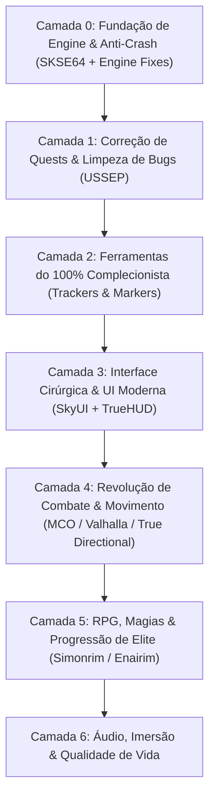

# 🐉 SKYRIM SPECIAL EDITION: PROTOCOLO DEFINITIVO 100% & MASTER GAMEPLAY

> **Objetivo Soberano:** Transformar o Skyrim SE na sua versão definitiva: combate moderno responsivo, estabilidade inabalável (zero crash), preservação de lore, reativação de conquistas e rastreamento cirúrgico de 100% de colecionáveis, quests e perks.
> **Ambiente Alvo:** Linux (Proton + Mod Organizer 2 via `mo2-linux-installer`) / Windows (MO2 Nativo).
> **Conta Nexus Vinculada:** `Mercenary308` (API Key persistida em `~/.config/nexusmods/credentials.json`).

---

## 🏗️ ARQUITETURA EM 7 CAMADAS



---

## 🛠️ CAMADA 0: FUNDAÇÃO DA ENGINE, ESTABILIDADE & CONQUISTAS STEAM
*Sem isso, mods quebram a engine e a Bethesda bloqueia as conquistas da Steam.*

| Mod / Ferramenta | Nexus ID | Função Vital | Por que é Obrigatório no 100% |
| :--- | :--- | :--- | :--- |
| **SKSE64** | *Externo* | Extensor de Scripts 64-bit | Base para 95% dos mods avançados. |
| **Address Library for SKSE Plugins** | `32444` | Header universal de offsets de memória | Evita que updates quebrem DLLs de mods. |
| **SSE Engine Fixes** | `17230` | Patch em C++ direto na engine da Bethesda | **Reabilita Conquistas Steam com mods**, corrige física em >60 FPS e vazamento de memória. |
| **Scrambled Bugs** | `43532` | Correções profundas de engine do jogo | Conserta bugs de perks, feitiços e cálculos de acerto do motor vanilla. |
| **Recursion Fix** | `105248` | Correção de loops infinitos de scripts | Impede que scripts do jogo fiquem travados consumindo CPU em saves longos (run 100%). |
| **Crash Logger SSE** | `59818` | Diagnóstico de falhas | Se o jogo fechar, gera log apontando exatamente qual arquivo/malha causou o crash. |

---

## 🐛 CAMADA 1: CORREÇÃO DE QUESTS & INTEGRIDADE DE SAVEGAME
*Skyrim possui dezenas de missões que travam permanentemente sem estes patches.*

| Mod | Nexus ID | Função Vital | Impacto no 100% |
| :--- | :--- | :--- | :--- |
| **USSEP (Unofficial Skyrim SE Patch)** | `266` | Compilado massivo de correções | Resolve mais de 10.000 bugs de diálogos, gatilhos de quests e itens inacessíveis. |
| **Quest Journal Limit Bug Fixer** | `56130` | Correção de limite de missões ativas | Previne corrupção quando você acumula centenas de quests secundárias. |
| **Encounter Zones Unlocked SE** | `1961` | Zonas de encontro dinâmicas | Garante que dungeons visitadas no início voltem a escalar de nível no endgame. |

---

## 🏆 CAMADA 2: ARSENAL DO 100% COMPLECIONISTA
*Rastreamento cirúrgico de cada gema, quest, máscara, livro e conquista sem precisar consultar wiki externa o tempo todo.*

| Mod | Nexus ID | O que faz no Jogo | Por que é Indispensável |
| :--- | :--- | :--- | :--- |
| **Completionist - Skyrim Quest Tracker** | `46358` | Menu MCM com checklist completa | Rastreador de missões primárias, secundárias, daédricas, livros de skill e itens únicos. |
| **Stones of Barenziah Quest Markers** | `684` | Marcadores para as 24 Gemas | Elimina a agonia de vasculhar Skyrim procurando a última gema da Thieves Guild. |
| **Jiub's Opus & Arvak's Skull Markers** | `818` | Marcadores na Soul Cairn | Transforma a pior busca cega da DLC Dawnguard em algo rápido e objetivo. |
| **Dragon Priest Masks Quest Markers** | `11604` | Marcadores para os 8 Sacerdotes Dragão | Rastreamento direto para fechar o santuário de Bromjunaar. |
| **Crimson Nirnroot Quest Markers** | `1016` | Marcadores para as 30 Nirnroots Vermelhas | Agiliza a quest lendária de Blackreach sem frustração. |
| **Unread Books Glow SSE** | `1296` | Destaca livros de perícia e feitiços não lidos | Garante que nenhum Skill Book passe despercebido para upar habilidades. |

---

## 🖥️ CAMADA 3: INTERFACE DE USUÁRIO (UI) CIRÚRGICA & MODERNA
*Substitui a UI arcaica de console por uma interface de PC fluida, legível e informativa.*

| Mod | Nexus ID | Função | Experiência de Jogo |
| :--- | :--- | :--- | :--- |
| **SkyUI SE** | `12604` | Interface lendária de inventário e menus | Menu MCM, filtros por peso/valor/dano, busca textual rápida. |
| **TrueHUD - HUD Additions** | `62775` | Barras de vida e estamina estilo souls/RPG moderno | Barra flutuante sobre chefes, indicador de poise e dano numérico opcional. |
| **Better Third Person Selection (BTPS)** | `64339` | Seleção precisa de itens em 3ª pessoa | Permite pegar moedas, plantas e chaves em 3ª pessoa sem errar a mira. |
| **Dear Diary Dark Mode (ou SkyUI Flashing Save Fix)** | `60837` | Tema escuro elegante com textura de papel | Elimina o cinza cansativo do SkyUI vanilla para longas sessões de jogo. |
| **Compass Navigation Overhaul** | `66816` | Bússola aprimorada no topo | Mostra distância exata, nome da localização e marcadores verticais. |

---

## ⚔️ CAMADA 4: REVOLUÇÃO TOTAL DE COMBATE (SOULS-LIKE / ARPG)
*Skyrim vanilla tem combate travado de 2011 ("bater em esponja de dano"). Esta camada transforma a jogabilidade em algo no nível de The Witcher 3 / Elden Ring.*

| Mod | Nexus ID | O que altera na Gameplay |
| :--- | :--- | :--- |
| **True Directional Movement (TDM)** | `51614` | Movimentação 360° fluida em 3ª pessoa com trava de mira (Lock-On) perfeita. |
| **MCO/DXP (Modern Combat Overhaul)** | *Distr. Guild* | Sistema de ataque com combos, peso real nas armas e animações dedicadas por classe de arma. |
| **Valhalla Combat** | `64741` | Sistema de bloqueio perfeito (Timed Block), execução por quebra de postura e estamina agressiva. |
| **Precision - Accurate Melee Collisions** | `72347` | Hitbox cirúrgica baseada na malha da arma (fim das espadas cortando o ar e acertando você). |
| **SmoothCam** | `41638` | Câmera de 3ª pessoa fluida com presets cinematográficos e sem tremor. |

---

## 🧙‍♂️ CAMADA 5: RPG, BUILDS & PROGRESSÃO
*Atualização do antigo pacote de 2021 (Ordinator).*

| Mod | Nexus ID | Vantagem Técnica e de Gameplay |
| :--- | :--- | :--- |
| **Ordinator - Perks of Skyrim** | `1137` | Mais de 400 novos perks que viabilizam qualquer arquétipo (Bardo, Paladino, Necromante, Ladino Trapmaster). |
| **Apocalypse - Magic of Skyrim** | `1090` | 155 feitiços com efeitos únicos e sinergia com o Ordinator. |
| **Nether's Follower Framework (NFF)** | `55653` | Substitui o antigo *AFT*. Muito mais estável em scripts, permite treinar companheiros e definir residências. |
| **Summermyst - Enchantments of Skyrim** | `6285` | Dezenas de novos encantamentos balanceados para o late game do 100%. |

---

## 🐎 CAMADA 6: QUALIDADE DE VIDA & IMERSÃO
*Melhorias pontuais que eliminam irritações do jogo base.*

| Mod | Nexus ID | Impacto |
| :--- | :--- | :--- |
| **Auto Unequip Shield to Back / Simple Dual Sheath** | `50049` | Escudos e adagas vão para as costas e cintura de forma elegante. |
| **Timing is Everything SE** | `25464` | Permite calibrar em que nível começam os ataques de vampiros e cultistas (evita mortes prematuras de NPCs em cidades). |
| **Rich Skyrim Merchants** | `1772` | Aumenta o ouro dos mercadores para você conseguir vender o loot do 100% sem precisar esperar 48h a cada venda. |
| **Quick Loot RE** | `21085` | Menu de saque rápido em tempo real ao olhar para baús e cadáveres (estilo Fallout 4). |

---

## 🚀 GUIA DE IMPLANTAÇÃO FUTURA NO LINUX / STEAM

### Pré-requisitos do Sistema
1. Instalar o **Skyrim Special Edition** via Steam com Proton Experimental ou GE-Proton.
2. Abrir o jogo vanilla uma vez até o menu principal para gerar os arquivos `.ini` iniciais.

### Roteiro de Instalação do MO2:
```bash
# 1. Clonar o instalador automatizado para Proton
git clone https://github.com/rockerbacon/modorganizer2-linux-installer.git
cd modorganizer2-linux-installer

# 2. Rodar o assistente (ele detecta a pasta do jogo na Steam automaticamente)
./install.sh
```

### Configurações Iniciais dentro do MO2:
1. Em `Settings > Nexus`, vincular com a conta `Mercenary308`.
2. Baixar os mods compactados na pasta de downloads do MO2.
3. Instalar seguindo estritamente a ordem das Camadas (0 a 6).
4. Executar o jogo **sempre através do atalho do SKSE** dentro do MO2.

---

## ⚖️ CAMADA 7: QUEBRA DO PARADOXO DO LEVELING & ECONOMIA JUSTA
*No Skyrim vanilla, você é punido por jogar normalmente: o ferreiro é forçado a forjar 5.000 adagas de ferro, os treinadores custam fortunas e limitam 5 aulas por nível (perdidas se você upar antes de pagar), e o gold dos mercadores é ridículo (750 septims).*
*Esta camada elimina a necessidade de qualquer glitch ou grind maçante:*

| Mod | Nexus ID | Como Resolve o Paradoxo | Benefício na Run 100% |
| :--- | :--- | :--- | :--- |
| **Experience** | `17751` | **Muda a lógica de XP para padrão RPG moderno:** Você ganha nível completando missões, descobrindo masmorras e explorando o mapa — e **NÃO** spamando magias na parede ou forjando adagas. | Você avança e zera o jogo jogando as quests, sem precisar grindar skills secundárias. |
| **Smart Training - Tweaked SE** | `18048` | **Fim do desperdício de aulas:** No vanilla, se você upa de nível sem usar os 5 treinos de mestre, eles somem para sempre. Com este mod, os treinos acumulam como créditos. | Se você passar 10 níveis sem ir a um mestre, você terá 50 treinos acumulados quando tiver dinheiro. |
| **Train and Study** | `17578` | **Treinamento orgânico:** Bonecos de treino (*dummies*), alvos de arquearia e livros comuns agora concedem treino real passando tempo in-game. | Alternativa imersiva para subir armas e arco sem exploits de bater nos Greybeards ajoelhados. |
| **Trade and Barter** | `23081` | **Economia balanceada e dinâmica:** Ajusta preços com base no seu status social, guilda e reputação local, além de dar estoque de ouro real aos mercadores. | O ouro acumulado nas dungeons tem valor real e você não precisa esperar 48h no botão T a cada 3 itens vendidos. |
| **Skyrim Skill Uncapper** | `8889` | **Personalização cirúrgica de limites:** Permite calibrar ganho de XP por skill, pontos de perk por nível e quantidade de treinos por mestre via arquivo `.ini`. | Dá total controle se quiser aumentar o limite de 5 treinos/nível para 10 ou 15 sem quebrar o jogo. |

---

## 🔮 CAMADA 8: O FIM DA PAUSA EM COMBATE & MAGIA AUTOMÁTICA
*No Skyrim vanilla, jogar de mago ou conjurador exige pausar o jogo a cada 3 segundos para equipar feitiço na mão. Os dois mods lendários que você lembrava:*

| Mod | Nexus ID | Mecânica | O que Resolve |
| :--- | :--- | :--- | :--- |
| **Smart Cast SSE Patch** | `32847` | **Casting Automático & Lógica "If / Then":** Você configura no SkyUI regras automáticas: *Se Vida < 50% ➔ Castar Fast Healing automaticamente*; *Se entrar em combate ➔ Castar Oakflesh/Ironflesh*; *Se equipar espada ➔ Castar Cloak de Fogo*. Sem pausar o jogo, sem ocupar as mãos. | Acaba com a morte estúpida por esquecer de curar ou ficar abrindo menu de favoritos em pânico. |
| **Wheeler - Quick Action Wheel** | `97345` | **Roda de Ações Rápida (Estilo GTA V / Doom Eternal / Monster Hunter):** Abre uma roda em slow-motion no botão do mouse/teclado. Você troca magias, armas, gritos e poções instantaneamente com o cursor. | Elimina 100% da necessidade de parar o jogo no menu de favoritos arcaico. |
| **The Wizard Warrior** | `14890` | **Castar Magias no Golpe de Arma (Spellsword Real):** Permite atribuir qualquer feitiço para ser disparado ao balançar a espada, bloquear com escudo ou atirar flecha. | Mago-Guerreiro definitivo sem ficar trocando itens de mão. |
| **Disable Follower Collision** | `35925` | **Fim da Lydia travando portas:** Remove totalmente a caixa de colisão física entre você e seus seguidores / invocações. Você atravessa o NPC se ele parar na sua frente. | Acaba com o ódio clássico de ficar preso em corredores estreitos de catacumbas. |
