# 🗺️ Arquitetura Completa, Mapa do Código & Guia Forense de Debug
## Extensão: YouTube Comments & Replies Extractor (v1.1.0 Soberana)

> **Finalidade do Documento:** Servir como índice soberano, dicionário de dados e mapa de contexto para qualquer sessão de desenvolvimento, manutenção ou debug assistido por IA.

---

## 🌳 1. Árvore Estrutural de Arquivos & Responsabilidades

```
youtube_comments_extractor/
├── README.md                      # Manual de instalação e uso rápido no Chromium
├── PLANO_DE_MELHORIAS.md          # Histórico de decisões arquiteturais e diagnóstico
├── ARQUITETURA_E_DEBUG.md         # [ESTE ARQUIVO] Mapa mestre para debug e contexto de IA
└── 1.0.1_0/                       # Diretório raiz da extensão (Load Unpacked no Chrome)
    ├── manifest.json              # Manifesto V3 (permissões, worker, scripts, ícones)
    ├── BUILD_INFO.txt             # Metadados de compilação da versão
    │
    ├── icons/                     # Ativos visuais nos tamanhos 16x16, 48x48 e 128x128
    │   ├── icon16.png
    │   ├── icon48.png
    │   ├── icon128.png
    │   └── README.md
    │
    ├── lib/                       # Bibliotecas e módulos centrais desacoplados
    │   ├── db.js                  # Camada IndexedDB (persistência contínua, deduplicação, índices)
    │   └── exporter.js            # Motores de exportação (Markdown p/ IA, JSONL, JSON, CSV)
    │
    ├── background/                # Camada Service Worker
    │   └── background.js          # Roteador de mensagens entre abas e ciclo de vida da extensão
    │
    ├── content/                   # Scripts injetados nas páginas do YouTube
    │   ├── content.css            # Estilos de overlay (se necessário)
    │   └── content.js             # Engine de scraping, auto-scroll, auto-pause, replies e SPA
    │
    ├── dashboard/                 # Aba Dedicada de Controle Persistente (UI Principal)
    │   ├── dashboard.html         # Estrutura HTML do painel (sidebar, controles, feed, métricas)
    │   ├── dashboard.css          # Design moderno dark mode, responsivo e de alta densidade
    │   └── dashboard.js           # Orquestrador da interface, conexão com DB e envio de comandos
    │
    └── popup/                     # Lançador Rápido na Barra de Ferramentas
        ├── popup.html             # Interface compacta com detecção de vídeo ativo
        ├── popup.css              # Estilização enxuta
        └── popup.js               # Redirecionador com 1 clique para a Aba Dedicada
```

---

## 🔌 2. Protocolo de Comunicação & Mensageria (`chrome.runtime` / `chrome.tabs`)

```mermaid
sequenceDiagram
    autonumber
    actor Dev as Usuário / Dev
    participant Pop as Popup (popup.js)
    participant Dash as Dashboard Tab (dashboard.js)
    participant SW as Service Worker (background.js)
    participant Cont as Content Script (content.js)
    participant IDB as IndexedDB (lib/db.js)

    Dev->>Pop: Clica no ícone da extensão
    Pop->>Dash: Abre dashboard.html em nova aba
    Dash->>Dash: Inicializa lib/db.js e lista vídeos
    Dev->>Dash: Clica em "Iniciar Extração"
    Dash->>Cont: chrome.tabs.sendMessage("startExtraction", { options })
    Cont->>Cont: autoPauseVideo() + applySortOrder("newest")
    
    rect rgb(20, 30, 45)
        note over Cont, Dash: FASE 1: Rolagem Exaustiva de Comentários Principais (Roots)
        loop Auto-Scroll Contínuo & Wiggle Recovery
            Cont->>Cont: Rola continuation-loader + extrai roots recém-descobertos
            Cont->>Dash: chrome.runtime.sendMessage("commentsBatch", { batch, progress })
            Dash->>IDB: upsertCommentsBatch(videoId, batch)
            Dash->>Dash: Atualiza métricas e feed ao vivo
        end
    end

    rect rgb(30, 20, 45)
        note over Cont, Dash: FASE 2: Expansão Exaustiva de Respostas (Replies)
        loop Thread por Thread com Respostas
            Cont->>Cont: scrollIntoView() + Clica "Ver respostas" + Pagina "Mostrar mais"
            Cont->>Dash: chrome.runtime.sendMessage("commentsBatch", { replyBatch, progress })
            Dash->>IDB: upsertCommentsBatch(videoId, replyBatch)
            Dash->>Dash: Atualiza contadores de respostas
        end
    end

    Cont->>Dash: chrome.runtime.sendMessage("commentsBatch", { isFinished: true })
```



### Dicionário de Ações de Mensagens

| Ação (`message.action`) | Origem ➔ Destino | Payload | Descrição / Efeito |
| :--- | :--- | :--- | :--- |
| `startExtraction` | Dashboard ➔ Content | `{ videoId, throttle, maxComments, sortOrder, autoPause, existingIds }` | Inicia o motor de rolagem, pausa o player, altera ordenação e respeita IDs já no DB. |
| `pauseExtraction` | Dashboard ➔ Content | `{}` | Seta flag `shouldStop = true`, mantendo a posição e o progresso intactos. |
| `stopExtraction` | Dashboard ➔ Content | `{}` | Interrompe o processo e dispara o lote final de encerramento. |
| `commentsBatch` | Content ➔ Dashboard | `{ videoId, videoInfo, comments: [...], progress, isFinished, stoppedReason }` | Envia lote de comentários para inserção imediata no IndexedDB. |
| `commentsDisabled` | Content ➔ Dashboard | `{ videoId }` | Notifica que os comentários foram desativados pelo canal, cancelando o timeout. |
| `videoNavigated` | Content ➔ Dashboard | `{ videoInfo }` | Notifica que o usuário mudou de vídeo dentro da mesma aba do YouTube (SPA). |
| `getVideoInfo` | Popup/Dash ➔ Content | `{}` | Retorna metadados do vídeo ativo no DOM (título, canal, id, contagem). |
| `openDashboard` | Popup ➔ Background | `{ videoId, tabId }` | Abre a aba do dashboard caso requisitado via background. |

---

## 🗄️ 3. Dicionário de Dados do Banco Local (IndexedDB)

* **Nome do Banco:** `YouTubeCommentsExtractorDB`
* **Versão:** `1`

### 3.1. Store: `videos`
* **Chave Primária (`keyPath`):** `videoId` (string, ex: `"dQw4w9WgXcQ"`)
* **Índices:** `lastUpdated`

```typescript
interface VideoRecord {
  videoId: string;              // ID canônico extraído de ?v=...
  title: string;                // Título limpo do vídeo
  channel: string;              // Nome do canal
  url: string;                  // URL completa
  totalComments?: string;       // Total de comentários informado pelo YouTube no DOM
  status: "idle" | "running" | "paused" | "completed";
  throttleMs?: number;          // Delay configurado pelo usuário (padrão 600ms)
  maxComments?: number;         // Limite máximo ou 0 para ilimitado
  extractedTotal?: number;      // Contagem consolidada gravada
  extractedRootCount?: number;   // Apenas comentários principais
  extractedRepliesCount?: number;// Apenas respostas
  lastUpdated: string;          // ISO Date
}
```

### 3.2. Store: `comments`
* **Chave Primária (`keyPath`):** `id` (formato: `"<videoId>_<canonicalCommentId>"`)
* **Índices:** `videoId`, `parentId`, `isReply`, `likeCount`, `["videoId", "isReply"]`

```typescript
interface CommentRecord {
  id: string;                   // Chave primária: `${videoId}_${rawId}`
  rawId: string;                // ID canônico do YouTube extraído de ?lc=...
  videoId: string;              // Chave estrangeira para o vídeo
  parentId?: string | null;     // ID do comentário raiz se for resposta; null se raiz
  isReply: boolean;             // true para respostas, false para raízes
  author: {
    name: string;               // Nome visível (@handle ou nome)
    channelUrl: string;         // Link do canal do autor
    channelId: string;          // ID/Handle extraído da URL
    isOwner: boolean;           // true se for o próprio dono do vídeo
    isMember: boolean;          // true se tiver insígnia de membro
  };
  content: {
    text: string;               // Texto puro do comentário
    html: string;               // HTML bruto (com formatações e links)
  };
  publishedTime: string;        // String relativa do YouTube (ex: "há 2 dias", "edited")
  isEdited: boolean;            // Detectado via badge ou texto
  likeCount: number;            // Número inteiro tratado (ex: "1.2K" -> 1200)
  isPinned: boolean;            // true se fixado pelo canal
  hasCreatorHeart: boolean;     // true se recebeu coração do canal
  savedAt: string;              // ISO Date da gravação no IndexedDB
}
```

---

## 🎯 4. Dicionário de Seletores do YouTube DOM (`SELECTORS`)

Se o YouTube alterar layout ou classes, este é o único ponto que precisará de ajuste em `content/content.js`:

| Constante no Código | Seletor CSS Principal | Fallback / Variação | Função no DOM |
| :--- | :--- | :--- | :--- |
| `commentsSection` | `ytd-comments#comments` | - | Contêiner mestre da seção de comentários. |
| `commentThread` | `ytd-comment-thread-renderer` | - | Bloco de uma conversa (raiz + respostas). |
| `commentRenderer` | `ytd-comment-view-model` | `ytd-comment-renderer` | Nó individual de um comentário. |
| `commentContent` | `yt-attributed-string#content-text` | `yt-formatted-string#content-text` | Bloco contendo o texto do comentário. |
| `authorName` | `a#author-text` | `#header-author a#author-text` | Nome ou @handle do autor. |
| `publishedTime` | `#published-time-text a` | `yt-formatted-string.published-time-text a` | Link permanente do timestamp (contém o `?lc=...`). |
| `likeCount` | `#vote-count-middle` | `span#vote-count-middle` | Texto do contador de curtidas. |
| `replyButton` | `#more-replies button` | `ytd-button-renderer#more-replies button` | Botão para abrir respostas ("Ver X respostas"). |
| `repliesRenderer` | `#replies` | `#replies.ytd-comment-thread-renderer` | Contêiner onde as respostas são montadas. |
| `showMoreReplies` | `#continuation button` | `ytd-continuation-item-renderer button` | Botão de paginação de respostas ("Mostrar mais"). |
| `commentExpander` | `#expander #more` | `ytd-text-inline-expander #more` | Botão "Ler mais" em comentários longos. |
| `videoTitle` | `h1.ytd-watch-metadata yt-formatted-string` | `h1 yt-formatted-string` | Título do vídeo. |
| `channelName` | `ytd-channel-name #text a` | `#channel-name a` | Nome do canal do vídeo. |
| `commentCount` | `#count yt-formatted-string span:first-child` | `#count yt-formatted-string` | Total aproximado de comentários do vídeo. |
| `pinnedBadge` | `#pinned-comment-badge` | - | Indicador de comentário fixado. |
| `heartBadge` | `#creator-heart` | - | Indicador de coração dado pelo criador. |

---

## 🛠️ 5. Playbook Forense de Diagnóstico & Resolução de Falhas

### Cenário A: "A extensão não encontra os comentários na página"
* **Verificação no Console DevTools da Aba do YouTube (F12):**
  1. Digite: `document.querySelector("ytd-comments#comments")`.
  2. Se retornar `null`, verifique se o usuário rolou a página até o vídeo carregar os metadados ou se os comentários estão desativados: `document.querySelector("ytd-message-renderer #message")`.
  3. Se retornar o elemento mas a contagem for zero, verifique se a classe interna mudou para outro web component.

### Cenário B: "As respostas não estão expandindo"
* **Diagnóstico:**
  1. No console da aba do YouTube, inspecione a primeira thread:
     ```javascript
     const thread = document.querySelector("ytd-comment-thread-renderer");
     const btn = thread.querySelector("#more-replies button");
     console.log("Botão de resposta:", btn);
     if (btn) btn.click();
     ```
  2. Se o botão não for clicável, o seletor `replyButton` foi alterado na última atualização do Polymer/YouTube.

### Cenário C: "Como auditar os dados gravados no IndexedDB?"
* **No Console da Aba do Dashboard (`dashboard.html`):**
  1. Abra o DevTools (F12) na aba do Dashboard.
  2. Vá na aba **Application** (ou **Aplicativo**) ➔ **Storage** ➔ **IndexedDB** ➔ `YouTubeCommentsExtractorDB`.
  3. Você verá as tabelas `videos` e `comments` com todos os registros em tempo real.
  4. Para inspecionar via JavaScript:
     ```javascript
     const db = await window.commentsDB.init();
     const comments = await window.commentsDB.getHierarchicalComments("<ID_DO_VIDEO>");
     console.log("Comentários carregados:", comments);
     ```

### Cenário D: "Recarregar a extensão sem reiniciar o navegador"
1. Acesse `chrome://extensions/`.
2. Localize **YouTube Comments & Replies Extractor**.
3. Clique no ícone de **Recarregar (🔄)**.
4. Feche a aba antiga do dashboard e abra uma nova clicando no popup para carregar o novo código em memória.
