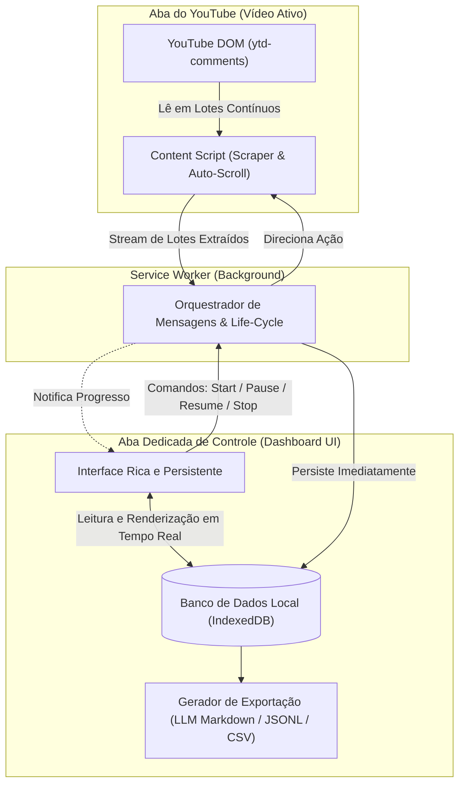

# 📋 Plano de Modernização & Melhorias: YouTube Comments Extractor

> **Status:** Mapeamento e Diagnóstico Concluídos (Aguardando aprovação antes de codificar)  
> **Versão Base Atual:** 1.0.1 (Manifest V3)  
> **Localização:** `/home/lanwsl/dotfiles/youtube_comments_extractor/1.0.1_0/`

---

## 🔍 1. Diagnóstico Forense dos Problemas Atuais

### 1.1. Perda de Foco e Fechamento Involuntário da Interface (Popup Blur)
* **Causa Raiz:** O arquivo `manifest.json` define a interface em `action.default_popup: "popup/popup.html"`. No Chromium, o popup de uma extensão tem ciclo de vida efêmero: no momento em que o usuário clica fora ou troca de janela, a janela de popup é destruída instantaneamente.
* **Efeito Colateral:** O script `popup.js` morre, perdendo todas as variáveis em memória (`isRunning`, `extractedData`, listeners de progresso). A extração no `content.js` fica órfã ou continua em background sem interface de monitoramento.

### 1.2. Falta de Persistência e Duplicação ao Reabrir
* **Causa Raiz:** A extensão atual não possui nenhum banco de dados local (`chrome.storage.local` ou `IndexedDB`). Toda a coleta fica estritamente na memória RAM temporária do `content.js` e só é retornada em um único objeto final ao fim de todo o processo.
* **Efeito Colateral:** Ao reabrir o popup, a interface não tem como saber o estado anterior. Se o usuário clicar em "Expand" novamente, dispara uma nova requisição para a página, reiniciando o scraping do topo, expandindo botões já clicados e duplicando comentários no DOM.

### 1.3. Exportação Limitada e Inadequada para IA / LLMs
* **Causa Raiz:** O gerador de JSON exporta uma estrutura bruta com nós do DOM, e o CSV achata respostas em linhas soltas com IDs desconectados.
* **Efeito Colateral:** Ao enviar para uma IA (Claude, Gemini, NotebookLM ou ChatGPT), o contexto da discussão é fragmentado. A IA gasta tokens com ruído estrutural e não consegue entender com clareza quem respondeu a quem, as dinâmicas de debate e as principais dores/padrões da audiência.

---

## 🏗️ 2. Nova Arquitetura Proposta

---

## 🚀 3. Pilares de Melhoria

### Pilar A: Interface Persistente e Imune a Perda de Foco (Dashboard Tab)
1. **Aba Dedicada (`dashboard/dashboard.html`):**
   * A extração passa a rodar controlada a partir de uma aba própria e dedicada no navegador (`chrome-extension://<id>/dashboard/dashboard.html`).
   * Nunca fecha ao trocar de janela, mover o mouse ou usar outros monitores.
   * Exibe visualização tabular ao vivo dos comentários capturados, métricas em tempo real e gráfico de distribuição de likes.
2. **Popup Enxuto:**
   * O popup da barra de ferramentas passa a ser um launcher rápido: mostra se detectou vídeo do YouTube e tem um botão com destaque: **"Abrir Painel de Extração em Nova Aba"**.

### Pilar B: Persistência Local Contínua (IndexedDB) & Resumo Seguro (Pause / Resume)
1. **Camada IndexedDB (Baseada em Repositório Local):**
   * **Tabela `videos`:** Metadados do vídeo (`videoId`, título, canal, contagem total esperada, status `extracting` | `paused` | `completed`, timestamp da última atualização).
   * **Tabela `comments`:** Registros individuais com chave primária única (`commentId` nativo do YouTube).
2. **Deduplicação Nativa por Chave Primária:**
   * Cada comentário ou resposta possui um identificador único de elemento do YouTube.
   * Inserções utilizam `put` / `bulkPut`: se um comentário já foi salvo, é apenas atualizado sem duplicação.
3. **Mecanismo de "Continuar de Onde Parou" (Resume):**
   * Ao pausar ou recarregar a página, a extensão consulta os IDs já persistidos no IndexedDB.
   * O scraper pula nós do DOM que já estão salvos e avança diretamente para novos nós não indexados.

### Pilar C: Formato de Exportação Otimizado para IA (LLM-Ready Context)
Para alimentar IAs com profundidade máxima e economia de tokens, serão implementados 3 formatos especializados:

1. **`LLM_CONTEXT.md` (Markdown Estruturado com Árvore de Diálogo):**
   * **Frontmatter YAML com Metadados:** Título, canal, data, estatísticas (total de comentários, total de respostas, likes médios, comentários com coração do criador).
   * **Seção de Destaques:** Top 10 comentários mais curtidos e comentários fixados pelo canal (para a IA ter a visão geral imediata).
   * **Árvore Hierárquica de Discussões:** Comentários raiz numerados com suas respectivas respostas aninhadas por citação (`> ↳ @autor (+X likes): texto`), permitindo à IA rastrear argumentos, objeções e concordâncias com precisão.
2. **`comments_dataset.jsonl` (JSON Lines):**
   * Cada linha é um registro limpo contendo `{ id, video_id, parent_id, is_reply, author, text, likes, timestamp, thread_root_id }`.
   * Padrão ideal para pipelines de RAG (Retrieval-Augmented Generation), notebooks Python e fine-tuning.
3. **CSV Sanitizado:**
   * Preservação da exportação CSV tradicional, porém adicionando colunas de relação (`Parent Comment ID`, `Thread ID`, `Level`) para evitar o achatamento cego anterior.

---

## 📑 4. Mapeamento e Auditoria de Arquivos

| Arquivo Atual | Ação Proposta | Responsabilidade |
| :--- | :--- | :--- |
| `manifest.json` | **Expandir** | Adicionar permissões `"storage"`, `"unlimitedStorage"`, configurar nova aba e background handlers. |
| `background/background.js` | **Refatorar** | Atuar como roteador seguro e orquestrador de mensagens entre Content Script e Dashboard. |
| `content/content.js` | **Refatorar** | Adicionar streaming em lote (chunks) para enviar dados periodicamente em vez de acumular tudo na RAM; lógica de detecção de IDs já salvos. |
| `popup/popup.html` / `popup.js` | **Simplificar** | Atuar como seletor rápido com status do vídeo e botão de redirecionamento para o Dashboard. |
| `dashboard/dashboard.html` *(Novo)* | **Criar** | Interface visual persistente completa (nunca fecha com blur), monitoramento em tempo real, filtros e exportações. |
| `dashboard/dashboard.css` *(Novo)* | **Criar** | Estilização moderna, limpa, responsiva e com suporte a dark mode. |
| `dashboard/dashboard.js` *(Novo)* | **Criar** | Gerenciador da UI, conexão direta com IndexedDB e motor de geração dos formatos de IA. |
| `lib/db.js` *(Novo)* | **Criar** | Camada utilitária do IndexedDB (criação de stores, índices, inserção em lote `bulkPut`, queries de exportação). |

---

## 🗺️ 5. Fases de Execução Sugeridas

1. **Fase 1: Fundação do Banco de Dados & Manifest V3**
   * Atualização de permissões do manifesto e criação do módulo `lib/db.js` com schema de vídeos e comentários.
2. **Fase 2: Interface Persistente (Aba Dashboard)**
   * Criação da tela `dashboard.html` com controles completos (Iniciar, Pausar, Continuar, Limpar, Exportar) e tabela viva.
3. **Fase 3: Refatoração do Content Script para Streaming & Deduplicação**
   * Modificação do loop de scroll para enviar batches de comentários ao DB e respeitar o estado salvo, eliminando duplicatas.
4. **Fase 4: Motor de Exportação Especializado em IA**
   * Implementação dos geradores `LLM_CONTEXT.md` (árvore conversacional indentada) e `dataset.jsonl`.
5. **Fase 5: Validação Prática em Vídeos Longos**
   * Teste de troca de janela, pausa deliberada no meio da extração, retomada e conferência da integridade no IndexedDB.
